# libatbus 节点层完整协议栈性能压测报告

- **测试日期**：2026-11-26（Linux、Windows、多节点互联）；2026-11-18（WSL2）
- **源码版本**：libatbus `ffdd409`
- **协议栈范围**：`atbus::node` v2 完整协议栈（帧封装 + Protobuf + 握手 + X25519 密钥交换 + 加密 + 压缩）
- **测试形态**：本机回环单向满载吞吐测试（TCP 与共享内存 `shm://`），包含单对基线（1 发 1 收）与多节点汇聚（最多 1000 节点，999 发 1 收）

本报告衡量 `atbus::node` 在完整协议栈开启时的单核处理上限、不同加密与压缩组合的开销、共享内存通道收益、内存分配器影响，以及单接收节点在多连接并发下的扩展表现。

---

## 1. 核心结论与配置建议

### 1.1 关键数据速览（无加密无压缩）

下表列出单核满载下的典型实测上限（`1 KB = 1024 B`，`1 MB = 1024 KB`，`1 GB = 1024 MB`）：

| 场景 | 通道 | 分配器 | 200B QPS / 吞吐量 | 1KB QPS / 吞吐量 | 64KB QPS / 吞吐量 | 300KB QPS / 吞吐量 |
|---|---|---|---:|---:|---:|---:|
| Linux（单对） | TCP | mimalloc | 3.66M / 697.5 MB/s | 1.65M / 1.58 GB/s | 42.7K / 2.60 GB/s | 9.6K / 2.76 GB/s |
| WSL2（单对） | TCP | mimalloc | 3.20M / 610.4 MB/s | 1.32M / 1.26 GB/s | 38.1K / 2.33 GB/s | 9.1K / 2.62 GB/s |
| WSL2（单对） | TCP | glibc | 3.51M / 669.3 MB/s | 1.40M / 1.33 GB/s | 19.1K / 1.17 GB/s | 3.8K / 1.09 GB/s |
| Windows（单对） | TCP | MSVC CRT | 917.8K / 175.1 MB/s | 294.8K / 287.9 MB/s | 6.1K / 382.9 MB/s | 1.5K / 450.0 MB/s |
| Linux（单对） | `shm://` | mimalloc | 2.68M / 510.6 MB/s | 1.50M / 1.43 GB/s | 50.6K / 3.09 GB/s | 10.4K / 2.96 GB/s |
| Windows（单对） | `shm://` | MSVC CRT | 1.26M / 240.9 MB/s | 890.4K / 869.5 MB/s | 33.8K / 2.06 GB/s | 8.3K / 2.39 GB/s |
| Linux（1000 节点汇聚） | TCP | mimalloc | 3.70M / 706.6 MB/s | 1.39M / 1.33 GB/s | 73.2K / 2.23 GB/s（32KB） | 9.4K / 2.70 GB/s |

### 1.2 主要发现

1. **单接收节点的处理上限由单个 CPU 核心决定。** Linux TCP 无加密无压缩时，单个接收节点在 200B 小包下可达 3.66M QPS（约 697.5 MB/s），300KB 大包下可达 9.6K QPS（2.76 GB/s）。小包高 QPS 受益于协议栈对 `<= 64KB` 消息的合并发送。当并发发送节点从 2 个增至 1000 个时，接收端总吞吐基本保持稳定（200B 在 3.69M–3.78M 之间，300KB 在 8.9K–9.9K 之间），全部 480 组多节点测试中接收端 CPU 均占满单核（98.9%–100%）。
2. **大包场景下使用 mimalloc 收益明显。** 在 WSL2 同机对照中，mimalloc 在 85/110 组里快于 glibc 默认分配器：无加密无压缩的 64KB 提升 99.5%（1.17 -> 2.33 GB/s），300KB 提升 140.5%（1.09 -> 2.62 GB/s）；`aes-128-gcm` 在 64KB 和 300KB 分别提升 125% 和 133%。代价是 200B 小包下降约 9%，且峰值内存增加（接收端多 6–8 MB，发送端多 4–21 MB）。在压缩主导的场景（lz4 / zstd）下，CPU 瓶颈在压缩算法本身，换分配器差异很小。
3. **同分配器下 WSL2 与独立 Linux 性能接近。** 两侧均启用 mimalloc 时，110 组测试的 WSL2/Linux 吞吐比值中位数为 104%，104 组落在 85%–118% 之间，WSL2 可直接用于日常开发与回归压测。唯一明显例外是 8KB 档：WSL2 无论使用 glibc 还是 mimalloc 都停在约 1.06 GB/s，约为独立 Linux（1.74–2.30 GB/s）的一半，原因尚未定位。
4. **Windows 原生 TCP 回环明显慢于 Linux，同机通信应优先考虑共享内存。** Windows TCP 无加密无压缩的吞吐只有 Linux 的 14%–25%（110 组比值中位数 31.2%），瓶颈在每次收发的系统调用开销。切换到 `shm://` 后，Windows 在 8KB 以上消息的吞吐达到 TCP 的 5.4–5.6 倍（2.06–2.39 GB/s），1KB 也达到 3.0 倍。在 Linux 上，`shm://` 仅在 8KB 以上快 7%–26%，200B 和 1KB 反而比 TCP 慢 27% 和 9%；同时每个共享内存段默认映射 256 MB，两端进程峰值 RSS 会升至约 270 MB（TCP 为 11–40 MB）。
5. **加密开销因平台和算法而异。** Linux 和 WSL2 上（支持 AES-NI），AES-GCM 在大包上损耗很小：Linux 64KB 档明文 2.60 GB/s，开启 AES-GCM 后为 2.26–2.29 GB/s（-12% 到 -13%）；200B 小包因每包固定加解密开销占比高，降幅达 55%–56%。128 / 192 / 256 三种密钥长度性能相差约 1%，按安全规范选型即可。`chacha20-poly1305-ietf` 在 Linux 64KB 下为 1.65 GB/s（-37%），适合无 AES-NI 环境；裸 `chacha20` 在 x86 上极慢（64KB 仅 102.0 MB/s，仅为明文的 3.8%），不要选用。Windows TCP 上 AES-GCM 只有明文的 17%–40%（64KB 仅 138.4 MB/s），反而慢于 `chacha20-poly1305-ietf`（158.4 MB/s），原因尚未定位。
6. **内网高带宽环境下不建议默认开启压缩，同时开压缩和加密时额外加密开销很低。** 协议栈在消息体 `>= 1024B` 时才执行压缩（200B 不压缩，压缩有字典，包体过小很可能反而不如不压缩），且按**先压缩、再加密**的顺序处理。千兆级以上的本机或内网环境下，压缩消耗的 CPU 会拉低单核吞吐（Linux 64KB 明文 2.60 GB/s，lz4 约 1.21 GB/s，zstd 约 527–540 MB/s）。`lz4@fast` 与 `lz4@default` 的压缩率（约 44%–56%）和速度几乎一致；`zstd@high-ratio` 压缩率（约 21%–33%）高于 `zstd@default`（约 24%–35%）且速度相近。由于加密只作用于压缩后的较小数据，在 Linux 64KB 下 `lz4@default`（1.21 GB/s）叠加 `aes-128-gcm` 后为 1.19 GB/s（仅降 1.3%），叠加 `chacha20-poly1305-ietf` 后为 1.09 GB/s（降 9.8%）。
7. **多节点汇聚时，压缩瓶颈从发送端转移到接收端。** 单发单收时，lz4 和 zstd 的发送端先打满单核；发送节点增至 10 个以上后，多核并行压缩不再受限，接收端成为唯一瓶颈，聚合吞吐大幅抬升并在此后保持平稳（如 300KB `lz4@fast` 从 2 节点的 3.2K 升至 10 节点的 10.0K，与无压缩的 9.8K 相当；1KB `zstd@default` 从 183.1K 升至 321.1K）。无压缩组合在 1KB 和 32KB 随连接数增加出现约 11%–17% 的下降，多连接下接收端单消息耗时增加的原因尚未定位。

> [!IMPORTANT]
> **设计说明与运行注意事项**
> 1. **共享内存通道（`shm://`）按设计不启用加密与压缩。** 共享内存只用于本机进程间高性能通信，不需要考虑跨网传输加密，也避免多消耗一次压缩和解压开销。因此即使配置了加密或压缩参数，shm 数据通道仍按明文无压缩传输（三平台 315 组对应测试协商结果均为 `none/none`，实测速率与明文一致）。若本机通信仍有加密要求，请改用 TCP。
> 2. **1000 节点满载时接收端事件循环会被长时间占住。** 1000 节点的 120 组测试全部稳定跑完，接收端峰值 RSS 最高 334.1 MB，系统可用内存始终在 4323 MB 以上；但其中 113 组出现过超过 1.5 秒的单次采样间隔，最长 12.6 秒。这是因为单次 `poll()` 会持续处理各连接上已到达的数据后再返回事件循环。虽然按实际时间折算 QPS 不受影响，但满载期间同线程上的定时器会被推迟同等时长。

### 1.3 典型部署场景配置建议

| 使用场景 | 推荐通道 | 推荐加密 | 推荐压缩 | 分配器 / 构建建议 | 说明 |
|---|---|---|---|---|---|
| Linux 跨机内网（万兆/千兆） | TCP | 按安全要求选 `aes-128-gcm` 或 `aes-256-gcm` | 关闭（`none`） | 大包高频场景用 `LD_PRELOAD` 加载 mimalloc；优先静态链接 libatbus | AES-GCM 大包损耗仅 12%–13%；高带宽下压缩会浪费 CPU |
| 跨机房 / 带宽受限网络 | TCP | `aes-128-gcm` / `aes-256-gcm`（无 AES-NI 时选 `chacha20-poly1305-ietf`） | 偏低延迟选 `lz4@default`；偏高压缩率选 `zstd@high-ratio` | Linux 大包场景建议启用 mimalloc | 先压缩再加密，叠加 AES-GCM 几乎无额外吞吐损失 |
| Linux 同机进程间通信（无加密要求） | 消息 `>= 8KB` 用 `shm://`；小包为主用 TCP | 关闭（shm 按设计不加密） | 关闭（shm 按设计不压缩） | 注意每段默认占用 256 MB 共享内存 | 8KB–300KB 吞吐高于 TCP 7%–26%；200B/1KB 下 TCP 更快 |
| Windows 同机进程间通信（无加密要求） | `shm://` | 关闭（shm 按设计不加密） | 关闭（shm 按设计不压缩） | Windows 共享内存跨进程需管理员权限 | 8KB 以上吞吐为 TCP 的 5.4–5.6 倍，1KB 为 3.0 倍 |
| 任意平台生产环境 | — | 禁用裸 `chacha20` | — | 避免把动态库数据与静态库数据直接混比 | 裸 `chacha20` 在 x86 上吞吐不足明文的 4% 且无认证标签 |

---

## 2. 测试范围与环境

### 2.1 测试矩阵总览

| 测试组 | 拓扑与通道 | 组合配置 | 包长档位 | 平台 | 单组时长 | 有效组数 |
|---|---|---|---|---|---:|---:|
| 单对基线（TCP） | 1 发 1 收，ctrl + data 双连接 | 22 种（6 加密 + 4 压缩 + 12 压缩×加密） | 200B、1KB、8KB、64KB、300KB | Linux / WSL2 / Windows | 15s | 各 110 / 110 |
| 分配器对照（TCP） | 同上 | 同上 22 种 | 同上 5 档 | WSL2（mimalloc vs glibc） | 15s | 110 / 110 |
| 单对基线（`shm://`） | TCP 控制 + 单向 shm 数据（256 MB） | 同上 22 种（shm 按设计不加密不压缩，见 4.4 节） | 同上 5 档 | Linux / WSL2 / Windows | 15s | 各 110 / 110 |
| 多节点互联（TCP） | 1 收 + (N-1) 发，星型，N = 2 / 10 / 100 / 1000 | 20 种（无加密无压缩 + 4 压缩 + 3 加密 + 12 压缩×加密） | 200B、256B、1KB、8KB、32KB、300KB | Linux（mimalloc） | 10s | 480 / 480 |

组合明细说明：
- **仅加密（6 组，无压缩）**：`none`、`aes-128-gcm`、`aes-192-gcm`、`aes-256-gcm`、`chacha20`、`chacha20-poly1305-ietf`。多节点测试去掉了 `aes-192-gcm` 和裸 `chacha20`。
- **仅压缩（4 组，无加密）**：`lz4@fast`、`lz4@default`、`zstd@default`（对应协议等级 `BALANCED`，zstd level 3）、`zstd@high-ratio`（level 6）。
- **压缩 + 加密（12 组）**：上述 4 种压缩 × `aes-128-gcm` / `aes-256-gcm` / `chacha20-poly1305-ietf`。
- **压缩触发阈值**：协议栈 `_allow_compress` 要求数据消息体 `>= 1024B` 才压缩——压缩算法存在字典等固定开销，包体过小压缩后往往反而不如不压缩。因此 **200B 和 256B 档实际均不压缩**，其压缩组结果等同于同加密算法下不压缩的重复采样。

### 2.2 软硬件与构建环境

| 项目 | Linux（独立测试机） | WSL2（Debian） | Windows 原生 |
|---|---|---|---|
| 宿主机/角色 | Proxmox LXC 容器（独立测试机） | 本机 WSL2 虚拟机 | 本机物理系统 |
| CPU | AMD Ryzen 9 9950X 宿主，分配 12 vCPU | AMD Ryzen 7 9700X，`.wslconfig` 限制 8 逻辑处理器（4 物理核 × 2 SMT） | AMD Ryzen 7 9700X（8 核 16 线程） |
| 内存 | 24 GB | 20 GB | 93.4 GB |
| 操作系统与内核 | Debian GNU/Linux 13 (trixie)，PVE 7.0.14-30-pve | Debian GNU/Linux 13，6.18.58.1-microsoft-standard-WSL2 | Windows 11 专业版 26H2 |
| 编译器与选项 | GCC 14.2.0，Release（`-O3 -DNDEBUG`，Ninja） | 同左 | MSVC（VS 2026 Community），Release（`/O2`） |
| 产物与文件位置 | WSL 构建后传输二进制（glibc 2.41 一致，仅依赖系统 `libcrypto.so.3`/`libzstd`/`libz`） | WSL 原生 ext4（`~/workspace`），未经过 `/mnt` | NTFS（`D:\`） |
| 内存分配器 | **mimalloc v2.1.9（`LD_PRELOAD`）** | glibc PtMalloc（主表）；mimalloc 单独跑对照组 | MSVC CRT |
| CMake 选项 | `-DPROJECT_ENABLE_TOOLS=ON -DBUILD_SHARED_LIBS=OFF` | 同左 | 同左 |
| 网络 | 本机 TCP 回环 `ipv4://127.0.0.1` | 同左 | 同左 |

> 说明：Linux 测试机以 mimalloc 运行以测出高性能部署上限；WSL2 额外使用 mimalloc 跑了完整 110 组，用于剥离分配器差异、单独评估 WSL2 虚拟化影响。

---

## 3. 测试方法与统计说明

### 3.1 拓扑与发包方式

- **单对基线**：
  1. 收发各启一个独立进程，各自运行一个 `atbus::node`。双方均监听并广播地址（sender 自动监听 `port+1`），sender 主动连入 receiver 后，receiver 反向建立数据连接，还原真实的 ctrl + data 双连接形态。
  2. sender 按固定包长全速调用 `send_data`，写满 8 MB 发送缓冲区并收到 `EN_ATBUS_ERR_BUFF_LIMIT` 后，通过 `poll()` 等待队列排空再继续，测出单连接最大可持续速率。
  3. receiver 循环调用 `node->poll()`（以及用于 shm 的 `node->proc()`），逐条计数并检查消息头内嵌的 8 字节递增序号。
  4. `shm://` 通道为单向共享内存：receiver 额外监听 `shm://key` 创建 256 MB 共享内存段作为读端；sender 经 TCP 完成握手后，按通道优先级（`mem > shm > fd`）自动建立写端连接。
  5. 测试负载为固定随机种子生成的类 JSON 文本（含可变字段名、数字与标签），`zstd@default` 对该数据的独立压缩率约为 24%（压缩后不到原体积的四分之一）。
  6. 加密握手统一采用 X25519 + HKDF-SHA256，密钥刷新周期 24 小时，单组运行期间不触发重协商。
- **多节点互联**：
  1. 1 个接收节点 + `N-1` 个发送进程，星型连接到 `ipv4://127.0.0.1`，每对节点均建立 ctrl + data 双连接。
  2. 接收进程绑定到容器内 CPU 0（其超线程兄弟核心不在容器内，独占一个物理核），发送进程轮转分配到其余 11 个逻辑核。同机交错 3 轮验证显示，绑核与不绑核的结果相差不到 1%。
  3. 所有发送进程先完成建连和注册并等待同步文件，全部就绪后同时开始满载发送 10 秒。
  4. 发送缓冲上限在 `N <= 256` 时沿用默认 8 MB；`N = 1000` 时调为 1 MB。999 个发送进程各占 8 MB 会把 24 GB 测试机压至仅剩 192 MB 可用内存。虽然 1 MB 上限会让单对发送吞吐下降（200B 降 4.6%，300KB 降 15.5%），但 1000 节点下瓶颈在接收端，发送缓冲取 1 MB、2 MB、4 MB 时接收端 QPS 差异不到 2%。
  5. 接收端按连接统计的诊断开关（`--per-conn`）默认关闭，连接数达到几百上千时该统计会额外消耗接收端 0.9%–4.6% 的 CPU。

### 3.2 指标定义与统计方式

- **QPS（msg/s）**：接收端每秒收到的应用消息条数（不含协议控制帧）。
- **吞吐量（payload）**：接收端每秒收到的应用层原始负载字节数，不含协议头、加密膨胀或压缩缩减。采用二进制单位：`1 KB = 1024 B`，`1 MB = 1024 KB`，`1 GB = 1024 MB`。
- **CPU 占用**：通过 `uv_getrusage` 统计进程 user + system 时间占比。满载模式下瓶颈端会接近 100%（单核满载）。
- **峰值内存（RSS）**：通过 `uv_getrusage` 的 `ru_maxrss` 获取进程运行期间的峰值常驻内存。
- **实测压缩率**：由发送端独立调用 `atfw::util::compression` 压缩测试负载测得（压缩后字节数 / 原始字节数），反映测试数据本身的可压缩比例；协议栈实际压缩对象为 Protobuf body，200B/256B 不触发压缩。
- **统计聚合方式**：
  - **单对基线**：每组跑 15 秒，接收端每秒采样一次。丢弃前 2 秒（建连、握手与预热）以及空闲和收尾不完整的样本（低于峰值速率 20% 或间隔不足 0.2 秒），对其余样本按实际覆盖时长做加权中位数得到 QPS 和吞吐量，CPU 取加权均值。TCP 组全部核验协商算法与配置一致；序号跳变/回退仅出现在被丢弃的预热切换阶段（ctrl 切到 data 连接），稳定期内无丢包（WSL2 shm 批次有一次在稳定期内少收 1 条消息）。
  - **多节点互联**：每组跑 10 秒，接收端每次采样记录实际覆盖时长（事件循环被占住时可能超过 1 秒）。丢弃前 2 秒后，取达到峰值速率 80% 以上的样本作为稳定阶段，按时长加权取中位数。有效运行须同时满足：接收端报告完整、全部 `N-1` 个发送端均提交报告且发出过消息、稳定阶段不少于 3 秒、系统可用内存未低于 512 MB。全部 480 组均有效。
  - **两种统计方式的对比**：平稳运行时两者结果一致。同机同天的单对基线与 2 节点结果对比，200B、1KB、300KB 仅差 1%–3%（3.66M / 1.65M / 9.6K 对比 3.73M / 1.67M / 9.9K），8KB 相差 25%（302.0K 对比 227.6K，因回环吞吐恰好分别落在高低两档）。

### 3.3 运行波动与读数基准

本机 TCP 回环的单流吞吐在多次运行间存在**高低两档波动**：同一配置在不同批次可能整体落在不同的吞吐区间，偶尔在单次运行中途切换，而同一次运行内的逐秒波动通常只有 ±1%–10%。最典型的例子是 Linux 8KB 明文，同机先后两次测试分别测得 2.30 GB/s（2359 MB/s）和 1.74 GB/s（1778 MB/s，多节点 2 节点组）。重复运行偏差统计如下：

- Linux 同机重复运行：多数配置偏差在 10% 以内，8KB 档可达 25%。
- Windows TCP 重复运行：约两成配置偏差超过 20%。
- 构建方式差异：在 `atsf4g-co` 工程内的动态库构建，与独立静态库构建相比，同机交错 3 轮中位数在 200B 低 22.5%、300KB 低 3%。**本报告数据全部来自独立静态构建。**

读表原则：
- 同批次交错对比和跨算法的大幅排序可信。
- 比较表内绝对值时，Linux 差异在 10% 以内（8KB 在 25% 以内）、Windows 差异在 20% 以内不作优劣结论。

---

## 4. 测试结果与分析

全部图表均为离线渲染的静态 SVG（GitHub 可直接显示），每个测试组均配有**吞吐量**与**QPS**成对曲线。单对基线的交互式筛选与逐秒序列见 [benchmark_charts.html](benchmark/2026-11/benchmark_charts.html)（自包含 HTML，下载后浏览器打开）。

### 4.1 跨平台 TCP 基线对比（无加密无压缩）

本节对比 Linux（mimalloc）、WSL2（mimalloc）、WSL2（glibc）和 Windows（MSVC）在无加密无压缩 TCP 通道上的单对满载表现。同时列出 WSL2 的两种分配器，以便区分“平台差异”与“分配器差异”。

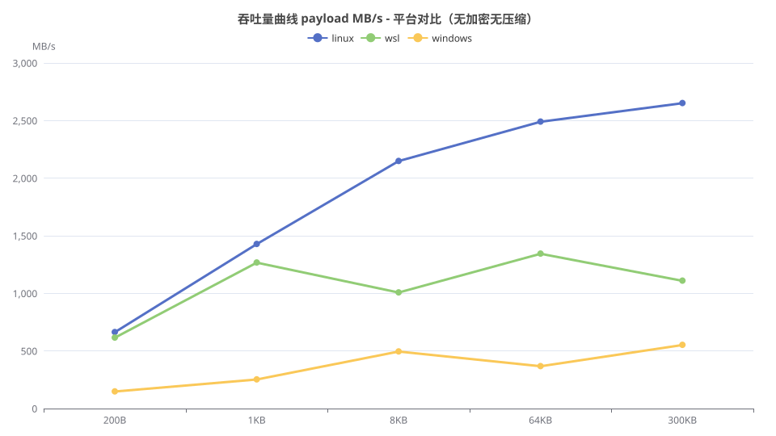

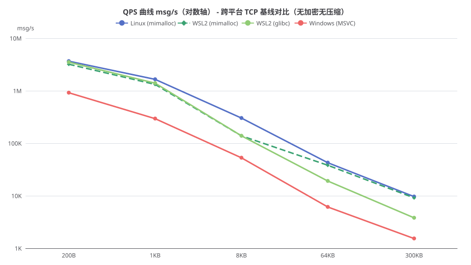

| 包长 | Linux (mimalloc) | WSL2 (mimalloc) | WSL2 (glibc) | Windows (MSVC) | WSL2(mi) / Linux | Windows / Linux |
|---|---:|---:|---:|---:|---:|---:|
| 200B | 3.66M / 697.5 MB/s | 3.20M / 610.4 MB/s | 3.51M / 669.3 MB/s | 917.8K / 175.1 MB/s | 88% | 25% |
| 1KB | 1.65M / 1.58 GB/s | 1.32M / 1.26 GB/s | 1.40M / 1.33 GB/s | 294.8K / 287.9 MB/s | 80% | 18% |
| 8KB | 302.0K / 2.30 GB/s | 138.8K / 1.06 GB/s | 138.7K / 1.06 GB/s | 52.9K / 413.6 MB/s | 46% | 18% |
| 64KB | 42.7K / 2.60 GB/s | 38.1K / 2.33 GB/s | 19.1K / 1.17 GB/s | 6.1K / 382.9 MB/s | 89% | 14% |
| 300KB | 9.6K / 2.76 GB/s | 9.1K / 2.62 GB/s | 3.8K / 1.09 GB/s | 1.5K / 450.0 MB/s | 95% | 16% |

- **Linux vs WSL2**：在相同 mimalloc 分配器下，除 8KB 档外，WSL2 与 Linux 整体走势贴近（110 组全矩阵比值中位数 104%，104 组在 85%–118% 内）。WSL2 在 8KB 档无论是 glibc（1083 MB/s）还是 mimalloc（1085 MB/s）均明显低于 Linux（1778–2359 MB/s），原因尚未定位。
- **Linux vs Windows**：Windows 原生 TCP 回环在各包长下仅为 Linux 的 14%–25%，两端 CPU 在 88%–99%，主要受限于 Windows 回环 socket 的系统调用开销。

---

### 4.2 内存分配器影响（WSL2：mimalloc vs glibc）

为排除平台与硬件差异，在 WSL2 上使用同一份二进制分别以默认 glibc 和 `LD_PRELOAD` 注入 mimalloc 跑完完整 110 组矩阵。下图选取四类典型负载（无加密无压缩、`aes-128-gcm`、`lz4@default`、`zstd@default`）对比吞吐量与 QPS。

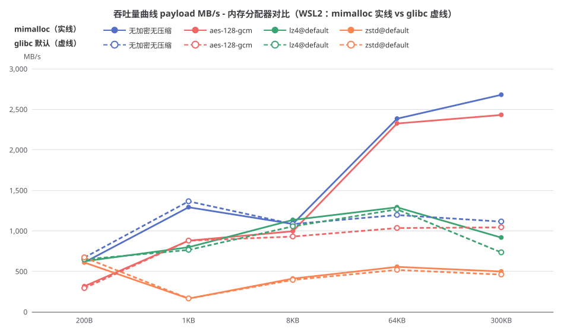

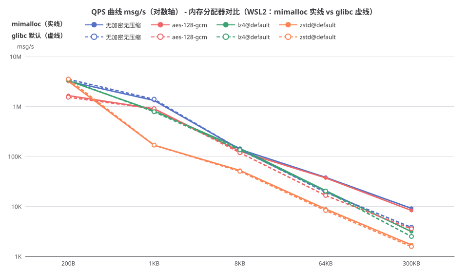

| 负载组合 | 包长 | WSL2 glibc（QPS / 吞吐量） | WSL2 mimalloc（QPS / 吞吐量） | 变化 | 峰值 RSS 变化（收/发） |
|---|---:|---:|---:|---:|---|
| 无加密无压缩 | 200B | 3.51M / 669.3 MB/s | 3.20M / 610.4 MB/s | -8.8% | +7.8 / +10.0 MB |
| 无加密无压缩 | 1KB | 1.40M / 1.33 GB/s | 1.32M / 1.26 GB/s | -5.3% | +7.4 / +8.9 MB |
| 无加密无压缩 | 8KB | 138.7K / 1.06 GB/s | 138.8K / 1.06 GB/s | +0.1% | +7.3 / +9.3 MB |
| 无加密无压缩 | 64KB | 19.1K / 1.17 GB/s | 38.1K / 2.33 GB/s | **+99.5%** | +7.5 / +11.3 MB |
| 无加密无压缩 | 300KB | 3.8K / 1.09 GB/s | 9.1K / 2.62 GB/s | **+140.5%** | +6.6 / +5.7 MB |
| `aes-128-gcm` | 64KB | 16.5K / 1.01 GB/s | 37.2K / 2.27 GB/s | **+124.9%** | +7.1 / +18.8 MB |
| `aes-128-gcm` | 300KB | 3.6K / 1.02 GB/s | 8.3K / 2.37 GB/s | **+133.0%** | +6.5 / +6.2 MB |
| `lz4@default` | 64KB | 20.2K / 1.24 GB/s | 20.6K / 1.26 GB/s | +1.9% | +7.4 / +10.4 MB |
| `lz4@default` | 300KB | 2.5K / 733.3 MB/s | 3.1K / 916.4 MB/s | +25.0% | +6.7 / +8.8 MB |
| `zstd@default` | 64KB | 8.3K / 517.6 MB/s | 8.9K / 555.2 MB/s | +7.3% | +7.2 / +7.6 MB |
| `zstd@default` | 300KB | 1.6K / 460.0 MB/s | 1.7K / 497.3 MB/s | +8.1% | +6.9 / +15.0 MB |

- 在不开启压缩的高吞吐路径（明文与 AES-GCM）上，大消息（64KB–300KB）频繁申请与释放临时缓冲区，mimalloc 将吞吐提升至原来的 2.0–2.4 倍；这也是 Linux（mimalloc）与 WSL2 默认配置（glibc）之间大包差距的主要来源。
- 开启压缩（尤其是 zstd）后，单核算力主要消耗在压缩算法本身，内存分配器不再是瓶颈。
- 全部 110 组中 mimalloc 在 85 组里快于 glibc，代价是接收端 RSS 增加 6.0–7.8 MB、发送端增加 3.8–20.9 MB。完整数据见 [summary.wsl_mimalloc.csv](benchmark/2026-11/summary.wsl_mimalloc.csv)。

---

### 4.3 加密与压缩组合（单对 TCP 基线）

以下三组曲线图分别展示 Linux、WSL2 和 Windows 在 TCP 通道上的全部 22 种组合 × 5 种包长表现。图例按统一规则排列：
- **颜色**区分压缩算法（每行一种压缩）；
- **线型**区分加密家族（实线 = 无加密，虚线 = AES-GCM，点线 = chacha20，点划线 = chacha20-poly1305-ietf）；
- **标记形状**区分具体算法（AES-128 / 192 / 256 依次为 ▲ ■ ◆）。

#### 4.3.1 Linux (Debian 13, GCC 14.2, -O3, mimalloc)

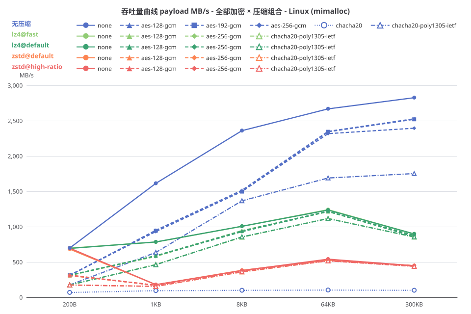

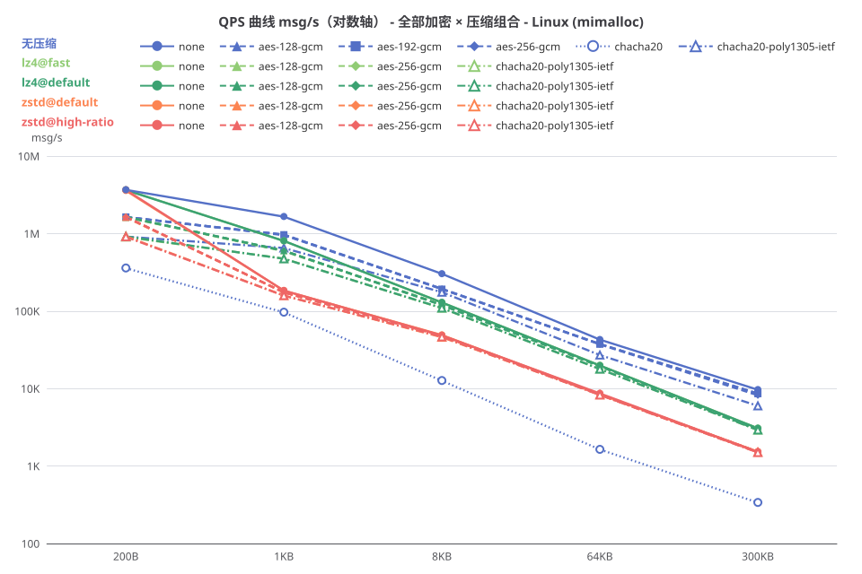

关键档位对比速览（200B、1KB、64KB、300KB）：

| 加密 | 压缩 | 200B QPS / 吞吐 | 1KB QPS / 吞吐 | 64KB QPS / 吞吐 | 300KB QPS / 吞吐 | 64KB 实测压缩率 |
|---|---|---:|---:|---:|---:|---:|
| none | 无 | 3.66M / 697.5 MB/s | 1.65M / 1.58 GB/s | 42.7K / 2.60 GB/s | 9.6K / 2.76 GB/s | - |
| aes-128-gcm | 无 | 1.62M / 309.4 MB/s | 971.8K / 949.0 MB/s | 37.6K / 2.29 GB/s | 8.6K / 2.47 GB/s | - |
| aes-256-gcm | 无 | 1.63M / 311.1 MB/s | 952.6K / 930.3 MB/s | 37.1K / 2.26 GB/s | 8.2K / 2.34 GB/s | - |
| chacha20-poly1305-ietf | 无 | 913.9K / 174.3 MB/s | 650.7K / 635.4 MB/s | 27.0K / 1.65 GB/s | 6.0K / 1.71 GB/s | - |
| chacha20 | 无 | 357.6K / 68.2 MB/s | 96.2K / 93.9 MB/s | 1.6K / 102.0 MB/s | 337 / 98.7 MB/s | - |
| none | lz4@default | 3.63M / 692.3 MB/s | 802.6K / 783.8 MB/s | 19.8K / 1.21 GB/s | 3.1K / 896.5 MB/s | 43.6% |
| none | zstd@default | 3.58M / 682.5 MB/s | 182.9K / 178.7 MB/s | 8.4K / 527.0 MB/s | 1.5K / 447.4 MB/s | 23.8% |
| none | zstd@high-ratio | 3.65M / 696.3 MB/s | 183.6K / 179.3 MB/s | 8.6K / 540.5 MB/s | 1.5K / 446.5 MB/s | 21.0% |
| aes-128-gcm | lz4@default | 1.64M / 312.8 MB/s | 602.3K / 588.2 MB/s | 19.5K / 1.19 GB/s | 2.9K / 856.6 MB/s | 43.6% |
| aes-128-gcm | zstd@high-ratio | 1.64M / 313.8 MB/s | 174.2K / 170.1 MB/s | 8.3K / 518.7 MB/s | 1.5K / 446.5 MB/s | 21.0% |
| chacha20-poly1305-ietf | lz4@default | 916.2K / 174.7 MB/s | 472.4K / 461.3 MB/s | 17.8K / 1.09 GB/s | 2.9K / 854.9 MB/s | 43.6% |
| chacha20-poly1305-ietf | zstd@high-ratio | 907.0K / 173.0 MB/s | 158.3K / 154.6 MB/s | 8.3K / 515.7 MB/s | 1.5K / 438.0 MB/s | 21.0% |

<details>
<summary>展开 Linux 全部 110 组完整数据表</summary>

##### 仅加密（无压缩）

| 加密 | 压缩 | 包长 | QPS | 吞吐量(payload) | CPU 收/发 | 峰值内存 收/发 | 实测压缩率 |
|---|---|---:|---:|---:|---|---|---:|
| none | none@default | 200B | 3.66M | 697.5MB/s | 100%/100% | 14.6/25.0MB | - |
| aes-128-gcm | none@default | 200B | 1.62M | 309.4MB/s | 100%/100% | 15.2/31.0MB | - |
| aes-192-gcm | none@default | 200B | 1.64M | 312.2MB/s | 100%/100% | 15.1/31.1MB | - |
| aes-256-gcm | none@default | 200B | 1.63M | 311.1MB/s | 100%/100% | 14.9/31.1MB | - |
| chacha20 | none@default | 200B | 357.6K | 68.2MB/s | 100%/100% | 15.0/29.0MB | - |
| chacha20-poly1305-ietf | none@default | 200B | 913.9K | 174.3MB/s | 100%/100% | 15.1/31.0MB | - |
| none | none@default | 1KB | 1.65M | 1.58GB/s | 100%/100% | 15.0/29.0MB | - |
| aes-128-gcm | none@default | 1KB | 971.8K | 949.0MB/s | 100%/100% | 15.1/29.3MB | - |
| aes-192-gcm | none@default | 1KB | 965.8K | 943.1MB/s | 100%/100% | 14.9/29.3MB | - |
| aes-256-gcm | none@default | 1KB | 952.6K | 930.3MB/s | 100%/100% | 15.0/29.4MB | - |
| chacha20 | none@default | 1KB | 96.2K | 93.9MB/s | 100%/100% | 15.0/30.8MB | - |
| chacha20-poly1305-ietf | none@default | 1KB | 650.7K | 635.4MB/s | 100%/100% | 15.0/28.9MB | - |
| none | none@default | 8KB | 302.0K | 2.30GB/s | 100%/100% | 15.0/31.0MB | - |
| aes-128-gcm | none@default | 8KB | 194.0K | 1.48GB/s | 100%/100% | 15.0/31.4MB | - |
| aes-192-gcm | none@default | 8KB | 191.5K | 1.46GB/s | 100%/100% | 14.8/31.4MB | - |
| aes-256-gcm | none@default | 8KB | 191.9K | 1.46GB/s | 100%/100% | 15.3/39.3MB | - |
| chacha20 | none@default | 8KB | 12.6K | 98.6MB/s | 100%/100% | 14.9/33.1MB | - |
| chacha20-poly1305-ietf | none@default | 8KB | 174.9K | 1.33GB/s | 100%/100% | 14.8/39.1MB | - |
| none | none@default | 64KB | 42.7K | 2.60GB/s | 100%/100% | 15.0/33.0MB | - |
| aes-128-gcm | none@default | 64KB | 37.6K | 2.29GB/s | 100%/100% | 15.0/39.2MB | - |
| aes-192-gcm | none@default | 64KB | 37.5K | 2.29GB/s | 100%/100% | 15.1/39.2MB | - |
| aes-256-gcm | none@default | 64KB | 37.1K | 2.26GB/s | 100%/100% | 15.3/39.3MB | - |
| chacha20 | none@default | 64KB | 1.6K | 102.0MB/s | 100%/100% | 15.0/34.4MB | - |
| chacha20-poly1305-ietf | none@default | 64KB | 27.0K | 1.65GB/s | 100%/100% | 15.0/37.0MB | - |
| none | none@default | 300KB | 9.6K | 2.76GB/s | 100%/100% | 14.6/26.9MB | - |
| aes-128-gcm | none@default | 300KB | 8.6K | 2.47GB/s | 100%/100% | 15.3/28.9MB | - |
| aes-192-gcm | none@default | 300KB | 8.6K | 2.46GB/s | 100%/100% | 15.3/29.2MB | - |
| aes-256-gcm | none@default | 300KB | 8.2K | 2.34GB/s | 100%/100% | 15.1/25.2MB | - |
| chacha20 | none@default | 300KB | 337 | 98.7MB/s | 100%/100% | 15.1/29.0MB | - |
| chacha20-poly1305-ietf | none@default | 300KB | 6.0K | 1.71GB/s | 100%/100% | 15.0/29.1MB | - |

##### 仅压缩（无加密）

| 加密 | 压缩 | 包长 | QPS | 吞吐量(payload) | CPU 收/发 | 峰值内存 收/发 | 实测压缩率 |
|---|---|---:|---:|---:|---|---|---:|
| none | none@default | 200B | 3.66M | 697.5MB/s | 100%/100% | 14.6/25.0MB | - |
| none | lz4@fast | 200B | 3.65M | 696.6MB/s | 100%/100% | 14.9/26.9MB | 76.6% |
| none | lz4@default | 200B | 3.63M | 692.3MB/s | 100%/100% | 15.0/26.8MB | 76.6% |
| none | zstd@default | 200B | 3.58M | 682.5MB/s | 100%/100% | 15.1/26.9MB | 66.1% |
| none | zstd@high-ratio | 200B | 3.65M | 696.3MB/s | 100%/100% | 15.1/26.9MB | 65.6% |
| none | none@default | 1KB | 1.65M | 1.58GB/s | 100%/100% | 15.0/29.0MB | - |
| none | lz4@fast | 1KB | 800.9K | 782.1MB/s | 100%/100% | 14.8/29.1MB | 55.5% |
| none | lz4@default | 1KB | 802.6K | 783.8MB/s | 100%/100% | 14.9/29.0MB | 55.5% |
| none | zstd@default | 1KB | 182.9K | 178.7MB/s | 100%/100% | 15.0/31.2MB | 35.2% |
| none | zstd@high-ratio | 1KB | 183.6K | 179.3MB/s | 100%/100% | 15.0/31.1MB | 33.3% |
| none | none@default | 8KB | 302.0K | 2.30GB/s | 100%/100% | 15.0/31.0MB | - |
| none | lz4@fast | 8KB | 128.6K | 1005.1MB/s | 100%/100% | 15.0/31.1MB | 45.9% |
| none | lz4@default | 8KB | 128.7K | 1005.8MB/s | 100%/100% | 14.8/30.9MB | 45.9% |
| none | zstd@default | 8KB | 49.0K | 382.6MB/s | 100%/100% | 15.1/31.1MB | 24.2% |
| none | zstd@high-ratio | 8KB | 48.5K | 378.5MB/s | 100%/100% | 14.9/30.8MB | 21.9% |
| none | none@default | 64KB | 42.7K | 2.60GB/s | 100%/100% | 15.0/33.0MB | - |
| none | lz4@fast | 64KB | 19.8K | 1.21GB/s | 100%/100% | 15.0/29.0MB | 43.6% |
| none | lz4@default | 64KB | 19.8K | 1.21GB/s | 100%/100% | 15.0/29.1MB | 43.6% |
| none | zstd@default | 64KB | 8.4K | 527.0MB/s | 100%/100% | 15.0/29.1MB | 23.8% |
| none | zstd@high-ratio | 64KB | 8.6K | 540.5MB/s | 100%/100% | 15.0/29.0MB | 21.0% |
| none | none@default | 300KB | 9.6K | 2.76GB/s | 100%/100% | 14.6/26.9MB | - |
| none | lz4@fast | 300KB | 3.1K | 896.5MB/s | 100%/100% | 14.8/34.9MB | 38.3% |
| none | lz4@default | 300KB | 3.1K | 896.5MB/s | 100%/100% | 15.0/26.8MB | 38.3% |
| none | zstd@default | 300KB | 1.5K | 447.4MB/s | 100%/100% | 15.1/33.1MB | 23.4% |
| none | zstd@high-ratio | 300KB | 1.5K | 446.5MB/s | 100%/100% | 15.0/33.1MB | 20.6% |

##### 压缩 + 加密组合

| 加密 | 压缩 | 包长 | QPS | 吞吐量(payload) | CPU 收/发 | 峰值内存 收/发 | 实测压缩率 |
|---|---|---:|---:|---:|---|---|---:|
| aes-128-gcm | lz4@fast | 200B | 1.62M | 308.5MB/s | 100%/100% | 15.0/31.2MB | 76.6% |
| aes-256-gcm | lz4@fast | 200B | 1.63M | 311.1MB/s | 100%/100% | 14.9/31.3MB | 76.6% |
| chacha20-poly1305-ietf | lz4@fast | 200B | 901.9K | 172.0MB/s | 100%/100% | 14.8/31.1MB | 76.6% |
| aes-128-gcm | lz4@default | 200B | 1.64M | 312.8MB/s | 100%/100% | 15.0/31.3MB | 76.6% |
| aes-256-gcm | lz4@default | 200B | 1.64M | 313.1MB/s | 100%/100% | 15.0/30.9MB | 76.6% |
| chacha20-poly1305-ietf | lz4@default | 200B | 916.2K | 174.7MB/s | 100%/100% | 14.6/30.7MB | 76.6% |
| aes-128-gcm | zstd@default | 200B | 1.62M | 308.4MB/s | 100%/100% | 15.1/31.0MB | 66.1% |
| aes-256-gcm | zstd@default | 200B | 1.63M | 310.3MB/s | 100%/100% | 15.0/31.1MB | 66.1% |
| chacha20-poly1305-ietf | zstd@default | 200B | 920.0K | 175.5MB/s | 100%/100% | 15.1/31.0MB | 66.1% |
| aes-128-gcm | zstd@high-ratio | 200B | 1.64M | 313.8MB/s | 100%/100% | 15.1/31.2MB | 65.6% |
| aes-256-gcm | zstd@high-ratio | 200B | 1.64M | 313.2MB/s | 100%/100% | 14.9/31.2MB | 65.6% |
| chacha20-poly1305-ietf | zstd@high-ratio | 200B | 907.0K | 173.0MB/s | 100%/100% | 15.0/31.1MB | 65.6% |
| aes-128-gcm | lz4@fast | 1KB | 601.8K | 587.7MB/s | 100%/100% | 14.9/29.4MB | 55.5% |
| aes-256-gcm | lz4@fast | 1KB | 592.1K | 578.2MB/s | 100%/100% | 15.0/29.3MB | 55.5% |
| chacha20-poly1305-ietf | lz4@fast | 1KB | 475.6K | 464.5MB/s | 100%/100% | 14.8/29.0MB | 55.5% |
| aes-128-gcm | lz4@default | 1KB | 602.3K | 588.2MB/s | 100%/100% | 15.0/29.2MB | 55.5% |
| aes-256-gcm | lz4@default | 1KB | 599.9K | 585.8MB/s | 100%/100% | 15.1/29.2MB | 55.5% |
| chacha20-poly1305-ietf | lz4@default | 1KB | 472.4K | 461.3MB/s | 100%/100% | 15.0/29.2MB | 55.5% |
| aes-128-gcm | zstd@default | 1KB | 174.6K | 170.5MB/s | 100%/100% | 15.3/31.3MB | 35.2% |
| aes-256-gcm | zstd@default | 1KB | 174.2K | 170.1MB/s | 100%/100% | 15.2/31.3MB | 35.2% |
| chacha20-poly1305-ietf | zstd@default | 1KB | 158.5K | 154.7MB/s | 100%/100% | 15.0/31.3MB | 35.2% |
| aes-128-gcm | zstd@high-ratio | 1KB | 174.2K | 170.1MB/s | 100%/100% | 15.3/31.2MB | 33.3% |
| aes-256-gcm | zstd@high-ratio | 1KB | 174.2K | 170.2MB/s | 100%/100% | 15.0/31.3MB | 33.3% |
| chacha20-poly1305-ietf | zstd@high-ratio | 1KB | 158.3K | 154.6MB/s | 100%/100% | 15.0/31.1MB | 33.3% |
| aes-128-gcm | lz4@fast | 8KB | 120.8K | 943.5MB/s | 100%/100% | 15.3/30.8MB | 45.9% |
| aes-256-gcm | lz4@fast | 8KB | 120.3K | 940.1MB/s | 100%/100% | 15.1/31.3MB | 45.9% |
| chacha20-poly1305-ietf | lz4@fast | 8KB | 108.9K | 850.5MB/s | 100%/100% | 14.8/31.1MB | 45.9% |
| aes-128-gcm | lz4@default | 8KB | 120.3K | 939.6MB/s | 100%/100% | 15.0/31.2MB | 45.9% |
| aes-256-gcm | lz4@default | 8KB | 119.0K | 929.4MB/s | 100%/100% | 14.9/31.1MB | 45.9% |
| chacha20-poly1305-ietf | lz4@default | 8KB | 109.5K | 855.8MB/s | 100%/100% | 15.0/31.0MB | 45.9% |
| aes-128-gcm | zstd@default | 8KB | 48.0K | 375.0MB/s | 100%/100% | 15.2/31.4MB | 24.2% |
| aes-256-gcm | zstd@default | 8KB | 48.0K | 375.1MB/s | 100%/100% | 15.1/31.4MB | 24.2% |
| chacha20-poly1305-ietf | zstd@default | 8KB | 45.9K | 358.4MB/s | 100%/100% | 15.0/31.1MB | 24.2% |
| aes-128-gcm | zstd@high-ratio | 8KB | 48.0K | 375.4MB/s | 100%/100% | 15.1/31.3MB | 21.9% |
| aes-256-gcm | zstd@high-ratio | 8KB | 48.2K | 376.7MB/s | 100%/100% | 15.3/31.3MB | 21.9% |
| chacha20-poly1305-ietf | zstd@high-ratio | 8KB | 46.5K | 363.3MB/s | 100%/100% | 14.8/31.0MB | 21.9% |
| aes-128-gcm | lz4@fast | 64KB | 19.4K | 1.18GB/s | 100%/100% | 15.0/29.2MB | 43.6% |
| aes-256-gcm | lz4@fast | 64KB | 19.5K | 1.19GB/s | 100%/100% | 15.0/29.2MB | 43.6% |
| chacha20-poly1305-ietf | lz4@fast | 64KB | 17.9K | 1.09GB/s | 100%/100% | 15.0/29.0MB | 43.6% |
| aes-128-gcm | lz4@default | 64KB | 19.5K | 1.19GB/s | 100%/100% | 15.0/29.2MB | 43.6% |
| aes-256-gcm | lz4@default | 64KB | 19.4K | 1.19GB/s | 100%/100% | 15.0/29.1MB | 43.6% |
| chacha20-poly1305-ietf | lz4@default | 64KB | 17.8K | 1.09GB/s | 100%/100% | 15.0/31.1MB | 43.6% |
| aes-128-gcm | zstd@default | 64KB | 8.4K | 525.0MB/s | 100%/100% | 15.3/29.1MB | 23.8% |
| aes-256-gcm | zstd@default | 64KB | 8.4K | 525.0MB/s | 100%/100% | 15.3/29.2MB | 23.8% |
| chacha20-poly1305-ietf | zstd@default | 64KB | 8.3K | 518.2MB/s | 100%/100% | 15.1/29.3MB | 23.8% |
| aes-128-gcm | zstd@high-ratio | 64KB | 8.3K | 518.7MB/s | 100%/100% | 15.3/27.3MB | 21.0% |
| aes-256-gcm | zstd@high-ratio | 64KB | 8.4K | 525.0MB/s | 100%/100% | 15.3/29.2MB | 21.0% |
| chacha20-poly1305-ietf | zstd@high-ratio | 64KB | 8.3K | 515.7MB/s | 100%/100% | 15.0/29.0MB | 21.0% |
| aes-128-gcm | lz4@fast | 300KB | 3.0K | 876.6MB/s | 100%/100% | 15.0/35.1MB | 38.3% |
| aes-256-gcm | lz4@fast | 300KB | 2.9K | 861.3MB/s | 100%/100% | 15.4/35.3MB | 38.3% |
| chacha20-poly1305-ietf | lz4@fast | 300KB | 2.9K | 852.0MB/s | 100%/100% | 15.1/31.0MB | 38.3% |
| aes-128-gcm | lz4@default | 300KB | 2.9K | 856.6MB/s | 100%/100% | 15.1/39.3MB | 38.3% |
| aes-256-gcm | lz4@default | 300KB | 3.0K | 876.6MB/s | 100%/100% | 14.8/39.3MB | 38.3% |
| chacha20-poly1305-ietf | lz4@default | 300KB | 2.9K | 854.9MB/s | 100%/100% | 14.7/30.9MB | 38.3% |
| aes-128-gcm | zstd@default | 300KB | 1.5K | 448.7MB/s | 100%/100% | 15.3/35.5MB | 23.4% |
| aes-256-gcm | zstd@default | 300KB | 1.5K | 444.0MB/s | 100%/100% | 15.1/33.3MB | 23.4% |
| chacha20-poly1305-ietf | zstd@default | 300KB | 1.5K | 441.8MB/s | 100%/100% | 15.0/33.3MB | 23.4% |
| aes-128-gcm | zstd@high-ratio | 300KB | 1.5K | 446.5MB/s | 100%/100% | 15.1/35.4MB | 20.6% |
| aes-256-gcm | zstd@high-ratio | 300KB | 1.5K | 442.2MB/s | 100%/100% | 15.3/35.3MB | 20.6% |
| chacha20-poly1305-ietf | zstd@high-ratio | 300KB | 1.5K | 438.0MB/s | 100%/100% | 15.0/35.2MB | 20.6% |

</details>

#### 4.3.2 WSL2 (Debian 13, GCC 14.2, -O3, glibc)

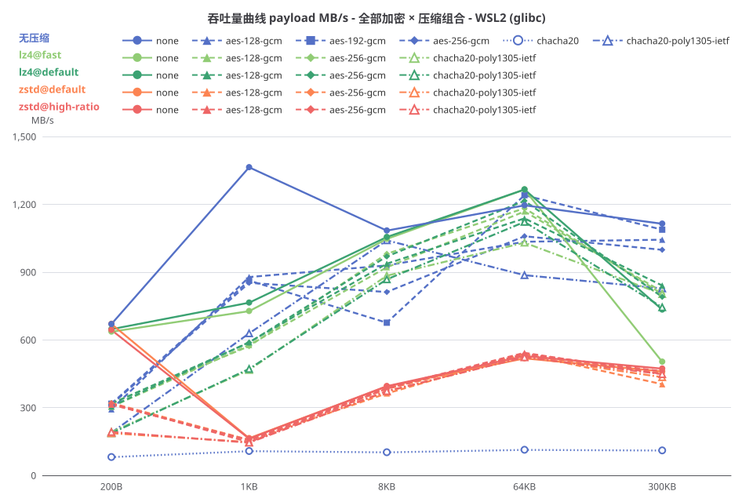

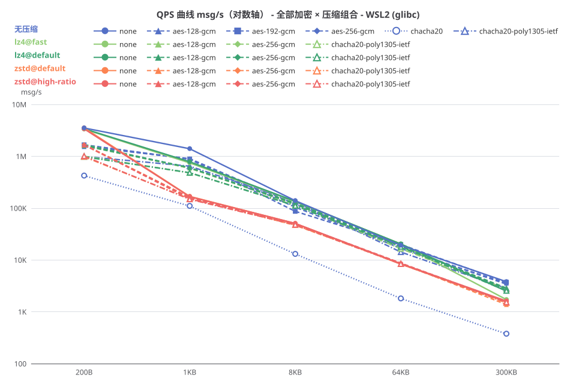

<details>
<summary>展开 WSL2 (glibc) 全部 110 组完整数据表</summary>

##### 仅加密（无压缩）

| 加密 | 压缩 | 包长 | QPS | 吞吐量(payload) | CPU 收/发 | 峰值内存 收/发 | 实测压缩率 |
|---|---|---:|---:|---:|---|---|---:|
| none | none@default | 200B | 3.51M | 669.3MB/s | 100%/100% | 11.8/21.3MB | - |
| aes-128-gcm | none@default | 200B | 1.53M | 292.1MB/s | 100%/100% | 12.1/25.5MB | - |
| aes-192-gcm | none@default | 200B | 1.66M | 317.1MB/s | 100%/100% | 12.5/25.3MB | - |
| aes-256-gcm | none@default | 200B | 1.64M | 313.3MB/s | 100%/100% | 12.4/25.7MB | - |
| chacha20 | none@default | 200B | 421.6K | 80.4MB/s | 100%/102% | 12.1/25.9MB | - |
| chacha20-poly1305-ietf | none@default | 200B | 988.8K | 188.6MB/s | 100%/101% | 12.3/25.6MB | - |
| none | none@default | 1KB | 1.40M | 1.33GB/s | 100%/100% | 12.0/20.4MB | - |
| aes-128-gcm | none@default | 1KB | 898.9K | 877.8MB/s | 100%/100% | 12.6/23.9MB | - |
| aes-192-gcm | none@default | 1KB | 882.9K | 862.2MB/s | 100%/100% | 12.5/24.9MB | - |
| aes-256-gcm | none@default | 1KB | 872.7K | 852.2MB/s | 100%/100% | 12.5/25.0MB | - |
| chacha20 | none@default | 1KB | 109.6K | 107.0MB/s | 100%/101% | 12.3/26.1MB | - |
| chacha20-poly1305-ietf | none@default | 1KB | 643.7K | 628.6MB/s | 100%/100% | 12.4/25.0MB | - |
| none | none@default | 8KB | 138.7K | 1.06GB/s | 100%/100% | 12.0/19.9MB | - |
| aes-128-gcm | none@default | 8KB | 118.9K | 929.1MB/s | 100%/100% | 12.6/20.4MB | - |
| aes-192-gcm | none@default | 8KB | 86.5K | 675.7MB/s | 100%/100% | 12.5/20.5MB | - |
| aes-256-gcm | none@default | 8KB | 103.9K | 811.4MB/s | 100%/100% | 12.4/20.4MB | - |
| chacha20 | none@default | 8KB | 13.0K | 101.6MB/s | 100%/102% | 12.3/25.4MB | - |
| chacha20-poly1305-ietf | none@default | 8KB | 133.2K | 1.02GB/s | 100%/100% | 12.3/20.6MB | - |
| none | none@default | 64KB | 19.1K | 1.17GB/s | 100%/100% | 11.8/20.1MB | - |
| aes-128-gcm | none@default | 64KB | 16.5K | 1.01GB/s | 100%/100% | 12.9/25.1MB | - |
| aes-192-gcm | none@default | 64KB | 19.8K | 1.21GB/s | 100%/100% | 12.9/25.5MB | - |
| aes-256-gcm | none@default | 64KB | 16.9K | 1.03GB/s | 100%/100% | 13.0/25.4MB | - |
| chacha20 | none@default | 64KB | 1.8K | 112.5MB/s | 101%/101% | 12.6/25.8MB | - |
| chacha20-poly1305-ietf | none@default | 64KB | 14.2K | 886.0MB/s | 100%/100% | 12.6/25.3MB | - |
| none | none@default | 300KB | 3.8K | 1.09GB/s | 100%/100% | 12.6/21.6MB | - |
| aes-128-gcm | none@default | 300KB | 3.6K | 1.02GB/s | 100%/100% | 13.5/23.7MB | - |
| aes-192-gcm | none@default | 300KB | 3.7K | 1.06GB/s | 100%/100% | 13.7/25.7MB | - |
| aes-256-gcm | none@default | 300KB | 3.4K | 998.4MB/s | 100%/100% | 13.8/26.0MB | - |
| chacha20 | none@default | 300KB | 375 | 109.7MB/s | 102%/102% | 13.6/26.8MB | - |
| chacha20-poly1305-ietf | none@default | 300KB | 2.8K | 827.3MB/s | 100%/100% | 13.4/24.8MB | - |

##### 仅压缩（无加密）

| 加密 | 压缩 | 包长 | QPS | 吞吐量(payload) | CPU 收/发 | 峰值内存 收/发 | 实测压缩率 |
|---|---|---:|---:|---:|---|---|---:|
| none | none@default | 200B | 3.51M | 669.3MB/s | 100%/100% | 11.8/21.3MB | - |
| none | lz4@fast | 200B | 3.33M | 635.8MB/s | 100%/100% | 11.9/21.2MB | 76.6% |
| none | lz4@default | 200B | 3.39M | 646.9MB/s | 100%/100% | 12.0/21.3MB | 76.6% |
| none | zstd@default | 200B | 3.51M | 670.3MB/s | 100%/100% | 11.8/23.8MB | 66.1% |
| none | zstd@high-ratio | 200B | 3.37M | 643.5MB/s | 100%/100% | 12.1/23.1MB | 65.6% |
| none | none@default | 1KB | 1.40M | 1.33GB/s | 100%/100% | 12.0/20.4MB | - |
| none | lz4@fast | 1KB | 744.3K | 726.9MB/s | 100%/100% | 12.1/24.8MB | 55.5% |
| none | lz4@default | 1KB | 782.6K | 764.2MB/s | 100%/100% | 11.9/24.5MB | 55.5% |
| none | zstd@default | 1KB | 168.3K | 164.3MB/s | 100%/102% | 12.2/21.2MB | 35.2% |
| none | zstd@high-ratio | 1KB | 165.9K | 162.1MB/s | 100%/101% | 12.1/21.5MB | 33.3% |
| none | none@default | 8KB | 138.7K | 1.06GB/s | 100%/100% | 12.0/19.9MB | - |
| none | lz4@fast | 8KB | 133.9K | 1.02GB/s | 100%/100% | 12.1/24.9MB | 45.9% |
| none | lz4@default | 8KB | 135.0K | 1.03GB/s | 100%/100% | 12.0/20.3MB | 45.9% |
| none | zstd@default | 8KB | 50.4K | 393.4MB/s | 100%/102% | 12.2/20.7MB | 24.2% |
| none | zstd@high-ratio | 8KB | 50.5K | 394.8MB/s | 100%/102% | 12.1/26.0MB | 21.9% |
| none | none@default | 64KB | 19.1K | 1.17GB/s | 100%/100% | 11.8/20.1MB | - |
| none | lz4@fast | 64KB | 20.2K | 1.24GB/s | 100%/100% | 12.2/25.0MB | 43.6% |
| none | lz4@default | 64KB | 20.2K | 1.24GB/s | 100%/100% | 12.0/22.9MB | 43.6% |
| none | zstd@default | 64KB | 8.3K | 517.6MB/s | 100%/102% | 12.5/26.1MB | 23.8% |
| none | zstd@high-ratio | 64KB | 8.4K | 528.1MB/s | 100%/102% | 12.1/21.1MB | 21.0% |
| none | none@default | 300KB | 3.8K | 1.09GB/s | 100%/100% | 12.6/21.6MB | - |
| none | lz4@fast | 300KB | 1.7K | 502.7MB/s | 100%/102% | 12.6/26.1MB | 38.3% |
| none | lz4@default | 300KB | 2.5K | 733.3MB/s | 100%/101% | 12.8/26.6MB | 38.3% |
| none | zstd@default | 300KB | 1.6K | 460.0MB/s | 100%/103% | 12.9/22.8MB | 23.4% |
| none | zstd@high-ratio | 300KB | 1.6K | 472.3MB/s | 100%/102% | 13.0/22.7MB | 20.6% |

##### 压缩 + 加密组合

| 加密 | 压缩 | 包长 | QPS | 吞吐量(payload) | CPU 收/发 | 峰值内存 收/发 | 实测压缩率 |
|---|---|---:|---:|---:|---|---|---:|
| aes-128-gcm | lz4@fast | 200B | 1.59M | 303.3MB/s | 100%/100% | 12.6/25.3MB | 76.6% |
| aes-256-gcm | lz4@fast | 200B | 1.67M | 319.3MB/s | 100%/100% | 12.5/25.5MB | 76.6% |
| chacha20-poly1305-ietf | lz4@fast | 200B | 1.00M | 191.4MB/s | 100%/100% | 12.4/25.3MB | 76.6% |
| aes-128-gcm | lz4@default | 200B | 1.60M | 305.0MB/s | 100%/100% | 12.5/25.3MB | 76.6% |
| aes-256-gcm | lz4@default | 200B | 1.66M | 317.0MB/s | 100%/100% | 12.5/25.1MB | 76.6% |
| chacha20-poly1305-ietf | lz4@default | 200B | 977.5K | 186.4MB/s | 100%/100% | 12.3/25.6MB | 76.6% |
| aes-128-gcm | zstd@default | 200B | 1.65M | 313.8MB/s | 100%/100% | 12.4/25.2MB | 66.1% |
| aes-256-gcm | zstd@default | 200B | 1.68M | 319.9MB/s | 100%/100% | 12.5/25.2MB | 66.1% |
| chacha20-poly1305-ietf | zstd@default | 200B | 977.3K | 186.4MB/s | 100%/101% | 12.3/25.3MB | 66.1% |
| aes-128-gcm | zstd@high-ratio | 200B | 1.64M | 313.6MB/s | 100%/100% | 12.3/25.1MB | 65.6% |
| aes-256-gcm | zstd@high-ratio | 200B | 1.67M | 317.9MB/s | 100%/100% | 12.6/25.4MB | 65.6% |
| chacha20-poly1305-ietf | zstd@high-ratio | 200B | 1.01M | 192.0MB/s | 100%/100% | 12.2/25.2MB | 65.6% |
| aes-128-gcm | lz4@fast | 1KB | 590.6K | 576.8MB/s | 100%/100% | 12.7/25.6MB | 55.5% |
| aes-256-gcm | lz4@fast | 1KB | 585.3K | 571.5MB/s | 100%/100% | 12.5/25.5MB | 55.5% |
| chacha20-poly1305-ietf | lz4@fast | 1KB | 477.7K | 466.5MB/s | 100%/100% | 12.1/25.6MB | 55.5% |
| aes-128-gcm | lz4@default | 1KB | 603.3K | 589.1MB/s | 100%/100% | 12.6/24.6MB | 55.5% |
| aes-256-gcm | lz4@default | 1KB | 601.6K | 587.5MB/s | 100%/100% | 12.5/25.8MB | 55.5% |
| chacha20-poly1305-ietf | lz4@default | 1KB | 482.4K | 471.1MB/s | 100%/100% | 12.4/25.6MB | 55.5% |
| aes-128-gcm | zstd@default | 1KB | 160.1K | 156.4MB/s | 100%/102% | 12.7/26.8MB | 35.2% |
| aes-256-gcm | zstd@default | 1KB | 160.6K | 156.8MB/s | 100%/101% | 12.9/26.8MB | 35.2% |
| chacha20-poly1305-ietf | zstd@default | 1KB | 150.8K | 147.3MB/s | 100%/102% | 12.5/26.3MB | 35.2% |
| aes-128-gcm | zstd@high-ratio | 1KB | 159.2K | 155.4MB/s | 100%/102% | 12.8/26.5MB | 33.3% |
| aes-256-gcm | zstd@high-ratio | 1KB | 150.4K | 146.8MB/s | 100%/104% | 13.0/26.6MB | 33.3% |
| chacha20-poly1305-ietf | zstd@high-ratio | 1KB | 148.0K | 144.5MB/s | 100%/102% | 12.3/26.6MB | 33.3% |
| aes-128-gcm | lz4@fast | 8KB | 117.9K | 921.0MB/s | 100%/100% | 12.5/25.5MB | 45.9% |
| aes-256-gcm | lz4@fast | 8KB | 125.5K | 980.7MB/s | 100%/100% | 12.6/25.3MB | 45.9% |
| chacha20-poly1305-ietf | lz4@fast | 8KB | 113.1K | 883.6MB/s | 100%/100% | 12.4/25.3MB | 45.9% |
| aes-128-gcm | lz4@default | 8KB | 119.9K | 936.9MB/s | 100%/100% | 12.6/25.2MB | 45.9% |
| aes-256-gcm | lz4@default | 8KB | 124.0K | 968.9MB/s | 100%/100% | 12.5/25.4MB | 45.9% |
| chacha20-poly1305-ietf | lz4@default | 8KB | 111.0K | 867.5MB/s | 100%/100% | 12.3/25.1MB | 45.9% |
| aes-128-gcm | zstd@default | 8KB | 46.4K | 362.6MB/s | 100%/102% | 12.8/26.6MB | 24.2% |
| aes-256-gcm | zstd@default | 8KB | 48.9K | 382.2MB/s | 100%/102% | 12.8/26.5MB | 24.2% |
| chacha20-poly1305-ietf | zstd@default | 8KB | 47.5K | 370.8MB/s | 100%/102% | 12.6/26.5MB | 24.2% |
| aes-128-gcm | zstd@high-ratio | 8KB | 49.6K | 387.4MB/s | 100%/102% | 13.0/26.8MB | 21.9% |
| aes-256-gcm | zstd@high-ratio | 8KB | 49.2K | 384.4MB/s | 100%/101% | 13.0/26.7MB | 21.9% |
| chacha20-poly1305-ietf | zstd@high-ratio | 8KB | 47.7K | 372.8MB/s | 100%/101% | 12.9/26.5MB | 21.9% |
| aes-128-gcm | lz4@fast | 64KB | 18.7K | 1.14GB/s | 100%/100% | 12.8/25.8MB | 43.6% |
| aes-256-gcm | lz4@fast | 64KB | 18.9K | 1.15GB/s | 100%/100% | 12.9/25.8MB | 43.6% |
| chacha20-poly1305-ietf | lz4@fast | 64KB | 16.5K | 1.01GB/s | 100%/100% | 12.7/25.2MB | 43.6% |
| aes-128-gcm | lz4@default | 64KB | 18.2K | 1.11GB/s | 100%/100% | 13.0/25.8MB | 43.6% |
| aes-256-gcm | lz4@default | 64KB | 19.4K | 1.19GB/s | 100%/100% | 12.7/25.9MB | 43.6% |
| chacha20-poly1305-ietf | lz4@default | 64KB | 18.0K | 1.10GB/s | 100%/100% | 12.8/25.6MB | 43.6% |
| aes-128-gcm | zstd@default | 64KB | 8.6K | 538.3MB/s | 100%/102% | 13.0/25.1MB | 23.8% |
| aes-256-gcm | zstd@default | 64KB | 8.5K | 532.6MB/s | 100%/102% | 13.0/26.8MB | 23.8% |
| chacha20-poly1305-ietf | zstd@default | 64KB | 8.4K | 525.5MB/s | 100%/101% | 12.9/26.6MB | 23.8% |
| aes-128-gcm | zstd@high-ratio | 64KB | 8.7K | 542.2MB/s | 100%/101% | 13.0/26.8MB | 21.0% |
| aes-256-gcm | zstd@high-ratio | 64KB | 8.6K | 536.8MB/s | 100%/101% | 13.1/26.9MB | 21.0% |
| chacha20-poly1305-ietf | zstd@high-ratio | 64KB | 8.4K | 522.5MB/s | 100%/102% | 12.8/26.6MB | 21.0% |
| aes-128-gcm | lz4@fast | 300KB | 2.8K | 813.3MB/s | 100%/101% | 13.5/26.3MB | 38.3% |
| aes-256-gcm | lz4@fast | 300KB | 2.7K | 803.0MB/s | 100%/101% | 13.5/26.4MB | 38.3% |
| chacha20-poly1305-ietf | lz4@fast | 300KB | 2.7K | 802.3MB/s | 100%/101% | 13.4/26.3MB | 38.3% |
| aes-128-gcm | lz4@default | 300KB | 2.9K | 840.4MB/s | 100%/101% | 13.4/24.8MB | 38.3% |
| aes-256-gcm | lz4@default | 300KB | 2.7K | 790.0MB/s | 100%/101% | 13.4/26.5MB | 38.3% |
| chacha20-poly1305-ietf | lz4@default | 300KB | 2.5K | 744.0MB/s | 100%/101% | 13.2/26.2MB | 38.3% |
| aes-128-gcm | zstd@default | 300KB | 1.4K | 403.3MB/s | 100%/103% | 13.7/28.3MB | 23.4% |
| aes-256-gcm | zstd@default | 300KB | 1.5K | 451.9MB/s | 100%/102% | 13.7/28.2MB | 23.4% |
| chacha20-poly1305-ietf | zstd@default | 300KB | 1.5K | 434.5MB/s | 100%/103% | 13.3/28.0MB | 23.4% |
| aes-128-gcm | zstd@high-ratio | 300KB | 1.5K | 448.5MB/s | 100%/103% | 13.4/28.4MB | 20.6% |
| aes-256-gcm | zstd@high-ratio | 300KB | 1.6K | 460.3MB/s | 100%/103% | 13.3/28.1MB | 20.6% |
| chacha20-poly1305-ietf | zstd@high-ratio | 300KB | 1.5K | 447.8MB/s | 100%/102% | 13.5/27.9MB | 20.6% |

</details>

#### 4.3.3 Windows 原生 (MSVC, /O2)

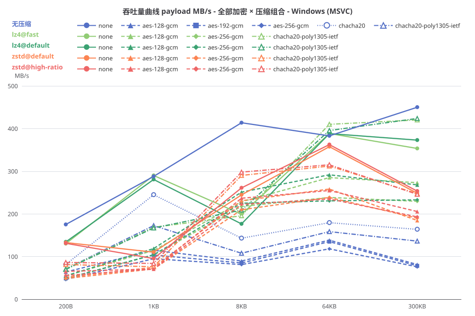

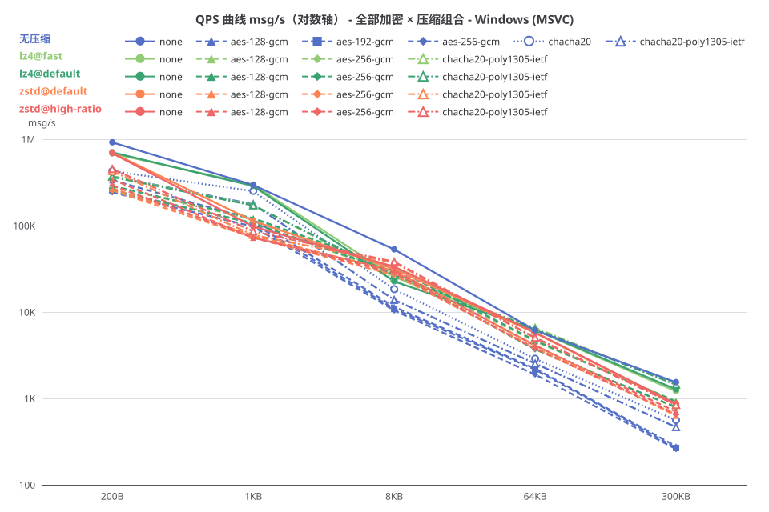

Windows 环境下有两点与 Linux 明显不同：
- 开启 AES-GCM 后吞吐下降到明文的 17%–40%（64KB 从 382.9 MB/s 降至 138.4 MB/s），反而低于 `chacha20-poly1305-ietf`（158.4 MB/s），原因尚未定位。
- 大包（64KB / 300KB）下“先压缩再加密”反而明显快于“仅加密”（例如 300KB `chacha20-poly1305-ietf` 仅加密为 136.2 MB/s，叠加 `lz4@default` 后达到 423.7 MB/s），因为压缩减少了进入加密和 Windows TCP 回环的字节量。

<details>
<summary>展开 Windows 原生全部 110 组完整数据表</summary>

##### 仅加密（无压缩）

| 加密 | 压缩 | 包长 | QPS | 吞吐量(payload) | CPU 收/发 | 峰值内存 收/发 | 实测压缩率 |
|---|---|---:|---:|---:|---|---|---:|
| none | none@default | 200B | 917.8K | 175.1MB/s | 99%/99% | 11.2/27.0MB | - |
| aes-128-gcm | none@default | 200B | 334.7K | 63.8MB/s | 99%/99% | 11.4/29.3MB | - |
| aes-192-gcm | none@default | 200B | 256.0K | 48.8MB/s | 95%/94% | 11.4/29.3MB | - |
| aes-256-gcm | none@default | 200B | 242.9K | 46.3MB/s | 93%/93% | 11.4/29.6MB | - |
| chacha20 | none@default | 200B | 426.8K | 81.4MB/s | 95%/94% | 11.4/29.4MB | - |
| chacha20-poly1305-ietf | none@default | 200B | 371.8K | 70.9MB/s | 97%/97% | 11.3/29.7MB | - |
| none | none@default | 1KB | 294.8K | 287.9MB/s | 99%/99% | 11.2/28.0MB | - |
| aes-128-gcm | none@default | 1KB | 117.5K | 114.7MB/s | 99%/99% | 11.4/28.4MB | - |
| aes-192-gcm | none@default | 1KB | 106.0K | 103.6MB/s | 98%/98% | 11.4/28.3MB | - |
| aes-256-gcm | none@default | 1KB | 97.2K | 94.9MB/s | 99%/99% | 11.4/28.2MB | - |
| chacha20 | none@default | 1KB | 250.8K | 244.9MB/s | 99%/99% | 11.4/28.5MB | - |
| chacha20-poly1305-ietf | none@default | 1KB | 176.7K | 172.6MB/s | 99%/99% | 11.4/28.3MB | - |
| none | none@default | 8KB | 52.9K | 413.6MB/s | 96%/96% | 11.3/20.7MB | - |
| aes-128-gcm | none@default | 8KB | 11.5K | 89.6MB/s | 92%/91% | 11.6/27.4MB | - |
| aes-192-gcm | none@default | 8KB | 10.9K | 85.0MB/s | 93%/92% | 11.6/28.0MB | - |
| aes-256-gcm | none@default | 8KB | 10.4K | 81.3MB/s | 93%/92% | 11.6/27.8MB | - |
| chacha20 | none@default | 8KB | 18.3K | 143.0MB/s | 92%/91% | 11.5/26.5MB | - |
| chacha20-poly1305-ietf | none@default | 8KB | 13.8K | 107.7MB/s | 95%/96% | 11.6/26.8MB | - |
| none | none@default | 64KB | 6.1K | 382.9MB/s | 99%/98% | 11.4/27.0MB | - |
| aes-128-gcm | none@default | 64KB | 2.2K | 138.4MB/s | 98%/98% | 11.7/27.3MB | - |
| aes-192-gcm | none@default | 64KB | 2.2K | 134.9MB/s | 99%/98% | 11.7/27.4MB | - |
| aes-256-gcm | none@default | 64KB | 1.9K | 118.0MB/s | 98%/97% | 11.6/27.3MB | - |
| chacha20 | none@default | 64KB | 2.9K | 179.4MB/s | 99%/98% | 11.5/27.1MB | - |
| chacha20-poly1305-ietf | none@default | 64KB | 2.5K | 158.4MB/s | 99%/98% | 11.6/27.3MB | - |
| none | none@default | 300KB | 1.5K | 450.0MB/s | 97%/98% | 12.0/25.6MB | - |
| aes-128-gcm | none@default | 300KB | 278 | 81.4MB/s | 98%/99% | 12.6/27.3MB | - |
| aes-192-gcm | none@default | 300KB | 267 | 78.2MB/s | 99%/97% | 12.5/27.2MB | - |
| aes-256-gcm | none@default | 300KB | 259 | 75.9MB/s | 99%/98% | 12.5/27.2MB | - |
| chacha20 | none@default | 300KB | 559 | 163.8MB/s | 97%/98% | 12.5/27.2MB | - |
| chacha20-poly1305-ietf | none@default | 300KB | 465 | 136.2MB/s | 96%/96% | 12.3/27.2MB | - |

##### 仅压缩（无加密）

| 加密 | 压缩 | 包长 | QPS | 吞吐量(payload) | CPU 收/发 | 峰值内存 收/发 | 实测压缩率 |
|---|---|---:|---:|---:|---|---|---:|
| none | none@default | 200B | 917.8K | 175.1MB/s | 99%/99% | 11.2/27.0MB | - |
| none | lz4@fast | 200B | 682.5K | 130.2MB/s | 95%/94% | 11.2/28.2MB | 76.6% |
| none | lz4@default | 200B | 703.9K | 134.3MB/s | 96%/97% | 11.2/27.9MB | 76.6% |
| none | zstd@default | 200B | 695.5K | 132.7MB/s | 98%/96% | 11.2/29.3MB | 66.1% |
| none | zstd@high-ratio | 200B | 686.7K | 131.0MB/s | 97%/97% | 11.2/29.7MB | 65.6% |
| none | none@default | 1KB | 294.8K | 287.9MB/s | 99%/99% | 11.2/28.0MB | - |
| none | lz4@fast | 1KB | 297.0K | 290.0MB/s | 99%/99% | 11.2/28.7MB | 55.5% |
| none | lz4@default | 1KB | 287.4K | 280.7MB/s | 99%/98% | 11.3/28.1MB | 55.5% |
| none | zstd@default | 1KB | 112.8K | 110.2MB/s | 98%/98% | 11.4/29.2MB | 35.2% |
| none | zstd@high-ratio | 1KB | 97.5K | 95.2MB/s | 96%/97% | 11.4/29.6MB | 33.3% |
| none | none@default | 8KB | 52.9K | 413.6MB/s | 96%/96% | 11.3/20.7MB | - |
| none | lz4@fast | 8KB | 25.5K | 199.1MB/s | 93%/93% | 11.4/28.2MB | 45.9% |
| none | lz4@default | 8KB | 22.6K | 176.5MB/s | 94%/92% | 11.4/28.2MB | 45.9% |
| none | zstd@default | 8KB | 31.3K | 244.6MB/s | 91%/88% | 11.5/28.8MB | 24.2% |
| none | zstd@high-ratio | 8KB | 33.4K | 261.0MB/s | 96%/95% | 11.5/28.6MB | 21.9% |
| none | none@default | 64KB | 6.1K | 382.9MB/s | 99%/98% | 11.4/27.0MB | - |
| none | lz4@fast | 64KB | 6.2K | 388.4MB/s | 98%/98% | 11.4/28.4MB | 43.6% |
| none | lz4@default | 64KB | 6.2K | 388.2MB/s | 98%/98% | 11.4/27.9MB | 43.6% |
| none | zstd@default | 64KB | 5.7K | 357.5MB/s | 98%/99% | 11.6/28.7MB | 23.8% |
| none | zstd@high-ratio | 64KB | 5.8K | 362.4MB/s | 98%/99% | 11.7/28.5MB | 21.0% |
| none | none@default | 300KB | 1.5K | 450.0MB/s | 97%/98% | 12.0/25.6MB | - |
| none | lz4@fast | 300KB | 1.2K | 353.3MB/s | 98%/98% | 12.0/27.7MB | 38.3% |
| none | lz4@default | 300KB | 1.3K | 372.9MB/s | 99%/99% | 12.0/27.5MB | 38.3% |
| none | zstd@default | 300KB | 848 | 248.4MB/s | 98%/98% | 12.0/29.1MB | 23.4% |
| none | zstd@high-ratio | 300KB | 865 | 253.4MB/s | 98%/98% | 12.0/29.1MB | 20.6% |

##### 压缩 + 加密组合

| 加密 | 压缩 | 包长 | QPS | 吞吐量(payload) | CPU 收/发 | 峰值内存 收/发 | 实测压缩率 |
|---|---|---:|---:|---:|---|---|---:|
| aes-128-gcm | lz4@fast | 200B | 287.3K | 54.8MB/s | 97%/97% | 11.4/29.3MB | 76.6% |
| aes-256-gcm | lz4@fast | 200B | 254.7K | 48.6MB/s | 97%/98% | 11.4/29.6MB | 76.6% |
| chacha20-poly1305-ietf | lz4@fast | 200B | 371.4K | 70.8MB/s | 96%/95% | 11.4/29.3MB | 76.6% |
| aes-128-gcm | lz4@default | 200B | 287.0K | 54.7MB/s | 98%/97% | 11.4/29.3MB | 76.6% |
| aes-256-gcm | lz4@default | 200B | 252.7K | 48.2MB/s | 96%/96% | 11.4/29.3MB | 76.6% |
| chacha20-poly1305-ietf | lz4@default | 200B | 365.9K | 69.8MB/s | 96%/95% | 11.4/29.4MB | 76.6% |
| aes-128-gcm | zstd@default | 200B | 270.0K | 51.5MB/s | 93%/93% | 11.4/29.5MB | 66.1% |
| aes-256-gcm | zstd@default | 200B | 255.0K | 48.6MB/s | 97%/96% | 11.4/29.3MB | 66.1% |
| chacha20-poly1305-ietf | zstd@default | 200B | 426.2K | 81.3MB/s | 97%/97% | 11.4/29.3MB | 66.1% |
| aes-128-gcm | zstd@high-ratio | 200B | 342.1K | 65.3MB/s | 98%/98% | 11.4/29.3MB | 65.6% |
| aes-256-gcm | zstd@high-ratio | 200B | 291.3K | 55.6MB/s | 98%/97% | 11.4/29.4MB | 65.6% |
| chacha20-poly1305-ietf | zstd@high-ratio | 200B | 451.5K | 86.1MB/s | 98%/99% | 11.4/29.7MB | 65.6% |
| aes-128-gcm | lz4@fast | 1KB | 117.2K | 114.4MB/s | 94%/94% | 11.4/29.1MB | 55.5% |
| aes-256-gcm | lz4@fast | 1KB | 106.2K | 103.7MB/s | 95%/95% | 11.4/29.0MB | 55.5% |
| chacha20-poly1305-ietf | lz4@fast | 1KB | 172.6K | 168.5MB/s | 97%/95% | 11.4/28.8MB | 55.5% |
| aes-128-gcm | lz4@default | 1KB | 121.6K | 118.8MB/s | 96%/96% | 11.4/28.8MB | 55.5% |
| aes-256-gcm | lz4@default | 1KB | 106.8K | 104.3MB/s | 94%/94% | 11.4/28.8MB | 55.5% |
| chacha20-poly1305-ietf | lz4@default | 1KB | 171.0K | 167.0MB/s | 97%/96% | 11.4/28.7MB | 55.5% |
| aes-128-gcm | zstd@default | 1KB | 76.5K | 74.7MB/s | 97%/97% | 11.5/29.5MB | 35.2% |
| aes-256-gcm | zstd@default | 1KB | 72.6K | 70.9MB/s | 98%/97% | 11.6/29.4MB | 35.2% |
| chacha20-poly1305-ietf | zstd@default | 1KB | 77.8K | 76.0MB/s | 93%/95% | 11.5/29.5MB | 35.2% |
| aes-128-gcm | zstd@high-ratio | 1KB | 72.4K | 70.7MB/s | 95%/94% | 11.6/29.5MB | 33.3% |
| aes-256-gcm | zstd@high-ratio | 1KB | 72.4K | 70.7MB/s | 97%/97% | 11.5/29.6MB | 33.3% |
| chacha20-poly1305-ietf | zstd@high-ratio | 1KB | 85.9K | 83.9MB/s | 97%/96% | 11.5/29.5MB | 33.3% |
| aes-128-gcm | lz4@fast | 8KB | 29.3K | 228.5MB/s | 98%/97% | 11.6/28.8MB | 45.9% |
| aes-256-gcm | lz4@fast | 8KB | 27.8K | 217.5MB/s | 99%/98% | 11.6/28.8MB | 45.9% |
| chacha20-poly1305-ietf | lz4@fast | 8KB | 25.0K | 195.6MB/s | 98%/99% | 11.6/28.6MB | 45.9% |
| aes-128-gcm | lz4@default | 8KB | 32.1K | 251.0MB/s | 98%/99% | 11.7/28.8MB | 45.9% |
| aes-256-gcm | lz4@default | 8KB | 28.8K | 225.0MB/s | 99%/99% | 11.6/28.9MB | 45.9% |
| chacha20-poly1305-ietf | lz4@default | 8KB | 26.7K | 208.9MB/s | 98%/98% | 11.6/28.8MB | 45.9% |
| aes-128-gcm | zstd@default | 8KB | 29.6K | 230.9MB/s | 98%/97% | 11.7/29.6MB | 24.2% |
| aes-256-gcm | zstd@default | 8KB | 26.8K | 209.7MB/s | 98%/98% | 11.7/29.6MB | 24.2% |
| chacha20-poly1305-ietf | zstd@default | 8KB | 37.1K | 290.2MB/s | 99%/99% | 11.6/29.4MB | 24.2% |
| aes-128-gcm | zstd@high-ratio | 8KB | 30.3K | 236.7MB/s | 97%/98% | 11.6/29.4MB | 21.9% |
| aes-256-gcm | zstd@high-ratio | 8KB | 28.4K | 222.2MB/s | 99%/99% | 11.7/29.4MB | 21.9% |
| chacha20-poly1305-ietf | zstd@high-ratio | 8KB | 38.1K | 297.9MB/s | 99%/99% | 11.7/29.5MB | 21.9% |
| aes-128-gcm | lz4@fast | 64KB | 4.6K | 285.1MB/s | 98%/98% | 11.6/28.0MB | 43.6% |
| aes-256-gcm | lz4@fast | 64KB | 3.8K | 238.5MB/s | 98%/98% | 11.6/28.1MB | 43.6% |
| chacha20-poly1305-ietf | lz4@fast | 64KB | 6.6K | 410.0MB/s | 99%/98% | 11.6/28.4MB | 43.6% |
| aes-128-gcm | lz4@default | 64KB | 4.7K | 291.7MB/s | 99%/97% | 11.6/28.0MB | 43.6% |
| aes-256-gcm | lz4@default | 64KB | 3.7K | 230.6MB/s | 97%/98% | 11.6/27.6MB | 43.6% |
| chacha20-poly1305-ietf | lz4@default | 64KB | 6.3K | 395.4MB/s | 97%/96% | 11.6/28.0MB | 43.6% |
| aes-128-gcm | zstd@default | 64KB | 4.1K | 258.2MB/s | 98%/97% | 12.0/28.9MB | 23.8% |
| aes-256-gcm | zstd@default | 64KB | 3.8K | 238.5MB/s | 98%/98% | 11.9/28.9MB | 23.8% |
| chacha20-poly1305-ietf | zstd@default | 64KB | 5.0K | 312.1MB/s | 98%/98% | 11.9/28.8MB | 23.8% |
| aes-128-gcm | zstd@high-ratio | 64KB | 4.1K | 254.9MB/s | 98%/98% | 12.0/28.9MB | 21.0% |
| aes-256-gcm | zstd@high-ratio | 64KB | 3.8K | 235.0MB/s | 98%/98% | 11.9/28.9MB | 21.0% |
| chacha20-poly1305-ietf | zstd@high-ratio | 64KB | 5.0K | 315.2MB/s | 98%/98% | 11.9/28.8MB | 21.0% |
| aes-128-gcm | lz4@fast | 300KB | 932 | 273.1MB/s | 98%/98% | 12.2/27.9MB | 38.3% |
| aes-256-gcm | lz4@fast | 300KB | 783 | 229.5MB/s | 99%/99% | 12.2/27.9MB | 38.3% |
| chacha20-poly1305-ietf | lz4@fast | 300KB | 1.4K | 420.3MB/s | 99%/98% | 12.2/27.5MB | 38.3% |
| aes-128-gcm | lz4@default | 300KB | 915 | 268.0MB/s | 99%/98% | 12.2/27.8MB | 38.3% |
| aes-256-gcm | lz4@default | 300KB | 795 | 232.9MB/s | 98%/98% | 12.2/28.0MB | 38.3% |
| chacha20-poly1305-ietf | lz4@default | 300KB | 1.4K | 423.7MB/s | 98%/98% | 12.2/27.9MB | 38.3% |
| aes-128-gcm | zstd@default | 300KB | 630 | 184.6MB/s | 98%/98% | 12.4/29.2MB | 23.4% |
| aes-256-gcm | zstd@default | 300KB | 649 | 190.1MB/s | 99%/98% | 12.3/29.2MB | 23.4% |
| chacha20-poly1305-ietf | zstd@default | 300KB | 845 | 247.6MB/s | 99%/99% | 12.2/29.1MB | 23.4% |
| aes-128-gcm | zstd@high-ratio | 300KB | 702 | 205.5MB/s | 99%/98% | 12.4/29.2MB | 20.6% |
| aes-256-gcm | zstd@high-ratio | 300KB | 659 | 193.0MB/s | 99%/98% | 12.3/29.2MB | 20.6% |
| chacha20-poly1305-ietf | zstd@high-ratio | 300KB | 839 | 245.9MB/s | 98%/98% | 12.3/29.2MB | 20.6% |

</details>

---

### 4.4 共享内存通道（`shm://` vs TCP）

共享内存段使用默认大小 256 MB，数据通道建立后两端进程的峰值 RSS 均升至约 270 MB（TCP 通道为 11–40 MB），确认数据实际经共享内存传输。

共享内存通道仅用于本机进程间高性能通信，按设计不启用加密与压缩：本机场景下不需要考虑跨网传输安全，也避免多浪费一次压缩和解压开销。本轮沿用统一矩阵脚本跑完了全部 22 种配置，三平台共 315 组带加密或压缩参数的 shm 运行均按预期协商为 `none/none`，实测速率与明文一致（例如 Linux 300KB `chacha20` 在 TCP 上仅 337 QPS / 98.7 MB/s，在 shm 上为 10.3K QPS / 2.95 GB/s，与 shm 明文的 10.4K QPS / 2.96 GB/s 一致；64KB `zstd@default` 在 TCP 上为 8.4K QPS，在 shm 上为 50.6K QPS）。因此本节只列出无加密无压缩的对比结果，其余 21 组作为同包长明文 shm 的重复测量保留在 CSV 中。

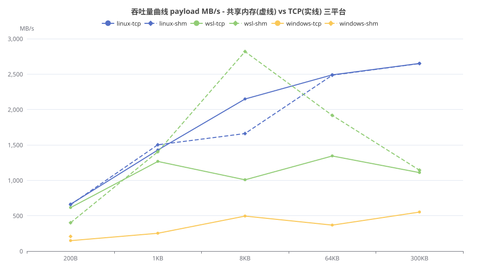

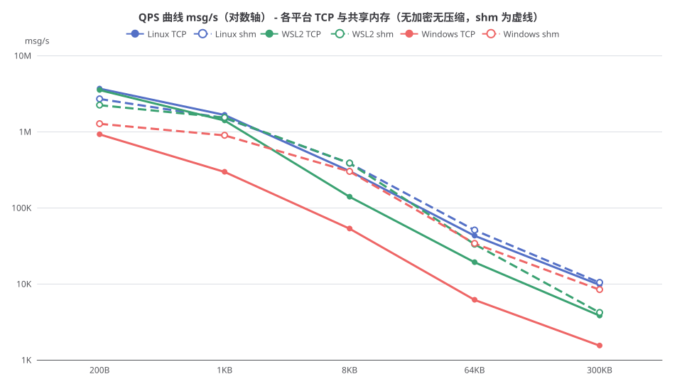

#### 4.4.1 `shm://` 吞吐量与 QPS（无加密无压缩，括号内为相对同平台 TCP 的倍数）

| 包长 | Linux (mimalloc) QPS / 吞吐量 | WSL2 (glibc) QPS / 吞吐量 | Windows (MSVC) QPS / 吞吐量 |
|---|---:|---:|---:|
| 200B | 2.68M / 510.6 MB/s (0.73x) | 2.22M / 423.7 MB/s (0.63x) | 1.26M / 240.9 MB/s (1.38x) |
| 1KB | 1.50M / 1.43 GB/s (0.91x) | 1.52M / 1.45 GB/s (1.09x) | 890.4K / 869.5 MB/s (3.02x) |
| 8KB | 381.8K / 2.91 GB/s (1.26x) | 383.7K / 2.93 GB/s (2.77x) | 298.2K / 2.28 GB/s (5.63x) |
| 64KB | 50.6K / 3.09 GB/s (1.18x) | 33.0K / 2.01 GB/s (1.73x) | 33.8K / 2.06 GB/s (5.51x) |
| 300KB | 10.4K / 2.96 GB/s (1.07x) | 4.2K / 1.19 GB/s (1.10x) | 8.3K / 2.39 GB/s (5.44x) |

- **Windows 收益最大**：从 200B（1.38x）起即快于 TCP，8KB–300KB 达到 TCP 的 5.44–5.63 倍，单核稳定输出 2.06–2.39 GB/s。
- **Linux 与 WSL2 仅在大包占优**：8KB 及以上 Linux 快 7%–26%，WSL2 在 8KB/64KB 达到 TCP 的 1.73–2.77 倍；但在 200B 小包下，Linux 和 WSL2 的 shm 反而比 TCP 慢 27% 和 37%（TCP 通道合并小包发送减少了每条消息的处理开销）。

其余 21 组带加密/压缩参数的配置在 shm 通道上相对无加密无压缩的速率比值范围（均落在明文正常波动范围内，与 shm 跳过加解密和压缩的设计一致）：

| 包长 | Linux | WSL2 | Windows |
|---|---:|---:|---:|
| 200B | 92%–103% | 97%–102% | 86%–106% |
| 1KB | 101%–108% | 97%–100% | 98%–104% |
| 8KB | 94%–100% | 98%–103% | 100%–104% |
| 64KB | 96%–100% | 101%–114% | 98%–102% |
| 300KB | 100%–100% | 97%–103% | 94%–102% |

---

### 4.5 多节点互联（2 / 10 / 100 / 1000 节点，Linux TCP）

在独立 Linux 测试机（mimalloc）上，让 `N-1` 个发送进程同时向 1 个单线程 `atbus::node` 接收节点全速发送，测量接收端聚合 QPS 与聚合吞吐量随节点数（2 / 10 / 100 / 1000）的变化。

#### 4.5.1 节点数扩展性（无加密无压缩）

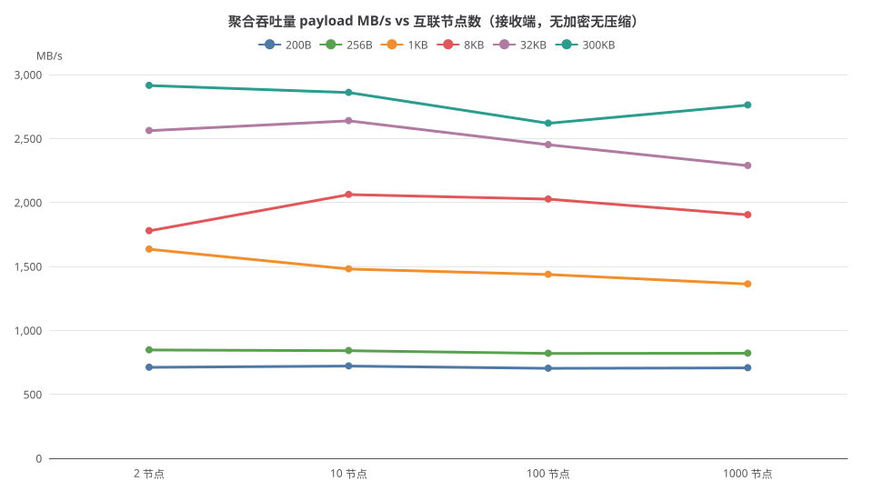

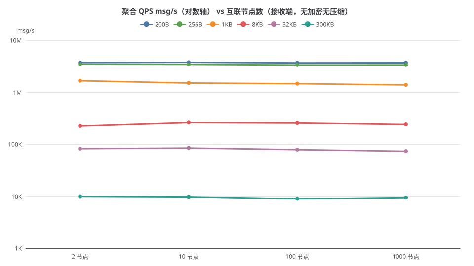

无加密无压缩时接收端的聚合 QPS（msg/s）：

| 互联节点数 | 200B | 256B | 1KB | 8KB | 32KB | 300KB |
|---|---:|---:|---:|---:|---:|---:|
| 2 | 3.73M | 3.47M | 1.67M | 227.6K | 82.0K | 9.9K |
| 10 | 3.78M | 3.45M | 1.52M | 263.9K | 84.4K | 9.8K |
| 100 | 3.69M | 3.36M | 1.47M | 259.3K | 78.4K | 8.9K |
| 1000 | 3.70M | 3.36M | 1.39M | 243.6K | 73.2K | 9.4K |

同一组合的聚合吞吐量（payload）：

| 互联节点数 | 200B | 256B | 1KB | 8KB | 32KB | 300KB |
|---|---:|---:|---:|---:|---:|---:|
| 2 | 711 MB/s | 846 MB/s | 1.60 GB/s | 1.74 GB/s | 2.50 GB/s | 2.85 GB/s |
| 10 | 721 MB/s | 841 MB/s | 1.45 GB/s | 2.01 GB/s | 2.58 GB/s | 2.79 GB/s |
| 100 | 703 MB/s | 820 MB/s | 1.40 GB/s | 1.98 GB/s | 2.39 GB/s | 2.56 GB/s |
| 1000 | 707 MB/s | 821 MB/s | 1.33 GB/s | 1.86 GB/s | 2.23 GB/s | 2.70 GB/s |

- 200B、256B 与 300KB 从 2 节点扩展到 1000 节点几乎无衰减；1KB 与 32KB 分别下降约 17% 和 11%，说明连接数大幅增加后接收端每条消息的处理耗时略有上升（原因尚未定位）。
- 8KB 档 2 节点（227.6K）低于 10 节点（263.9K），源于单流 TCP 回环在 8KB 上恰好落在低档，10–1000 节点则稳定在 243.6K–263.9K。

#### 4.5.2 1000 节点满载全组合表现与随节点数变化趋势

以下两张图展示 1000 节点（999 发 1 收）下全部 20 种加密 × 压缩组合的绝对聚合吞吐量与聚合 QPS（图例颜色与线型规则同 4.3 节），第三张图展示全部 20 组合 × 6 包长在 2 -> 10 -> 100 -> 1000 节点间相对各自 2 节点基线的变化倍率（QPS 与吞吐量的相对比值相同）。

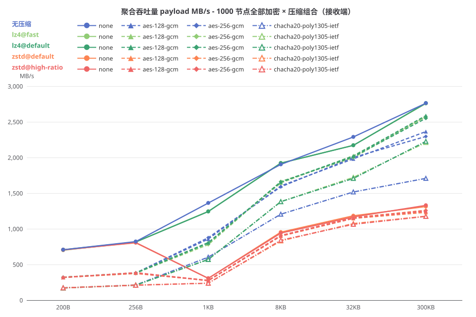

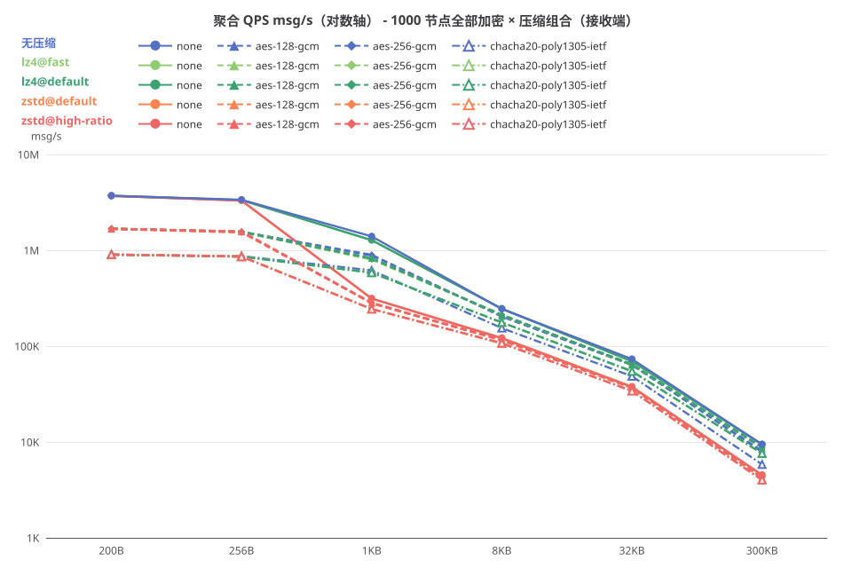

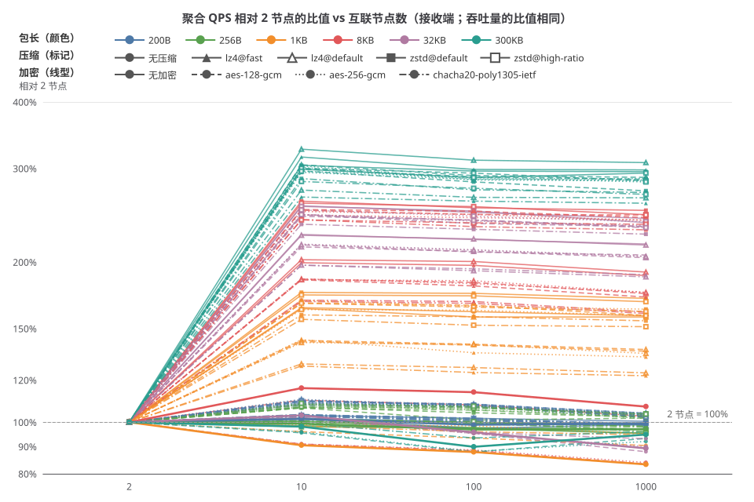

- **压缩组合在多发送端下大幅抬升**：2 节点单发单收时，lz4 和 zstd 的发送端压缩先打满单核；节点数增至 10 及以上后，发送端算力不再受限，接收端解压速度快于发送端压缩，聚合吞吐明显跳升并在 10–1000 节点保持平稳。1000 节点 300KB 下，`lz4@fast`/`lz4@default` 达到 9.4K QPS / 2.69–2.70 GB/s，与无压缩（9.4K / 2.70 GB/s）持平；`zstd@default` 在 1KB 从 183.1K 升至 312.8K，300KB 从 1.5K 升至 4.5K（1.28 GB/s）。
- **低于 100% 的曲线集中在 1KB 和 32KB 的非压缩组合**：这些组合在 2 节点时接收端即已满载，随连接数增多出现小幅下降。

#### 4.5.3 1000 节点资源消耗与事件循环观察

- **建连与注册**：最后一个发送进程启动后，999 个发送端在 0–14 秒内全部完成注册。
- **内存占用**：1000 节点的 120 组中，系统可用内存最低为 4323 MB，接收端进程峰值 RSS 最大为 334.1 MB（300KB 档）。
- **事件循环阻塞**：120 组里有 113 组出现过超过 1.5 秒的单次采样间隔，最长 12.6 秒（接收端单次 `poll()` 持续处理完当前已到达数据才返回事件循环）。

无加密无压缩、1000 节点时各包长的资源数据：

| 包长 | 接收端 QPS | 接收端 CPU | 接收端峰值 RSS | 发送端峰值 RSS（最小–最大） | 提交量 / 接收量 | 系统可用内存下限 | 最长采样间隔 |
|---|---:|---:|---:|---:|---:|---:|---:|
| 200B | 3.70M | 99.2% | 35.0 MB | 14.8–17.1 MB | 1.26 | 9014 MB | 2.5s |
| 256B | 3.36M | 99.2% | 35.2 MB | 14.8–17.0 MB | 1.12 | 10300 MB | 1.4s |
| 1KB | 1.39M | 99.2% | 35.0 MB | 14.8–15.2 MB | 1.01 | 11719 MB | 2.4s |
| 8KB | 243.6K | 99.2% | 44.9 MB | 14.8–15.2 MB | 1.04 | 8972 MB | 1.0s |
| 32KB | 73.2K | 99.1% | 72.4 MB | 16.8–17.2 MB | 1.00 | 9618 MB | 2.7s |
| 300KB | 9.4K | 99.1% | 325.4 MB | 16.3–17.2 MB | 1.00 | 4927 MB | 9.8s |

> 注：“提交量 / 接收量”中的提交量指发送端在计时窗口内写入发送缓冲的消息数，超出 1.00 的部分为发送端退出时尚留在各级缓冲区内、未送达接收端的消息。

<details>
<summary>展开 2 / 10 / 100 / 1000 节点全部 480 组完整数据表</summary>

##### 2 节点互联 - 聚合 QPS（接收端，msg/s）

| 加密 | 压缩 | 200B | 256B | 1KB | 8KB | 32KB | 300KB |
|---|---|---:|---:|---:|---:|---:|---:|
| none | 无 | 3.73M | 3.47M | 1.67M | 227.6K | 82.0K | 9.9K |
| none | lz4@fast | 3.71M | 3.44M | 803.9K | 130.4K | 32.1K | 3.2K |
| none | lz4@default | 3.72M | 3.45M | 807.1K | 128.4K | 32.3K | 3.1K |
| none | zstd@default | 3.74M | 3.46M | 183.1K | 48.8K | 15.7K | 1.5K |
| none | zstd@high-ratio | 3.67M | 3.47M | 186.0K | 49.0K | 15.7K | 1.5K |
| aes-128-gcm | 无 | 1.64M | 1.53M | 970.0K | 245.6K | 72.0K | 8.7K |
| aes-256-gcm | 无 | 1.63M | 1.51M | 942.8K | 242.0K | 71.2K | 8.5K |
| chacha20-poly1305-ietf | 无 | 910.8K | 883.0K | 651.6K | 150.4K | 52.1K | 6.1K |
| aes-128-gcm | lz4@fast | 1.63M | 1.54M | 606.6K | 122.4K | 31.4K | 3.1K |
| aes-256-gcm | lz4@fast | 1.62M | 1.51M | 601.3K | 121.4K | 31.2K | 3.1K |
| chacha20-poly1305-ietf | lz4@fast | 909.7K | 885.5K | 477.9K | 109.7K | 29.1K | 2.9K |
| aes-128-gcm | lz4@default | 1.62M | 1.52M | 603.1K | 121.5K | 31.7K | 3.1K |
| aes-256-gcm | lz4@default | 1.61M | 1.50M | 608.3K | 120.9K | 31.4K | 3.1K |
| chacha20-poly1305-ietf | lz4@default | 907.5K | 875.0K | 471.2K | 110.3K | 29.1K | 2.9K |
| aes-128-gcm | zstd@default | 1.62M | 1.54M | 175.6K | 47.4K | 15.7K | 1.5K |
| aes-256-gcm | zstd@default | 1.62M | 1.51M | 173.7K | 48.3K | 15.8K | 1.5K |
| chacha20-poly1305-ietf | zstd@default | 906.7K | 887.0K | 157.3K | 46.2K | 15.2K | 1.5K |
| aes-128-gcm | zstd@high-ratio | 1.63M | 1.52M | 175.5K | 47.4K | 15.8K | 1.5K |
| aes-256-gcm | zstd@high-ratio | 1.62M | 1.50M | 176.8K | 48.1K | 15.4K | 1.5K |
| chacha20-poly1305-ietf | zstd@high-ratio | 906.8K | 891.6K | 160.8K | 45.7K | 14.7K | 1.5K |

##### 2 节点互联 - 聚合吞吐量（接收端，payload）

| 加密 | 压缩 | 200B | 256B | 1KB | 8KB | 32KB | 300KB |
|---|---|---:|---:|---:|---:|---:|---:|
| none | 无 | 711MB/s | 846MB/s | 1.60GB/s | 1.74GB/s | 2.50GB/s | 2.85GB/s |
| none | lz4@fast | 709MB/s | 840MB/s | 785MB/s | 1019MB/s | 1004MB/s | 925MB/s |
| none | lz4@default | 710MB/s | 841MB/s | 788MB/s | 1003MB/s | 1008MB/s | 898MB/s |
| none | zstd@default | 713MB/s | 845MB/s | 179MB/s | 381MB/s | 490MB/s | 444MB/s |
| none | zstd@high-ratio | 701MB/s | 846MB/s | 182MB/s | 383MB/s | 492MB/s | 452MB/s |
| aes-128-gcm | 无 | 313MB/s | 374MB/s | 947MB/s | 1.87GB/s | 2.20GB/s | 2.48GB/s |
| aes-256-gcm | 无 | 310MB/s | 368MB/s | 921MB/s | 1.85GB/s | 2.17GB/s | 2.44GB/s |
| chacha20-poly1305-ietf | 无 | 174MB/s | 216MB/s | 636MB/s | 1.15GB/s | 1.59GB/s | 1.74GB/s |
| aes-128-gcm | lz4@fast | 311MB/s | 375MB/s | 592MB/s | 956MB/s | 982MB/s | 899MB/s |
| aes-256-gcm | lz4@fast | 308MB/s | 369MB/s | 587MB/s | 949MB/s | 974MB/s | 903MB/s |
| chacha20-poly1305-ietf | lz4@fast | 174MB/s | 216MB/s | 467MB/s | 857MB/s | 909MB/s | 857MB/s |
| aes-128-gcm | lz4@default | 309MB/s | 372MB/s | 589MB/s | 949MB/s | 990MB/s | 897MB/s |
| aes-256-gcm | lz4@default | 307MB/s | 367MB/s | 594MB/s | 945MB/s | 981MB/s | 897MB/s |
| chacha20-poly1305-ietf | lz4@default | 173MB/s | 214MB/s | 460MB/s | 862MB/s | 910MB/s | 843MB/s |
| aes-128-gcm | zstd@default | 309MB/s | 376MB/s | 172MB/s | 370MB/s | 491MB/s | 452MB/s |
| aes-256-gcm | zstd@default | 309MB/s | 368MB/s | 170MB/s | 377MB/s | 495MB/s | 439MB/s |
| chacha20-poly1305-ietf | zstd@default | 173MB/s | 217MB/s | 154MB/s | 361MB/s | 476MB/s | 436MB/s |
| aes-128-gcm | zstd@high-ratio | 310MB/s | 371MB/s | 171MB/s | 370MB/s | 494MB/s | 438MB/s |
| aes-256-gcm | zstd@high-ratio | 310MB/s | 366MB/s | 173MB/s | 376MB/s | 483MB/s | 444MB/s |
| chacha20-poly1305-ietf | zstd@high-ratio | 173MB/s | 218MB/s | 157MB/s | 357MB/s | 458MB/s | 438MB/s |

##### 10 节点互联 - 聚合 QPS（接收端，msg/s）

| 加密 | 压缩 | 200B | 256B | 1KB | 8KB | 32KB | 300KB |
|---|---|---:|---:|---:|---:|---:|---:|
| none | 无 | 3.78M | 3.45M | 1.52M | 263.9K | 84.4K | 9.8K |
| none | lz4@fast | 3.78M | 3.45M | 1.32M | 260.0K | 72.4K | 10.0K |
| none | lz4@default | 3.78M | 3.46M | 1.32M | 259.5K | 72.4K | 10.0K |
| none | zstd@default | 3.80M | 3.41M | 321.1K | 126.9K | 40.0K | 4.6K |
| none | zstd@high-ratio | 3.78M | 3.40M | 322.8K | 126.5K | 40.1K | 4.6K |
| aes-128-gcm | 无 | 1.76M | 1.63M | 931.4K | 223.4K | 73.1K | 8.3K |
| aes-256-gcm | 无 | 1.77M | 1.61M | 933.3K | 220.3K | 72.7K | 8.2K |
| chacha20-poly1305-ietf | 无 | 933.4K | 884.2K | 641.4K | 165.4K | 53.2K | 6.0K |
| aes-128-gcm | lz4@fast | 1.77M | 1.64M | 859.8K | 226.7K | 67.7K | 9.2K |
| aes-256-gcm | lz4@fast | 1.78M | 1.63M | 859.5K | 225.9K | 67.4K | 9.1K |
| chacha20-poly1305-ietf | lz4@fast | 935.3K | 890.4K | 609.3K | 186.2K | 57.4K | 7.8K |
| aes-128-gcm | lz4@default | 1.77M | 1.64M | 859.3K | 225.7K | 67.7K | 9.3K |
| aes-256-gcm | lz4@default | 1.78M | 1.63M | 858.8K | 224.0K | 67.8K | 9.2K |
| chacha20-poly1305-ietf | lz4@default | 937.6K | 886.3K | 606.3K | 186.2K | 57.5K | 7.9K |
| aes-128-gcm | zstd@default | 1.77M | 1.64M | 294.2K | 118.9K | 38.3K | 4.6K |
| aes-256-gcm | zstd@default | 1.75M | 1.63M | 294.5K | 118.5K | 38.8K | 4.5K |
| chacha20-poly1305-ietf | zstd@default | 937.3K | 899.7K | 250.2K | 111.2K | 35.9K | 4.3K |
| aes-128-gcm | zstd@high-ratio | 1.79M | 1.63M | 293.7K | 118.6K | 38.8K | 4.5K |
| aes-256-gcm | zstd@high-ratio | 1.77M | 1.63M | 287.8K | 119.9K | 38.7K | 4.5K |
| chacha20-poly1305-ietf | zstd@high-ratio | 932.8K | 887.7K | 251.0K | 109.7K | 36.0K | 4.2K |

##### 10 节点互联 - 聚合吞吐量（接收端，payload）

| 加密 | 压缩 | 200B | 256B | 1KB | 8KB | 32KB | 300KB |
|---|---|---:|---:|---:|---:|---:|---:|
| none | 无 | 721MB/s | 841MB/s | 1.45GB/s | 2.01GB/s | 2.58GB/s | 2.79GB/s |
| none | lz4@fast | 721MB/s | 843MB/s | 1.26GB/s | 1.98GB/s | 2.21GB/s | 2.85GB/s |
| none | lz4@default | 722MB/s | 845MB/s | 1.26GB/s | 1.98GB/s | 2.21GB/s | 2.86GB/s |
| none | zstd@default | 726MB/s | 833MB/s | 314MB/s | 992MB/s | 1.22GB/s | 1.32GB/s |
| none | zstd@high-ratio | 722MB/s | 829MB/s | 315MB/s | 988MB/s | 1.22GB/s | 1.32GB/s |
| aes-128-gcm | 无 | 337MB/s | 398MB/s | 910MB/s | 1.70GB/s | 2.23GB/s | 2.37GB/s |
| aes-256-gcm | 无 | 338MB/s | 393MB/s | 912MB/s | 1.68GB/s | 2.22GB/s | 2.34GB/s |
| chacha20-poly1305-ietf | 无 | 178MB/s | 216MB/s | 626MB/s | 1.26GB/s | 1.62GB/s | 1.73GB/s |
| aes-128-gcm | lz4@fast | 337MB/s | 399MB/s | 840MB/s | 1.73GB/s | 2.07GB/s | 2.63GB/s |
| aes-256-gcm | lz4@fast | 339MB/s | 399MB/s | 839MB/s | 1.72GB/s | 2.06GB/s | 2.60GB/s |
| chacha20-poly1305-ietf | lz4@fast | 178MB/s | 217MB/s | 595MB/s | 1.42GB/s | 1.75GB/s | 2.22GB/s |
| aes-128-gcm | lz4@default | 338MB/s | 401MB/s | 839MB/s | 1.72GB/s | 2.07GB/s | 2.67GB/s |
| aes-256-gcm | lz4@default | 339MB/s | 397MB/s | 839MB/s | 1.71GB/s | 2.07GB/s | 2.64GB/s |
| chacha20-poly1305-ietf | lz4@default | 179MB/s | 216MB/s | 592MB/s | 1.42GB/s | 1.75GB/s | 2.25GB/s |
| aes-128-gcm | zstd@default | 338MB/s | 401MB/s | 287MB/s | 929MB/s | 1.17GB/s | 1.31GB/s |
| aes-256-gcm | zstd@default | 334MB/s | 397MB/s | 288MB/s | 926MB/s | 1.19GB/s | 1.30GB/s |
| chacha20-poly1305-ietf | zstd@default | 179MB/s | 220MB/s | 244MB/s | 868MB/s | 1.10GB/s | 1.22GB/s |
| aes-128-gcm | zstd@high-ratio | 341MB/s | 397MB/s | 287MB/s | 927MB/s | 1.18GB/s | 1.28GB/s |
| aes-256-gcm | zstd@high-ratio | 338MB/s | 398MB/s | 281MB/s | 936MB/s | 1.18GB/s | 1.28GB/s |
| chacha20-poly1305-ietf | zstd@high-ratio | 178MB/s | 217MB/s | 245MB/s | 857MB/s | 1.10GB/s | 1.21GB/s |

##### 100 节点互联 - 聚合 QPS（接收端，msg/s）

| 加密 | 压缩 | 200B | 256B | 1KB | 8KB | 32KB | 300KB |
|---|---|---:|---:|---:|---:|---:|---:|
| none | 无 | 3.69M | 3.36M | 1.47M | 259.3K | 78.4K | 8.9K |
| none | lz4@fast | 3.71M | 3.36M | 1.30M | 257.2K | 70.8K | 9.4K |
| none | lz4@default | 3.71M | 3.35M | 1.27M | 257.5K | 71.3K | 9.5K |
| none | zstd@default | 3.64M | 3.37M | 319.8K | 123.4K | 38.9K | 4.5K |
| none | zstd@high-ratio | 3.74M | 3.38M | 321.4K | 124.6K | 39.3K | 4.4K |
| aes-128-gcm | 无 | 1.75M | 1.55M | 905.9K | 217.0K | 68.6K | 7.6K |
| aes-256-gcm | 无 | 1.75M | 1.60M | 927.3K | 214.8K | 67.8K | 7.5K |
| chacha20-poly1305-ietf | 无 | 918.8K | 877.5K | 625.8K | 162.2K | 49.9K | 5.7K |
| aes-128-gcm | lz4@fast | 1.74M | 1.62M | 847.0K | 220.9K | 65.7K | 8.9K |
| aes-256-gcm | lz4@fast | 1.75M | 1.59M | 812.5K | 221.2K | 65.8K | 8.8K |
| chacha20-poly1305-ietf | lz4@fast | 917.6K | 879.0K | 592.7K | 185.0K | 56.5K | 7.6K |
| aes-128-gcm | lz4@default | 1.75M | 1.63M | 845.6K | 222.4K | 66.4K | 8.9K |
| aes-256-gcm | lz4@default | 1.72M | 1.62M | 851.7K | 223.0K | 66.2K | 8.7K |
| chacha20-poly1305-ietf | lz4@default | 923.9K | 877.4K | 596.9K | 184.7K | 56.1K | 7.6K |
| aes-128-gcm | zstd@default | 1.75M | 1.60M | 291.3K | 118.0K | 37.7K | 4.4K |
| aes-256-gcm | zstd@default | 1.75M | 1.62M | 287.0K | 117.1K | 37.8K | 4.3K |
| chacha20-poly1305-ietf | zstd@default | 919.6K | 886.0K | 248.4K | 107.8K | 35.1K | 4.1K |
| aes-128-gcm | zstd@high-ratio | 1.75M | 1.62M | 288.9K | 116.4K | 37.4K | 4.4K |
| aes-256-gcm | zstd@high-ratio | 1.75M | 1.61M | 287.1K | 118.3K | 37.7K | 4.4K |
| chacha20-poly1305-ietf | zstd@high-ratio | 909.2K | 894.3K | 244.7K | 108.3K | 35.1K | 4.1K |

##### 100 节点互联 - 聚合吞吐量（接收端，payload）

| 加密 | 压缩 | 200B | 256B | 1KB | 8KB | 32KB | 300KB |
|---|---|---:|---:|---:|---:|---:|---:|
| none | 无 | 703MB/s | 820MB/s | 1.40GB/s | 1.98GB/s | 2.39GB/s | 2.56GB/s |
| none | lz4@fast | 708MB/s | 820MB/s | 1.24GB/s | 1.96GB/s | 2.16GB/s | 2.70GB/s |
| none | lz4@default | 708MB/s | 819MB/s | 1.21GB/s | 1.96GB/s | 2.18GB/s | 2.73GB/s |
| none | zstd@default | 694MB/s | 823MB/s | 312MB/s | 964MB/s | 1.19GB/s | 1.28GB/s |
| none | zstd@high-ratio | 713MB/s | 825MB/s | 314MB/s | 974MB/s | 1.20GB/s | 1.27GB/s |
| aes-128-gcm | 无 | 334MB/s | 377MB/s | 885MB/s | 1.66GB/s | 2.09GB/s | 2.18GB/s |
| aes-256-gcm | 无 | 334MB/s | 392MB/s | 906MB/s | 1.64GB/s | 2.07GB/s | 2.15GB/s |
| chacha20-poly1305-ietf | 无 | 175MB/s | 214MB/s | 611MB/s | 1.24GB/s | 1.52GB/s | 1.62GB/s |
| aes-128-gcm | lz4@fast | 333MB/s | 396MB/s | 827MB/s | 1.69GB/s | 2.00GB/s | 2.54GB/s |
| aes-256-gcm | lz4@fast | 333MB/s | 389MB/s | 794MB/s | 1.69GB/s | 2.01GB/s | 2.52GB/s |
| chacha20-poly1305-ietf | lz4@fast | 175MB/s | 215MB/s | 579MB/s | 1.41GB/s | 1.72GB/s | 2.18GB/s |
| aes-128-gcm | lz4@default | 334MB/s | 397MB/s | 826MB/s | 1.70GB/s | 2.03GB/s | 2.55GB/s |
| aes-256-gcm | lz4@default | 329MB/s | 395MB/s | 832MB/s | 1.70GB/s | 2.02GB/s | 2.50GB/s |
| chacha20-poly1305-ietf | lz4@default | 176MB/s | 214MB/s | 583MB/s | 1.41GB/s | 1.71GB/s | 2.18GB/s |
| aes-128-gcm | zstd@default | 334MB/s | 391MB/s | 285MB/s | 922MB/s | 1.15GB/s | 1.25GB/s |
| aes-256-gcm | zstd@default | 334MB/s | 395MB/s | 280MB/s | 915MB/s | 1.15GB/s | 1.23GB/s |
| chacha20-poly1305-ietf | zstd@default | 175MB/s | 216MB/s | 243MB/s | 842MB/s | 1.07GB/s | 1.16GB/s |
| aes-128-gcm | zstd@high-ratio | 334MB/s | 395MB/s | 282MB/s | 910MB/s | 1.14GB/s | 1.26GB/s |
| aes-256-gcm | zstd@high-ratio | 333MB/s | 392MB/s | 280MB/s | 925MB/s | 1.15GB/s | 1.25GB/s |
| chacha20-poly1305-ietf | zstd@high-ratio | 173MB/s | 218MB/s | 239MB/s | 846MB/s | 1.07GB/s | 1.18GB/s |

##### 1000 节点互联 - 聚合 QPS（接收端，msg/s）

| 加密 | 压缩 | 200B | 256B | 1KB | 8KB | 32KB | 300KB |
|---|---|---:|---:|---:|---:|---:|---:|
| none | 无 | 3.70M | 3.36M | 1.39M | 243.6K | 73.2K | 9.4K |
| none | lz4@fast | 3.67M | 3.34M | 1.27M | 246.0K | 69.5K | 9.4K |
| none | lz4@default | 3.71M | 3.34M | 1.27M | 245.9K | 69.5K | 9.4K |
| none | zstd@default | 3.70M | 3.30M | 312.8K | 122.0K | 37.9K | 4.5K |
| none | zstd@high-ratio | 3.69M | 3.31M | 313.4K | 120.4K | 37.4K | 4.5K |
| aes-128-gcm | 无 | 1.68M | 1.56M | 877.2K | 205.1K | 63.4K | 8.1K |
| aes-256-gcm | 无 | 1.68M | 1.56M | 896.9K | 203.4K | 64.1K | 7.8K |
| chacha20-poly1305-ietf | 无 | 902.9K | 869.1K | 617.2K | 154.2K | 48.5K | 5.8K |
| aes-128-gcm | lz4@fast | 1.68M | 1.57M | 825.3K | 210.4K | 64.8K | 8.8K |
| aes-256-gcm | lz4@fast | 1.68M | 1.55M | 797.9K | 213.0K | 63.9K | 8.8K |
| chacha20-poly1305-ietf | lz4@fast | 900.2K | 859.2K | 584.7K | 176.8K | 55.1K | 7.5K |
| aes-128-gcm | lz4@default | 1.68M | 1.57M | 826.0K | 211.9K | 64.6K | 8.8K |
| aes-256-gcm | lz4@default | 1.67M | 1.55M | 819.3K | 212.1K | 64.3K | 8.7K |
| chacha20-poly1305-ietf | lz4@default | 896.1K | 859.3K | 583.6K | 176.7K | 54.6K | 7.6K |
| aes-128-gcm | zstd@default | 1.68M | 1.57M | 278.9K | 114.9K | 36.7K | 4.2K |
| aes-256-gcm | zstd@default | 1.67M | 1.53M | 283.3K | 115.9K | 37.1K | 4.3K |
| chacha20-poly1305-ietf | zstd@default | 901.5K | 867.4K | 244.1K | 106.3K | 34.4K | 4.0K |
| aes-128-gcm | zstd@high-ratio | 1.66M | 1.58M | 283.5K | 116.1K | 36.9K | 4.3K |
| aes-256-gcm | zstd@high-ratio | 1.68M | 1.55M | 280.5K | 115.3K | 36.8K | 4.3K |
| chacha20-poly1305-ietf | zstd@high-ratio | 904.4K | 855.1K | 243.2K | 107.7K | 34.0K | 4.0K |

##### 1000 节点互联 - 聚合吞吐量（接收端，payload）

| 加密 | 压缩 | 200B | 256B | 1KB | 8KB | 32KB | 300KB |
|---|---|---:|---:|---:|---:|---:|---:|
| none | 无 | 707MB/s | 821MB/s | 1.33GB/s | 1.86GB/s | 2.23GB/s | 2.70GB/s |
| none | lz4@fast | 700MB/s | 815MB/s | 1.22GB/s | 1.88GB/s | 2.12GB/s | 2.69GB/s |
| none | lz4@default | 707MB/s | 815MB/s | 1.21GB/s | 1.88GB/s | 2.12GB/s | 2.70GB/s |
| none | zstd@default | 706MB/s | 805MB/s | 306MB/s | 953MB/s | 1.16GB/s | 1.28GB/s |
| none | zstd@high-ratio | 703MB/s | 808MB/s | 306MB/s | 940MB/s | 1.14GB/s | 1.30GB/s |
| aes-128-gcm | 无 | 320MB/s | 381MB/s | 857MB/s | 1.56GB/s | 1.93GB/s | 2.31GB/s |
| aes-256-gcm | 无 | 321MB/s | 381MB/s | 876MB/s | 1.55GB/s | 1.95GB/s | 2.24GB/s |
| chacha20-poly1305-ietf | 无 | 172MB/s | 212MB/s | 603MB/s | 1.18GB/s | 1.48GB/s | 1.67GB/s |
| aes-128-gcm | lz4@fast | 320MB/s | 383MB/s | 806MB/s | 1.61GB/s | 1.98GB/s | 2.51GB/s |
| aes-256-gcm | lz4@fast | 321MB/s | 379MB/s | 779MB/s | 1.62GB/s | 1.95GB/s | 2.51GB/s |
| chacha20-poly1305-ietf | lz4@fast | 172MB/s | 210MB/s | 571MB/s | 1.35GB/s | 1.68GB/s | 2.16GB/s |
| aes-128-gcm | lz4@default | 321MB/s | 382MB/s | 807MB/s | 1.62GB/s | 1.97GB/s | 2.53GB/s |
| aes-256-gcm | lz4@default | 319MB/s | 379MB/s | 800MB/s | 1.62GB/s | 1.96GB/s | 2.49GB/s |
| chacha20-poly1305-ietf | lz4@default | 171MB/s | 210MB/s | 570MB/s | 1.35GB/s | 1.67GB/s | 2.17GB/s |
| aes-128-gcm | zstd@default | 320MB/s | 384MB/s | 272MB/s | 897MB/s | 1.12GB/s | 1.20GB/s |
| aes-256-gcm | zstd@default | 318MB/s | 374MB/s | 277MB/s | 906MB/s | 1.13GB/s | 1.23GB/s |
| chacha20-poly1305-ietf | zstd@default | 172MB/s | 212MB/s | 238MB/s | 831MB/s | 1.05GB/s | 1.15GB/s |
| aes-128-gcm | zstd@high-ratio | 318MB/s | 385MB/s | 277MB/s | 907MB/s | 1.13GB/s | 1.22GB/s |
| aes-256-gcm | zstd@high-ratio | 320MB/s | 379MB/s | 274MB/s | 901MB/s | 1.12GB/s | 1.23GB/s |
| chacha20-poly1305-ietf | zstd@high-ratio | 173MB/s | 209MB/s | 238MB/s | 841MB/s | 1.04GB/s | 1.15GB/s |

</details>

---

## 5. 测试边界与待排查项

### 5.1 本次测试未覆盖的场景

使用本报告做容量估算或选型时，需注意以下边界：

- **未测量延迟分布（P50 / P99 / P99.9）**：本次全部采用背压满载发送，发送缓冲长期处于写满状态，反映的是单核最大可持续吞吐量，不能用于评估常规负载下的消息延迟。延迟分布需要以固定发包速率的开环压测单独测量。
- **未测试跨物理机真实网络**：本机回环绕过了网卡、交换机和真实网络丢包，结果代表协议栈与本机内核协议处理的 CPU 上限，不代表跨机真实带宽表现。
- **未测试多跳路由转发、双向并发及进程内 `mem://` 通道**：当前测试均为单向直连（1 对 1 或多对 1）。
- **测试负载为单一可压缩文本**：实测压缩率及压缩吞吐与业务数据熵值直接相关，高熵二进制数据或已压缩负载的压缩收益会更低。

### 5.2 本轮观察到但尚未定位原因的现象

1. **WSL2 8KB TCP 回环吞吐偏低**：无论 glibc 还是 mimalloc 均停留在约 1.06 GB/s，约为 Linux 独立测试机的一半。
2. **Windows TCP 下 AES-GCM 降幅偏大**：开启 AES-GCM 后仅为明文的 17%–40%，慢于 `chacha20-poly1305-ietf`。
3. **多节点汇聚时 1KB 与 32KB 非压缩组合吞吐小幅下降**：1000 节点下接收端单消息平均开销高于 2 节点，具体热点尚未采样确认。

---

## 6. 原始数据与复现步骤

### 6.1 原始数据索引

| 数据集 | 文件 | 说明 |
|---|---|---|
| 单对基线 TCP | [summary.linux.csv](benchmark/2026-11/summary.linux.csv) / [summary.wsl.csv](benchmark/2026-11/summary.wsl.csv) / [summary.windows.csv](benchmark/2026-11/summary.windows.csv) | 各平台 110 组 QPS、吞吐量、CPU、峰值 RSS、压缩率、协商结果与稳定时长 `steady_sec` |
| 分配器对照 | [summary.wsl_mimalloc.csv](benchmark/2026-11/summary.wsl_mimalloc.csv) | WSL2 使用 mimalloc 运行的 110 组完整结果 |
| 共享内存通道 | [summary.linux_shm.csv](benchmark/2026-11/summary.linux_shm.csv) / [summary.wsl_shm.csv](benchmark/2026-11/summary.wsl_shm.csv) / [summary.windows_shm.csv](benchmark/2026-11/summary.windows_shm.csv) | 三平台 `shm://` 通道各 110 组结果（按设计均协商为 `none/none`） |
| 交互式图表 | [benchmark_charts.html](benchmark/2026-11/benchmark_charts.html) | 自包含单对基线交互图表（含逐秒 QPS 序列） |
| 多节点互联 | [multi_summary.csv](benchmark/2026-11/multi_summary.csv) / [node-count-effect.echarts.json](benchmark/2026-11/node-count-effect.echarts.json) | 2 / 10 / 100 / 1000 节点共 480 组完整指标及变化倍率图配置 |

### 6.2 单对基线复现步骤

测试工具源码：[benchmark_node_stream_send.cpp](../tools/benchmark_node_stream_send.cpp)、[benchmark_node_stream_recv.cpp](../tools/benchmark_node_stream_recv.cpp)。

```bash
# 1. 配置与构建（Linux/WSL 示例；Windows 使用对应生成器并加 --config Release）
cd atframework/libatbus
./cmake_dev.sh -l -r build_jobs_linux -- -DCMAKE_BUILD_TYPE=Release -DPROJECT_ENABLE_SAMPLE=OFF -DPROJECT_ENABLE_UNITTEST=OFF
cmake --build build_jobs_linux --target benchmark_node_stream_recv benchmark_node_stream_send -j 8

# 2. 运行 TCP 完整矩阵（22 组合 × 5 包长，每组 15 秒；sender 自动监听 port+1）
#    端口需避开系统临时端口范围（ip_local_port_range），避免端口冲突
bash tools/script/benchmark_node_stream_matrix.sh \
  build_jobs_linux/tools build_jobs_linux/_agent_tmp/bench_results/<平台名> 15 ipv4://127.0.0.1:15000
# Windows:
# pwsh tools/script/benchmark_node_stream_matrix.ps1 -BinDir <...> -ResultDir <...> -DurationSec 15 -Address ipv4://127.0.0.1:15000

# 3. 共享内存通道版本（receiver 额外监听 shm://key，数据通道自动切为 shm）
bash tools/script/benchmark_node_stream_matrix.sh \
  build_jobs_linux/tools build_jobs_linux/_agent_tmp/bench_results/<平台名>_shm 15 ipv4://127.0.0.1:15000 shm://0x5A5A1001
# Windows: 追加 -ShmAddress 'shm://0x5A5A5002'

# 4. mimalloc 对照（Linux/WSL，通过 LD_PRELOAD 注入收发进程）
PRELOAD_LIB=<mimalloc-build>/libmimalloc.so.2.1 bash tools/script/benchmark_node_stream_matrix.sh ...

# 5. 生成汇总表格、SVG 曲线图与交互 HTML（需安装 node 与 echarts）
node tools/script/benchmark_node_stream_report.mjs <结果目录1> <结果目录2> ... --out <报告输出目录> --html
# 也可直接基于归档 CSV 重渲染全部 SVG 图表（加 --charts-only 与 --label）：
# node tools/script/benchmark_node_stream_report.mjs docs/benchmark/2026-11/summary.*.csv --out docs/benchmark/2026-11 --charts-only
```

### 6.3 多节点互联复现步骤

批量运行脚本：[benchmark_multinode_matrix.sh](../tools/script/benchmark_multinode_matrix.sh)；汇总出图脚本：[benchmark_multinode_report.mjs](../tools/script/benchmark_multinode_report.mjs)。

```bash
# 1. 独立静态构建（与单对基线一致）
cmake -S atframework/libatbus -B <BUILD_DIR>/libatbus -G Ninja -DCMAKE_BUILD_TYPE=Release \
      -DBUILD_SHARED_LIBS=OFF -DATFRAMEWORK_USE_DYNAMIC_LIBRARY=OFF -DPROJECT_ENABLE_TOOLS=ON
cmake --build <BUILD_DIR>/libatbus --target benchmark_node_stream_recv benchmark_node_stream_send

# 2. 在测试机上运行多节点矩阵（节点数超过 256 时自动将发送缓冲限为 1 MB）
export PRELOAD_LIB=<libmimalloc.so 路径>
bash benchmark_multinode_matrix.sh <bin_dir> results 10 15000 > matrix.log 2>&1

# 3. 汇总 CSV、表格与全部 SVG 图表（ECHARTS_NODE_MODULES 指向包含 echarts 的 node_modules）
node tools/script/benchmark_multinode_report.mjs results matrix.log --out report
# 也可直接基于归档 multi_summary.csv 重渲染全部 SVG 图表：
# node tools/script/benchmark_multinode_report.mjs --from-csv docs/benchmark/2026-11/multi_summary.csv --out docs/benchmark/2026-11 --charts-only
```

---

## 附录：历史数据（2016-07-07 裸通道层测试）

> 以下数据测于旧版 `io_stream` 与 `shm` 裸通道压测工具，不含 v2 协议封装、Protobuf、加密和压缩开销，硬件与编译环境也不同，仅作历史存档参考，不能与上文全协议栈结果直接对比。

<details>
<summary>展开 2016-07-07 裸通道层测试环境、结果与命令</summary>

### 环境

- 系统与编译器：CentOS 7.1，GCC 4.8.5
- CPU：Xeon E3-1230 v2 3.30 GHz × 8（收发各用 1 核）
- 内存：24 GB
- 网络：千兆网卡 × 1
- 编译选项：`-O2 -g -DNDEBUG -ggdb -Wall -Werror -Wno-unused-local-typedefs -std=gnu++11 -D_POSIX_MT_`
- 配置选项：`-DATBUS_MACRO_BUSID_TYPE=uint64_t -DATBUS_MACRO_CONNECTION_BACKLOG=128 -DATBUS_MACRO_CONNECTION_CONFIRM_TIMEOUT=30 -DATBUS_MACRO_DATA_ALIGN_TYPE=uint64_t -DATBUS_MACRO_DATA_NODE_SIZE=128 -DATBUS_MACRO_DATA_SMALL_SIZE=3072 -DATBUS_MACRO_HUGETLB_SIZE=4194304 -DATBUS_MACRO_MSG_LIMIT=65536`

### 结果

| 测试项 | 连接数 | 包长度 | CPU 消耗 | 内存消耗 | 吞吐量 | QPS |
|---|---:|---|---:|---:|---:|---:|
| Linux + 本地回环 + IPv6 + 静态缓冲区 | 1 | 8–16384 字节 | 90%/100% | 5.8 MB / 24 MB | 601 MB/s | 95K/s |
| Linux + 本地回环 + IPv6 + 静态缓冲区 | 1 | 8–128 字节（模拟 ping 包） | 48%/100% | 5.8 MB / 27 MB | 163 MB/s | 2822K/s |
| Linux + 本地回环 + IPv6 + 动态缓冲区（ptmalloc） | 1 | 8–16384 字节 | 90%/100% | 5.8 MB / 24 MB | 607 MB/s | 96K/s |
| Linux + 本地回环 + IPv6 + 动态缓冲区（ptmalloc） | 1 | 8–128 字节（模拟 ping 包） | 48%/100% | 5.8 MB / 27 MB | 165 MB/s | 2857K/s |
| Linux + 共享内存 | 1 | 8–16384 字节 | 98%/98% | 74 MB / 74 MB | 1.56 GB/s | 199K/s |
| Linux + 共享内存 | 1 | 8–128 字节（模拟 ping 包） | 100%/83% | 74 MB / 74 MB | 303 MB/s | 5253K/s |

### 说明与复现命令

1. 动态缓冲区指发送端使用 `malloc`/`free` 管理发送中数据，静态缓冲区指使用内置内存池。
2. 发送端因包含随机数生成，CPU 消耗高于无业务逻辑的接收端，动态缓冲区模式下因内存碎片在 3 分钟内从 20 MB 涨至 28 MB。
3. 当时未在 Windows 下运行压测，也未实现多连接压测工具。

```bash
# 需先将 tools/script 中的脚本复制到 <构建目录>/tools 下
./startup_benchmark_io_stream.sh ipv6://::1:16389 2048 4194304 8096
./startup_benchmark_io_stream.sh ipv6://::1:16389 16 4194304 8096
./startup_benchmark_io_stream.sh ipv6://::1:16389 2048 4194304 0
./startup_benchmark_io_stream.sh ipv6://::1:16389 16 4194304 0
./startup_benchmark_shm.sh 12345679 2048
./startup_benchmark_shm.sh 12345679 16
```

</details>
