Benchmark - Node层完整协议栈 TCP (Run On 2026-11-18)
======

本次测试针对 `atbus::node` 层完整协议栈（v2 协议：帧封装 + protobuf + 握手 + ECDH 密钥交换 + 加密 + 压缩）的 TCP 通道，
覆盖 加密算法 × 压缩算法 × 压缩+加密组合 × 包长 × 平台（**真实 Linux 物理机 / WSL2 / Windows 原生**），
每组独立运行且 0 失败，记录 QPS、吞吐量、CPU 消耗、内存消耗；并在真实 Linux 与 WSL2 上对比了 mimalloc
内存分配器的影响。

测试组结构（每平台 110 组 = 22 种组合 × 5 种包长）：

- **加密维度**（6 组，无压缩）：`none`、`aes-128-gcm`、`aes-192-gcm`、`aes-256-gcm`、`chacha20`、`chacha20-poly1305-ietf`
- **压缩维度**（4 组，无加密）：`lz4@fast`、`lz4@default`、`zstd@default`（即协议统一等级 BALANCED，zstd 映射为 level 3，
  报告中按协议语义记作 default）、`zstd@high-ratio`（level 6）
- **压缩+加密组合**（12 组）：上述 4 种压缩 × `aes-128-gcm` / `aes-256-gcm` / `chacha20-poly1305-ietf`
- **包长**（5 档）：200B、1KB、8KB、64KB、300KB

以上组合在 **TCP 通道**与**共享内存（shm://）通道**上各跑一轮（shm 拓扑：收端 `listen(shm://key)`，
发端 TCP 控制连接握手后数据通道自动升级为单工 shm 写端），TCP 结果见各平台小节，shm 见结论第 6 节及
"共享内存通道（shm://）补充测试"章节。

环境
------

| 项目 | 真实 Linux（benchmark 机） | WSL2 (Debian) | Windows 原生 |
|---|---|---|---|
| 角色 | 独立测试机（经跳板机访问） | 本机 WSL2 VM | 本机 |
| CPU | AMD Ryzen 9 9950X，8 vCPU（PVE 虚拟机） | AMD Ryzen 7 9700X，`.wslconfig` 限制 8 逻辑处理器（**4 物理核 × 2 SMT**） | AMD Ryzen 7 9700X（8C/16T） |
| 内存 | 16GB | 20GB | 93.4GB |
| 系统 | Debian GNU/Linux 13 (trixie)，PVE 内核 7.0.14-20-pve | Debian GNU/Linux 13，内核 6.18.58.1-microsoft-standard-WSL2 | Windows 11 专业版 26H2 |
| 编译器 | GCC 14.2.0（WSL 构建后传输二进制） | GCC 14.2.0 | MSVC（Visual Studio 2026 Community） |
| 编译选项 | Release（-O3 -DNDEBUG，Ninja） | 同左 | Release（/O2，多配置生成器） |
| 仓库位置 | WSL 构建产物直接传输执行（glibc 2.41 与构建机一致，仅依赖系统库 libcrypto.so.3/libzstd/libz） | WSL 原生 ext4（~/workspace），不经过 /mnt 挂载点 | NTFS（D:\） |
| 分配器 | **mimalloc v2.1.9（LD_PRELOAD）** | glibc PtMalloc（主表）；mimalloc 对照组另测 | MSVC CRT |
| CMake 选项 | -DPROJECT_ENABLE_TOOLS=ON -DBUILD_SHARED_LIBS=OFF | 同左 | 同左 |
| 网络 | 本机 TCP 回环 `ipv4://127.0.0.1` | 同左 | 同左 |

说明：真实 Linux 按需求以 **mimalloc PRELOAD 运行**（体现最高性能场景）。为使 WSL vs 真机损耗分析公平，
WSL 侧额外用 mimalloc 跑了同一矩阵做分配器对齐对比（见结论第 2 节）；WSL 主表与 Windows 主表保持各平台
默认分配器（glibc / MSVC CRT），mimalloc 的通用收益见结论第 4 节。

测试方法
------

### 拓扑与驱动

1. 收发两个独立进程各运行一个 `atbus::node`，各自占满一个核心；**两端都 listen 并广播地址**（sender 通过
   `--listen` 监听 `port+1`），sender 主动连接 receiver，receiver 的 connect-back 与 sender 的广播地址建立
   数据连接——即真实的 ctrl + data 双连接部署形态。（早期版本 sender 不 listen 会退化为自连接并把洪泛流量
   错误地落到控制连接上，产生虚假的快/慢吞吐档位，已修正，详见结论第 6 节。）
2. sender 以固定包长（200B / 1KB / 8KB / 64KB / 300KB）全速灌包：`send_data` 直到发送缓冲区（8MB）触发
   `EN_ATBUS_ERR_BUFF_LIMIT` 背压，随后在 `poll()` 中等待写队列排空再继续，即测量"单连接最大可持续速率"。
3. receiver 忙轮询 `node->poll()` 收包并逐消息计数，仅做轻量校验（消息内嵌单调递增序号检查）。
4. 每组运行 15 秒，每秒采样一次；统计窗口丢弃前 2 秒（连接/握手/warmup）和最后 1 秒（drain），取中间每秒
   采样的均值。所有运行均校验协商结果与请求一致、序号回退/跳变（仅出现在被丢弃的 warmup 窗口）不影响统计窗口。
5. payload 为确定性生成的类 JSON 结构化文本（字段名/数值/标签可变），单独测量其压缩率作为参照；zstd-3 对该
   payload 的实测压缩率约为 4.2x（24%）。
6. 加密协商统一使用 X25519 密钥交换 + HKDF-SHA256，key 刷新间隔 24h（远大于单次运行时长，测试中不会重新协商）。

### 指标口径

- **QPS**：receiver 每秒收到的消息数（payload 消息，不含协议控制帧）。
- **吞吐量**：receiver 每秒收到的 payload 字节数（应用层口径，不含协议头/加密膨胀/压缩缩减）。
- **CPU 消耗**：进程级 user+system 时间（`uv_getrusage`）。驱动模式就是"打满单核测瓶颈速率"，
  正常组合收/发两端都接近 100%（速率即单核上限）。
- **内存消耗**：进程峰值 RSS（`uv_getrusage` 的 `ru_maxrss`）。
- **实测压缩率**：由 sender 独立调用 `atfw::util::compression` 用相同算法/等级压缩 payload 测得（压缩后/原始字节数），
  表示该 payload 的可压性，不等于协议栈实际缩减的线上流量（协议栈压缩对象是 protobuf body）。

### 运行方差与测量可信度

TCP loopback 单流吞吐存在**批次级双稳态**：同一配置在不同批次测量会整体落在不同吞吐档位（批次内逐秒波动
很小，跨批次可达 ±30%-40%）。因此：

- 同批次内交错运行的 A/B 对比（如 mimalloc 对照、同批次内的算法排序）可信；
- 表格中 64KB/300KB 的**绝对值波动可达 ±30%-40%**，跨组合 ±30% 以内的差异不具统计意义；
- 重复测量数据见结论第 6 节。

> 注意：协议栈对消息 body 有压缩阈值（`_allow_compress`：数据转换消息 body ≥ 1024B 才启用压缩），
> 因此 **200B 档位实际不压缩**，其压缩组的结果应视为"无压缩"的重复采样；表中"实测压缩率"列是该 payload
> 独立压缩的可压性参照，不代表 200B 档位的线上流量缩减。

结果
------

曲线图（payload 尺寸为横轴，吞吐量/QPS 为纵轴，便于跨包长对比同一配置的性能走势）与柱状图均为离线渲染的
SVG（GitHub 直接渲染）；交互式全数据图表见
[benchmark/2026-11/benchmark_charts.html](benchmark/2026-11/benchmark_charts.html)（自包含 HTML，下载后浏览器打开）。

### 平台总览曲线（无加密无压缩）


### 真实 Linux (Debian 13, GCC 14.2, -O3, mimalloc)

#### 加密对比（无压缩）

| 加密 | 压缩 | 包长 | QPS | 吞吐量(payload) | CPU 收/发 | 峰值内存 收/发 | 实测压缩率 |
|---|---|---:|---:|---:|---|---|---:|
| none | none@default | 200B | 3.47M | 662.7MB/s | 100%/100% | 15.2/25.3MB | - |
| aes-128-gcm | none@default | 200B | 1.53M | 290.9MB/s | 100%/100% | 15.3/25.5MB | - |
| aes-192-gcm | none@default | 200B | 1.54M | 294.0MB/s | 100%/101% | 15.0/25.5MB | - |
| aes-256-gcm | none@default | 200B | 1.50M | 285.2MB/s | 100%/100% | 15.3/25.3MB | - |
| chacha20 | none@default | 200B | 352.1K | 67.2MB/s | 100%/101% | 15.2/25.2MB | - |
| chacha20-poly1305-ietf | none@default | 200B | 865.1K | 165.0MB/s | 100%/101% | 15.1/25.0MB | - |
| none | none@default | 1KB | 1.46M | 1.39GB/s | 100%/100% | 14.8/25.2MB | - |
| aes-128-gcm | none@default | 1KB | 934.1K | 912.2MB/s | 100%/100% | 15.3/25.3MB | - |
| aes-192-gcm | none@default | 1KB | 901.5K | 880.4MB/s | 100%/100% | 15.3/25.4MB | - |
| aes-256-gcm | none@default | 1KB | 911.8K | 890.4MB/s | 100%/100% | 15.3/25.5MB | - |
| chacha20 | none@default | 1KB | 92.9K | 90.7MB/s | 100%/103% | 15.2/25.0MB | - |
| chacha20-poly1305-ietf | none@default | 1KB | 609.7K | 595.4MB/s | 100%/100% | 15.3/25.1MB | - |
| none | none@default | 8KB | 275.0K | 2.10GB/s | 100%/100% | 15.0/25.1MB | - |
| aes-128-gcm | none@default | 8KB | 182.7K | 1.39GB/s | 100%/100% | 15.3/25.4MB | - |
| aes-192-gcm | none@default | 8KB | 220.4K | 1.68GB/s | 100%/100% | 15.3/25.6MB | - |
| aes-256-gcm | none@default | 8KB | 223.6K | 1.71GB/s | 100%/100% | 15.1/25.4MB | - |
| chacha20 | none@default | 8KB | 12.2K | 95.1MB/s | 100%/103% | 15.3/25.1MB | - |
| chacha20-poly1305-ietf | none@default | 8KB | 140.1K | 1.07GB/s | 100%/100% | 15.3/25.3MB | - |
| none | none@default | 64KB | 39.8K | 2.43GB/s | 100%/100% | 15.0/27.3MB | - |
| aes-128-gcm | none@default | 64KB | 35.4K | 2.16GB/s | 100%/100% | 15.3/27.5MB | - |
| aes-192-gcm | none@default | 64KB | 35.5K | 2.17GB/s | 100%/100% | 15.2/27.5MB | - |
| aes-256-gcm | none@default | 64KB | 34.9K | 2.13GB/s | 100%/100% | 15.3/27.5MB | - |
| chacha20 | none@default | 64KB | 1.7K | 103.4MB/s | 100%/101% | 15.3/26.7MB | - |
| chacha20-poly1305-ietf | none@default | 64KB | 26.6K | 1.63GB/s | 100%/100% | 15.3/27.4MB | - |
| none | none@default | 300KB | 9.0K | 2.59GB/s | 100%/100% | 15.0/23.3MB | - |
| aes-128-gcm | none@default | 300KB | 7.8K | 2.25GB/s | 100%/100% | 15.2/25.4MB | - |
| aes-192-gcm | none@default | 300KB | 7.8K | 2.23GB/s | 100%/100% | 15.3/25.3MB | - |
| aes-256-gcm | none@default | 300KB | 7.8K | 2.22GB/s | 100%/100% | 15.0/25.4MB | - |
| chacha20 | none@default | 300KB | 345 | 101.1MB/s | 102%/102% | 15.0/25.2MB | - |
| chacha20-poly1305-ietf | none@default | 300KB | 6.0K | 1.72GB/s | 100%/100% | 15.0/25.1MB | - |

#### 压缩对比（无加密）

| 加密 | 压缩 | 包长 | QPS | 吞吐量(payload) | CPU 收/发 | 峰值内存 收/发 | 实测压缩率 |
|---|---|---:|---:|---:|---|---|---:|
| none | none@default | 200B | 3.47M | 662.7MB/s | 100%/100% | 15.2/25.3MB | - |
| none | lz4@fast | 200B | 3.43M | 654.5MB/s | 100%/100% | 15.3/25.1MB | 76.6% |
| none | lz4@default | 200B | 3.46M | 660.5MB/s | 100%/100% | 15.0/25.2MB | 76.6% |
| none | zstd@default | 200B | 3.46M | 659.4MB/s | 100%/100% | 15.3/25.1MB | 66.1% |
| none | zstd@high-ratio | 200B | 3.46M | 659.9MB/s | 100%/100% | 14.8/25.3MB | 65.6% |
| none | none@default | 1KB | 1.46M | 1.39GB/s | 100%/100% | 14.8/25.2MB | - |
| none | lz4@fast | 1KB | 781.9K | 763.6MB/s | 100%/100% | 15.3/25.3MB | 55.5% |
| none | lz4@default | 1KB | 779.4K | 761.2MB/s | 100%/101% | 15.0/25.2MB | 55.5% |
| none | zstd@default | 1KB | 175.0K | 170.9MB/s | 100%/101% | 15.3/25.4MB | 35.2% |
| none | zstd@high-ratio | 1KB | 174.2K | 170.1MB/s | 100%/101% | 15.2/25.2MB | 33.3% |
| none | none@default | 8KB | 275.0K | 2.10GB/s | 100%/100% | 15.0/25.1MB | - |
| none | lz4@fast | 8KB | 121.3K | 947.9MB/s | 100%/101% | 15.0/25.4MB | 45.9% |
| none | lz4@default | 8KB | 121.2K | 947.2MB/s | 100%/101% | 15.0/25.3MB | 45.9% |
| none | zstd@default | 8KB | 46.1K | 360.1MB/s | 100%/106% | 15.2/25.1MB | 24.2% |
| none | zstd@high-ratio | 8KB | 46.1K | 360.3MB/s | 100%/106% | 15.0/25.4MB | 21.9% |
| none | none@default | 64KB | 39.8K | 2.43GB/s | 100%/100% | 15.0/27.3MB | - |
| none | lz4@fast | 64KB | 18.4K | 1.12GB/s | 100%/100% | 15.0/25.1MB | 43.6% |
| none | lz4@default | 64KB | 18.7K | 1.14GB/s | 100%/101% | 15.1/25.4MB | 43.6% |
| none | zstd@default | 64KB | 8.0K | 502.1MB/s | 100%/103% | 15.2/23.4MB | 23.8% |
| none | zstd@high-ratio | 64KB | 8.0K | 502.7MB/s | 100%/103% | 15.2/23.3MB | 21.0% |
| none | none@default | 300KB | 9.0K | 2.59GB/s | 100%/100% | 15.0/23.3MB | - |
| none | lz4@fast | 300KB | 3.0K | 864.2MB/s | 100%/101% | 15.3/27.2MB | 38.3% |
| none | lz4@default | 300KB | 2.9K | 861.7MB/s | 100%/101% | 15.1/27.3MB | 38.3% |
| none | zstd@default | 300KB | 1.6K | 455.5MB/s | 100%/103% | 15.0/27.3MB | 23.4% |
| none | zstd@high-ratio | 300KB | 1.4K | 424.2MB/s | 100%/104% | 15.0/27.2MB | 20.6% |

#### 压缩+加密组合

| 加密 | 压缩 | 包长 | QPS | 吞吐量(payload) | CPU 收/发 | 峰值内存 收/发 | 实测压缩率 |
|---|---|---:|---:|---:|---|---|---:|
| aes-128-gcm | lz4@fast | 200B | 1.53M | 291.7MB/s | 100%/100% | 15.3/25.4MB | 76.6% |
| aes-256-gcm | lz4@fast | 200B | 1.51M | 287.7MB/s | 100%/100% | 15.0/25.4MB | 76.6% |
| chacha20-poly1305-ietf | lz4@fast | 200B | 850.6K | 162.2MB/s | 100%/100% | 15.3/25.0MB | 76.6% |
| aes-128-gcm | lz4@default | 200B | 1.53M | 292.7MB/s | 100%/100% | 15.3/25.2MB | 76.6% |
| aes-256-gcm | lz4@default | 200B | 1.51M | 288.2MB/s | 100%/100% | 15.3/25.4MB | 76.6% |
| chacha20-poly1305-ietf | lz4@default | 200B | 857.1K | 163.5MB/s | 100%/101% | 15.3/25.2MB | 76.6% |
| aes-128-gcm | zstd@default | 200B | 1.54M | 294.6MB/s | 100%/100% | 15.2/25.5MB | 66.1% |
| aes-256-gcm | zstd@default | 200B | 1.45M | 277.5MB/s | 100%/100% | 15.3/25.2MB | 66.1% |
| chacha20-poly1305-ietf | zstd@default | 200B | 860.3K | 164.1MB/s | 100%/101% | 15.2/25.2MB | 66.1% |
| aes-128-gcm | zstd@high-ratio | 200B | 1.54M | 293.9MB/s | 100%/100% | 15.1/25.5MB | 65.6% |
| aes-256-gcm | zstd@high-ratio | 200B | 1.52M | 290.1MB/s | 100%/100% | 15.3/25.5MB | 65.6% |
| chacha20-poly1305-ietf | zstd@high-ratio | 200B | 861.8K | 164.4MB/s | 100%/101% | 15.3/25.2MB | 65.6% |
| aes-128-gcm | lz4@fast | 1KB | 567.3K | 554.0MB/s | 100%/101% | 15.3/23.3MB | 55.5% |
| aes-256-gcm | lz4@fast | 1KB | 571.7K | 558.3MB/s | 100%/101% | 15.2/23.3MB | 55.5% |
| chacha20-poly1305-ietf | lz4@fast | 1KB | 444.9K | 434.5MB/s | 100%/101% | 15.2/23.2MB | 55.5% |
| aes-128-gcm | lz4@default | 1KB | 559.4K | 546.3MB/s | 100%/100% | 15.5/23.5MB | 55.5% |
| aes-256-gcm | lz4@default | 1KB | 561.8K | 548.6MB/s | 100%/101% | 15.3/23.3MB | 55.5% |
| chacha20-poly1305-ietf | lz4@default | 1KB | 440.5K | 430.2MB/s | 100%/101% | 15.3/23.3MB | 55.5% |
| aes-128-gcm | zstd@default | 1KB | 164.9K | 161.0MB/s | 100%/105% | 15.3/25.3MB | 35.2% |
| aes-256-gcm | zstd@default | 1KB | 166.6K | 162.7MB/s | 100%/105% | 15.5/25.7MB | 35.2% |
| chacha20-poly1305-ietf | zstd@default | 1KB | 148.3K | 144.8MB/s | 100%/102% | 15.2/25.4MB | 35.2% |
| aes-128-gcm | zstd@high-ratio | 1KB | 166.1K | 162.2MB/s | 100%/105% | 15.3/25.5MB | 33.3% |
| aes-256-gcm | zstd@high-ratio | 1KB | 166.4K | 162.5MB/s | 100%/105% | 15.5/25.5MB | 33.3% |
| chacha20-poly1305-ietf | zstd@high-ratio | 1KB | 150.9K | 147.3MB/s | 100%/101% | 15.3/25.4MB | 33.3% |
| aes-128-gcm | lz4@fast | 8KB | 113.4K | 886.2MB/s | 100%/101% | 15.1/25.3MB | 45.9% |
| aes-256-gcm | lz4@fast | 8KB | 114.3K | 892.9MB/s | 100%/101% | 15.3/25.4MB | 45.9% |
| chacha20-poly1305-ietf | lz4@fast | 8KB | 102.7K | 802.5MB/s | 100%/101% | 15.1/25.1MB | 45.9% |
| aes-128-gcm | lz4@default | 8KB | 113.9K | 889.6MB/s | 100%/100% | 15.1/25.4MB | 45.9% |
| aes-256-gcm | lz4@default | 8KB | 114.0K | 890.6MB/s | 100%/100% | 15.0/25.3MB | 45.9% |
| chacha20-poly1305-ietf | lz4@default | 8KB | 103.0K | 804.7MB/s | 100%/100% | 15.2/25.4MB | 45.9% |
| aes-128-gcm | zstd@default | 8KB | 45.1K | 352.5MB/s | 100%/106% | 15.4/25.3MB | 24.2% |
| aes-256-gcm | zstd@default | 8KB | 45.1K | 352.4MB/s | 100%/106% | 15.5/25.7MB | 24.2% |
| chacha20-poly1305-ietf | zstd@default | 8KB | 43.4K | 339.3MB/s | 100%/102% | 15.2/25.5MB | 24.2% |
| aes-128-gcm | zstd@high-ratio | 8KB | 45.1K | 352.6MB/s | 100%/105% | 15.3/25.7MB | 21.9% |
| aes-256-gcm | zstd@high-ratio | 8KB | 44.9K | 351.1MB/s | 100%/106% | 15.5/25.7MB | 21.9% |
| chacha20-poly1305-ietf | zstd@high-ratio | 8KB | 43.5K | 339.5MB/s | 100%/102% | 15.3/25.3MB | 21.9% |
| aes-128-gcm | lz4@fast | 64KB | 18.2K | 1.11GB/s | 100%/100% | 15.3/25.3MB | 43.6% |
| aes-256-gcm | lz4@fast | 64KB | 18.2K | 1.11GB/s | 100%/101% | 15.3/25.6MB | 43.6% |
| chacha20-poly1305-ietf | lz4@fast | 64KB | 16.8K | 1.02GB/s | 100%/101% | 15.0/25.0MB | 43.6% |
| aes-128-gcm | lz4@default | 64KB | 18.1K | 1.11GB/s | 100%/101% | 15.5/25.4MB | 43.6% |
| aes-256-gcm | lz4@default | 64KB | 18.0K | 1.10GB/s | 100%/101% | 15.1/25.2MB | 43.6% |
| chacha20-poly1305-ietf | lz4@default | 64KB | 16.7K | 1.02GB/s | 100%/100% | 15.2/25.3MB | 43.6% |
| aes-128-gcm | zstd@default | 64KB | 8.0K | 498.3MB/s | 100%/103% | 15.1/23.6MB | 23.8% |
| aes-256-gcm | zstd@default | 64KB | 8.0K | 501.3MB/s | 100%/104% | 15.5/23.7MB | 23.8% |
| chacha20-poly1305-ietf | zstd@default | 64KB | 7.7K | 483.5MB/s | 100%/102% | 15.0/23.5MB | 23.8% |
| aes-128-gcm | zstd@high-ratio | 64KB | 8.0K | 497.7MB/s | 100%/104% | 15.6/23.6MB | 21.0% |
| aes-256-gcm | zstd@high-ratio | 64KB | 7.8K | 489.5MB/s | 100%/103% | 15.5/23.5MB | 21.0% |
| chacha20-poly1305-ietf | zstd@high-ratio | 64KB | 7.6K | 477.5MB/s | 100%/103% | 15.1/23.4MB | 21.0% |
| aes-128-gcm | lz4@fast | 300KB | 2.8K | 819.8MB/s | 100%/101% | 15.3/27.6MB | 38.3% |
| aes-256-gcm | lz4@fast | 300KB | 2.9K | 846.1MB/s | 100%/101% | 15.3/27.3MB | 38.3% |
| chacha20-poly1305-ietf | lz4@fast | 300KB | 2.7K | 801.3MB/s | 100%/101% | 15.1/25.3MB | 38.3% |
| aes-128-gcm | lz4@default | 300KB | 2.9K | 851.2MB/s | 100%/101% | 15.2/27.4MB | 38.3% |
| aes-256-gcm | lz4@default | 300KB | 2.9K | 844.2MB/s | 100%/101% | 15.0/27.3MB | 38.3% |
| chacha20-poly1305-ietf | lz4@default | 300KB | 2.7K | 804.4MB/s | 100%/101% | 15.1/25.0MB | 38.3% |
| aes-128-gcm | zstd@default | 300KB | 1.5K | 453.2MB/s | 100%/104% | 15.6/27.7MB | 23.4% |
| aes-256-gcm | zstd@default | 300KB | 1.5K | 453.2MB/s | 100%/104% | 15.3/27.6MB | 23.4% |
| chacha20-poly1305-ietf | zstd@default | 300KB | 1.5K | 440.7MB/s | 100%/106% | 15.1/27.4MB | 23.4% |
| aes-128-gcm | zstd@high-ratio | 300KB | 1.5K | 453.8MB/s | 100%/104% | 15.5/27.6MB | 20.6% |
| aes-256-gcm | zstd@high-ratio | 300KB | 1.5K | 450.8MB/s | 100%/104% | 15.5/27.5MB | 20.6% |
| chacha20-poly1305-ietf | zstd@high-ratio | 300KB | 1.4K | 411.1MB/s | 100%/102% | 15.2/27.3MB | 20.6% |

#### Linux 曲线图

吞吐量曲线 - 加密算法（无压缩）：

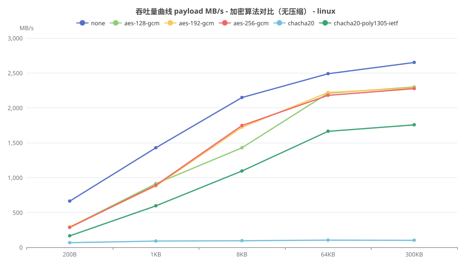

吞吐量曲线 - 压缩配置（无加密）：

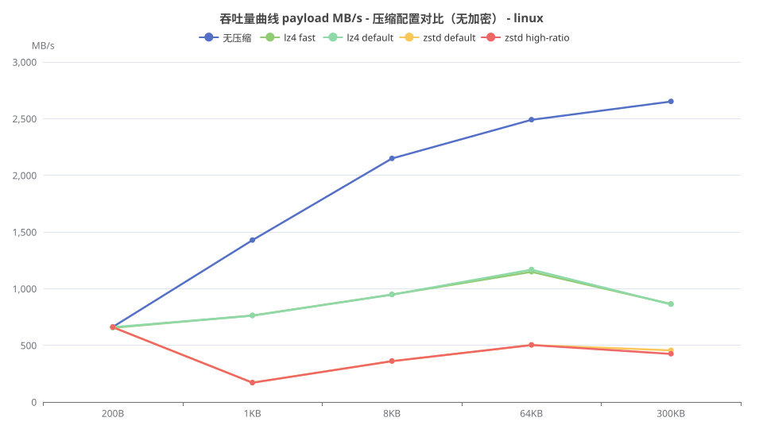

QPS 曲线 - 加密算法（无压缩）：

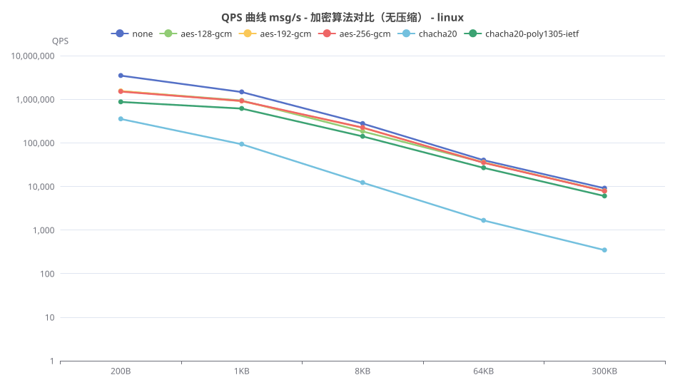

吞吐量曲线 - 压缩+加密组合：

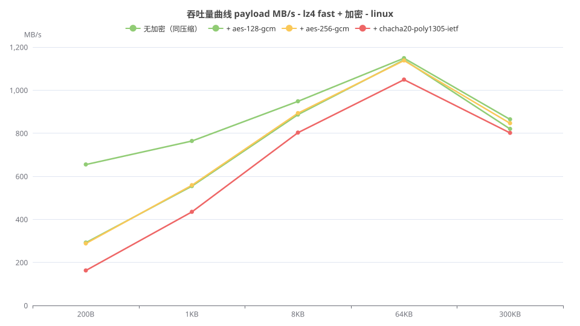

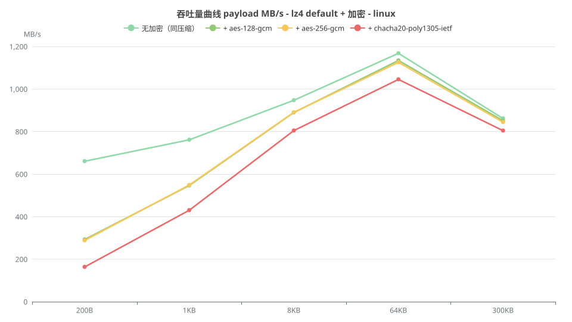

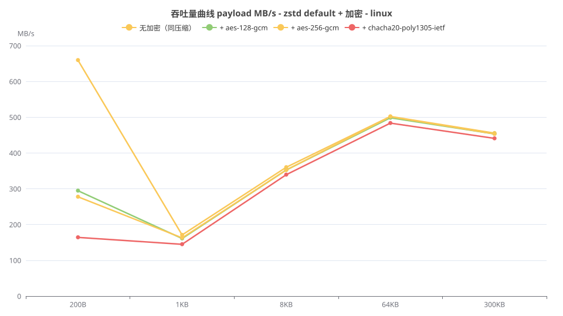

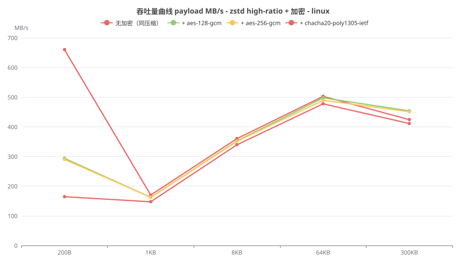

### WSL2 (Debian 13, GCC 14.2, -O3, glibc)

#### 加密对比（无压缩）

| 加密 | 压缩 | 包长 | QPS | 吞吐量(payload) | CPU 收/发 | 峰值内存 收/发 | 实测压缩率 |
|---|---|---:|---:|---:|---|---|---:|
| none | none@default | 200B | 3.22M | 614.8MB/s | 100%/100% | 11.8/21.3MB | - |
| aes-128-gcm | none@default | 200B | 1.38M | 263.1MB/s | 100%/100% | 12.1/25.5MB | - |
| aes-192-gcm | none@default | 200B | 1.56M | 296.8MB/s | 100%/100% | 12.5/25.3MB | - |
| aes-256-gcm | none@default | 200B | 1.54M | 293.0MB/s | 100%/100% | 12.4/25.7MB | - |
| chacha20 | none@default | 200B | 392.1K | 74.8MB/s | 100%/102% | 12.1/25.9MB | - |
| chacha20-poly1305-ietf | none@default | 200B | 913.9K | 174.3MB/s | 100%/101% | 12.3/25.6MB | - |
| none | none@default | 1KB | 1.30M | 1.24GB/s | 100%/100% | 12.0/20.4MB | - |
| aes-128-gcm | none@default | 1KB | 820.3K | 801.1MB/s | 100%/100% | 12.6/23.9MB | - |
| aes-192-gcm | none@default | 1KB | 801.6K | 782.8MB/s | 100%/100% | 12.5/24.9MB | - |
| aes-256-gcm | none@default | 1KB | 800.1K | 781.3MB/s | 100%/100% | 12.5/25.0MB | - |
| chacha20 | none@default | 1KB | 103.3K | 100.9MB/s | 100%/101% | 12.3/26.1MB | - |
| chacha20-poly1305-ietf | none@default | 1KB | 598.0K | 584.0MB/s | 100%/100% | 12.4/25.0MB | - |
| none | none@default | 8KB | 128.9K | 1007.1MB/s | 100%/100% | 12.0/19.9MB | - |
| aes-128-gcm | none@default | 8KB | 110.9K | 866.5MB/s | 100%/100% | 12.6/20.4MB | - |
| aes-192-gcm | none@default | 8KB | 78.5K | 613.5MB/s | 100%/100% | 12.5/20.5MB | - |
| aes-256-gcm | none@default | 8KB | 94.3K | 737.0MB/s | 100%/100% | 12.4/20.4MB | - |
| chacha20 | none@default | 8KB | 12.6K | 98.2MB/s | 100%/102% | 12.3/25.4MB | - |
| chacha20-poly1305-ietf | none@default | 8KB | 113.1K | 883.8MB/s | 100%/100% | 12.3/20.6MB | - |
| none | none@default | 64KB | 21.5K | 1.31GB/s | 100%/100% | 11.8/20.1MB | - |
| aes-128-gcm | none@default | 64KB | 15.2K | 951.5MB/s | 100%/100% | 12.9/25.1MB | - |
| aes-192-gcm | none@default | 64KB | 19.8K | 1.21GB/s | 100%/100% | 12.9/25.5MB | - |
| aes-256-gcm | none@default | 64KB | 19.0K | 1.16GB/s | 100%/100% | 13.0/25.4MB | - |
| chacha20 | none@default | 64KB | 1.8K | 112.2MB/s | 101%/101% | 12.6/25.8MB | - |
| chacha20-poly1305-ietf | none@default | 64KB | 13.1K | 819.0MB/s | 100%/100% | 12.6/25.3MB | - |
| none | none@default | 300KB | 3.8K | 1.08GB/s | 100%/100% | 12.6/21.6MB | - |
| aes-128-gcm | none@default | 300KB | 3.6K | 1.02GB/s | 100%/100% | 13.5/23.7MB | - |
| aes-192-gcm | none@default | 300KB | 3.7K | 1.06GB/s | 100%/100% | 13.7/25.7MB | - |
| aes-256-gcm | none@default | 300KB | 3.4K | 1004.5MB/s | 100%/100% | 13.8/26.0MB | - |
| chacha20 | none@default | 300KB | 367 | 107.6MB/s | 102%/102% | 13.6/26.8MB | - |
| chacha20-poly1305-ietf | none@default | 300KB | 2.7K | 801.0MB/s | 100%/100% | 13.4/24.8MB | - |

#### 压缩对比（无加密）

| 加密 | 压缩 | 包长 | QPS | 吞吐量(payload) | CPU 收/发 | 峰值内存 收/发 | 实测压缩率 |
|---|---|---:|---:|---:|---|---|---:|
| none | none@default | 200B | 3.22M | 614.8MB/s | 100%/100% | 11.8/21.3MB | - |
| none | lz4@fast | 200B | 3.14M | 598.0MB/s | 100%/100% | 11.9/21.2MB | 76.6% |
| none | lz4@default | 200B | 3.14M | 598.6MB/s | 100%/100% | 12.0/21.3MB | 76.6% |
| none | zstd@default | 200B | 3.24M | 617.6MB/s | 100%/100% | 11.8/23.8MB | 66.1% |
| none | zstd@high-ratio | 200B | 3.10M | 591.7MB/s | 100%/100% | 12.1/23.1MB | 65.6% |
| none | none@default | 1KB | 1.30M | 1.24GB/s | 100%/100% | 12.0/20.4MB | - |
| none | lz4@fast | 1KB | 687.2K | 671.1MB/s | 100%/100% | 12.1/24.8MB | 55.5% |
| none | lz4@default | 1KB | 726.0K | 709.0MB/s | 100%/100% | 11.9/24.5MB | 55.5% |
| none | zstd@default | 1KB | 158.4K | 154.7MB/s | 100%/102% | 12.2/21.2MB | 35.2% |
| none | zstd@high-ratio | 1KB | 154.7K | 151.1MB/s | 100%/101% | 12.1/21.5MB | 33.3% |
| none | none@default | 8KB | 128.9K | 1007.1MB/s | 100%/100% | 12.0/19.9MB | - |
| none | lz4@fast | 8KB | 124.3K | 970.7MB/s | 100%/100% | 12.1/24.9MB | 45.9% |
| none | lz4@default | 8KB | 126.5K | 988.3MB/s | 100%/100% | 12.0/20.3MB | 45.9% |
| none | zstd@default | 8KB | 46.7K | 364.6MB/s | 100%/102% | 12.2/20.7MB | 24.2% |
| none | zstd@high-ratio | 8KB | 47.4K | 370.7MB/s | 100%/102% | 12.1/26.0MB | 21.9% |
| none | none@default | 64KB | 21.5K | 1.31GB/s | 100%/100% | 11.8/20.1MB | - |
| none | lz4@fast | 64KB | 18.8K | 1.15GB/s | 100%/100% | 12.2/25.0MB | 43.6% |
| none | lz4@default | 64KB | 18.9K | 1.16GB/s | 100%/100% | 12.0/22.9MB | 43.6% |
| none | zstd@default | 64KB | 7.7K | 481.0MB/s | 100%/102% | 12.5/26.1MB | 23.8% |
| none | zstd@high-ratio | 64KB | 7.9K | 493.1MB/s | 100%/102% | 12.1/21.1MB | 21.0% |
| none | none@default | 300KB | 3.8K | 1.08GB/s | 100%/100% | 12.6/21.6MB | - |
| none | lz4@fast | 300KB | 1.7K | 495.6MB/s | 100%/102% | 12.6/26.1MB | 38.3% |
| none | lz4@default | 300KB | 2.4K | 712.9MB/s | 100%/101% | 12.8/26.6MB | 38.3% |
| none | zstd@default | 300KB | 1.6K | 456.2MB/s | 100%/103% | 12.9/22.8MB | 23.4% |
| none | zstd@high-ratio | 300KB | 1.6K | 470.9MB/s | 100%/102% | 13.0/22.7MB | 20.6% |

#### 压缩+加密组合

| 加密 | 压缩 | 包长 | QPS | 吞吐量(payload) | CPU 收/发 | 峰值内存 收/发 | 实测压缩率 |
|---|---|---:|---:|---:|---|---|---:|
| aes-128-gcm | lz4@fast | 200B | 1.48M | 283.2MB/s | 100%/100% | 12.6/25.3MB | 76.6% |
| aes-256-gcm | lz4@fast | 200B | 1.54M | 294.6MB/s | 100%/100% | 12.5/25.5MB | 76.6% |
| chacha20-poly1305-ietf | lz4@fast | 200B | 931.1K | 177.6MB/s | 100%/100% | 12.4/25.3MB | 76.6% |
| aes-128-gcm | lz4@default | 200B | 1.48M | 282.7MB/s | 100%/100% | 12.5/25.3MB | 76.6% |
| aes-256-gcm | lz4@default | 200B | 1.57M | 298.7MB/s | 100%/100% | 12.5/25.1MB | 76.6% |
| chacha20-poly1305-ietf | lz4@default | 200B | 916.4K | 174.8MB/s | 100%/100% | 12.3/25.6MB | 76.6% |
| aes-128-gcm | zstd@default | 200B | 1.52M | 289.2MB/s | 100%/100% | 12.4/25.2MB | 66.1% |
| aes-256-gcm | zstd@default | 200B | 1.56M | 297.0MB/s | 100%/100% | 12.5/25.2MB | 66.1% |
| chacha20-poly1305-ietf | zstd@default | 200B | 914.0K | 174.3MB/s | 100%/101% | 12.3/25.3MB | 66.1% |
| aes-128-gcm | zstd@high-ratio | 200B | 1.54M | 293.6MB/s | 100%/100% | 12.3/25.1MB | 65.6% |
| aes-256-gcm | zstd@high-ratio | 200B | 1.56M | 296.9MB/s | 100%/100% | 12.6/25.4MB | 65.6% |
| chacha20-poly1305-ietf | zstd@high-ratio | 200B | 938.3K | 179.0MB/s | 100%/100% | 12.2/25.2MB | 65.6% |
| aes-128-gcm | lz4@fast | 1KB | 551.1K | 538.2MB/s | 100%/100% | 12.7/25.6MB | 55.5% |
| aes-256-gcm | lz4@fast | 1KB | 525.5K | 513.2MB/s | 100%/100% | 12.5/25.5MB | 55.5% |
| chacha20-poly1305-ietf | lz4@fast | 1KB | 447.3K | 436.9MB/s | 100%/100% | 12.1/25.6MB | 55.5% |
| aes-128-gcm | lz4@default | 1KB | 559.3K | 546.2MB/s | 100%/100% | 12.6/24.6MB | 55.5% |
| aes-256-gcm | lz4@default | 1KB | 556.9K | 543.9MB/s | 100%/100% | 12.5/25.8MB | 55.5% |
| chacha20-poly1305-ietf | lz4@default | 1KB | 445.4K | 435.0MB/s | 100%/100% | 12.4/25.6MB | 55.5% |
| aes-128-gcm | zstd@default | 1KB | 149.7K | 146.2MB/s | 100%/102% | 12.7/26.8MB | 35.2% |
| aes-256-gcm | zstd@default | 1KB | 149.6K | 146.1MB/s | 100%/101% | 12.9/26.8MB | 35.2% |
| chacha20-poly1305-ietf | zstd@default | 1KB | 141.2K | 137.8MB/s | 100%/102% | 12.5/26.3MB | 35.2% |
| aes-128-gcm | zstd@high-ratio | 1KB | 150.3K | 146.7MB/s | 100%/102% | 12.8/26.5MB | 33.3% |
| aes-256-gcm | zstd@high-ratio | 1KB | 134.3K | 131.2MB/s | 100%/104% | 13.0/26.6MB | 33.3% |
| chacha20-poly1305-ietf | zstd@high-ratio | 1KB | 138.1K | 134.9MB/s | 100%/102% | 12.3/26.6MB | 33.3% |
| aes-128-gcm | lz4@fast | 8KB | 107.2K | 837.6MB/s | 100%/100% | 12.5/25.5MB | 45.9% |
| aes-256-gcm | lz4@fast | 8KB | 115.1K | 899.0MB/s | 100%/100% | 12.6/25.3MB | 45.9% |
| chacha20-poly1305-ietf | lz4@fast | 8KB | 104.4K | 815.4MB/s | 100%/100% | 12.4/25.3MB | 45.9% |
| aes-128-gcm | lz4@default | 8KB | 111.6K | 872.2MB/s | 100%/100% | 12.6/25.2MB | 45.9% |
| aes-256-gcm | lz4@default | 8KB | 116.0K | 906.2MB/s | 100%/100% | 12.5/25.4MB | 45.9% |
| chacha20-poly1305-ietf | lz4@default | 8KB | 104.5K | 816.1MB/s | 100%/100% | 12.3/25.1MB | 45.9% |
| aes-128-gcm | zstd@default | 8KB | 43.1K | 336.6MB/s | 100%/102% | 12.8/26.6MB | 24.2% |
| aes-256-gcm | zstd@default | 8KB | 45.7K | 356.7MB/s | 100%/102% | 12.8/26.5MB | 24.2% |
| chacha20-poly1305-ietf | zstd@default | 8KB | 44.1K | 344.5MB/s | 100%/102% | 12.6/26.5MB | 24.2% |
| aes-128-gcm | zstd@high-ratio | 8KB | 46.8K | 365.9MB/s | 100%/102% | 13.0/26.8MB | 21.9% |
| aes-256-gcm | zstd@high-ratio | 8KB | 45.8K | 358.0MB/s | 100%/101% | 13.0/26.7MB | 21.9% |
| chacha20-poly1305-ietf | zstd@high-ratio | 8KB | 44.6K | 348.6MB/s | 100%/101% | 12.9/26.5MB | 21.9% |
| aes-128-gcm | lz4@fast | 64KB | 17.4K | 1.06GB/s | 100%/100% | 12.8/25.8MB | 43.6% |
| aes-256-gcm | lz4@fast | 64KB | 17.5K | 1.07GB/s | 100%/100% | 12.9/25.8MB | 43.6% |
| chacha20-poly1305-ietf | lz4@fast | 64KB | 15.2K | 951.7MB/s | 100%/100% | 12.7/25.2MB | 43.6% |
| aes-128-gcm | lz4@default | 64KB | 16.8K | 1.03GB/s | 100%/100% | 13.0/25.8MB | 43.6% |
| aes-256-gcm | lz4@default | 64KB | 17.9K | 1.09GB/s | 100%/100% | 12.7/25.9MB | 43.6% |
| chacha20-poly1305-ietf | lz4@default | 64KB | 16.7K | 1.02GB/s | 100%/100% | 12.8/25.6MB | 43.6% |
| aes-128-gcm | zstd@default | 64KB | 8.0K | 502.5MB/s | 100%/102% | 13.0/25.1MB | 23.8% |
| aes-256-gcm | zstd@default | 64KB | 8.0K | 500.6MB/s | 100%/102% | 13.0/26.8MB | 23.8% |
| chacha20-poly1305-ietf | zstd@default | 64KB | 7.9K | 492.3MB/s | 100%/101% | 12.9/26.6MB | 23.8% |
| aes-128-gcm | zstd@high-ratio | 64KB | 8.1K | 508.4MB/s | 100%/101% | 13.0/26.8MB | 21.0% |
| aes-256-gcm | zstd@high-ratio | 64KB | 8.0K | 502.0MB/s | 100%/101% | 13.1/26.9MB | 21.0% |
| chacha20-poly1305-ietf | zstd@high-ratio | 64KB | 7.7K | 480.9MB/s | 100%/102% | 12.8/26.6MB | 21.0% |
| aes-128-gcm | lz4@fast | 300KB | 2.8K | 810.4MB/s | 100%/101% | 13.5/26.3MB | 38.3% |
| aes-256-gcm | lz4@fast | 300KB | 2.7K | 805.3MB/s | 100%/101% | 13.5/26.4MB | 38.3% |
| chacha20-poly1305-ietf | lz4@fast | 300KB | 2.7K | 787.5MB/s | 100%/101% | 13.4/26.3MB | 38.3% |
| aes-128-gcm | lz4@default | 300KB | 2.8K | 831.2MB/s | 100%/101% | 13.4/24.8MB | 38.3% |
| aes-256-gcm | lz4@default | 300KB | 2.7K | 792.9MB/s | 100%/101% | 13.4/26.5MB | 38.3% |
| chacha20-poly1305-ietf | lz4@default | 300KB | 2.5K | 729.3MB/s | 100%/101% | 13.2/26.2MB | 38.3% |
| aes-128-gcm | zstd@default | 300KB | 1.4K | 404.3MB/s | 100%/103% | 13.7/28.3MB | 23.4% |
| aes-256-gcm | zstd@default | 300KB | 1.5K | 449.6MB/s | 100%/102% | 13.7/28.2MB | 23.4% |
| chacha20-poly1305-ietf | zstd@default | 300KB | 1.5K | 431.8MB/s | 100%/103% | 13.3/28.0MB | 23.4% |
| aes-128-gcm | zstd@high-ratio | 300KB | 1.5K | 450.8MB/s | 100%/103% | 13.4/28.4MB | 20.6% |
| aes-256-gcm | zstd@high-ratio | 300KB | 1.5K | 452.5MB/s | 100%/103% | 13.3/28.1MB | 20.6% |
| chacha20-poly1305-ietf | zstd@high-ratio | 300KB | 1.5K | 446.7MB/s | 100%/102% | 13.5/27.9MB | 20.6% |

#### WSL 曲线图

吞吐量曲线 - 加密算法（无压缩）：

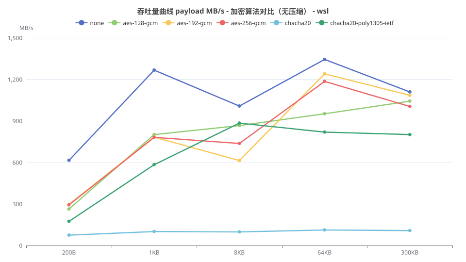

吞吐量曲线 - 压缩配置（无加密）：

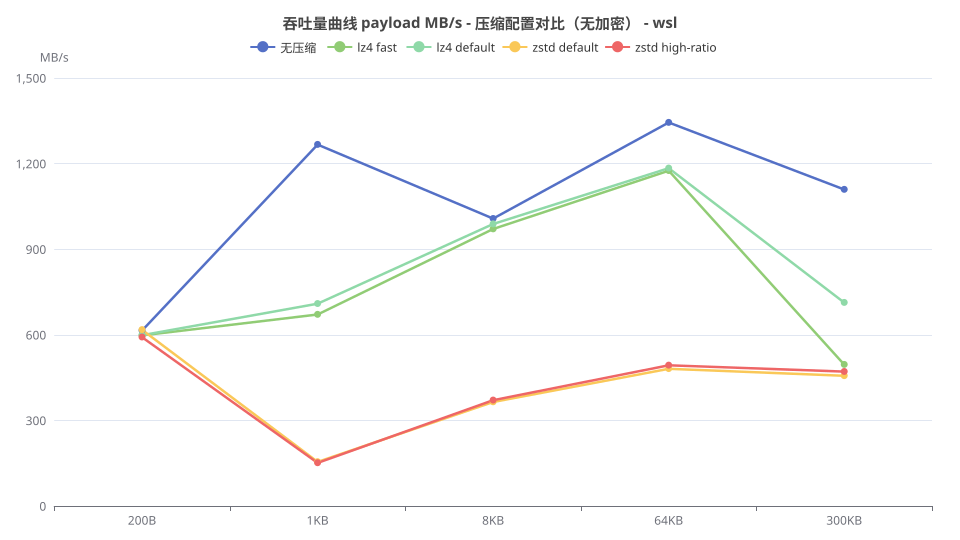

QPS 曲线 - 加密算法（无压缩）：

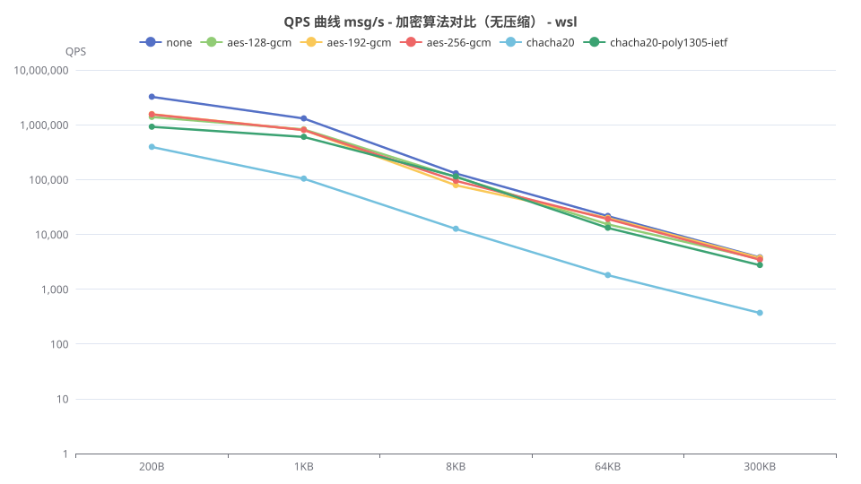

吞吐量曲线 - 压缩+加密组合：

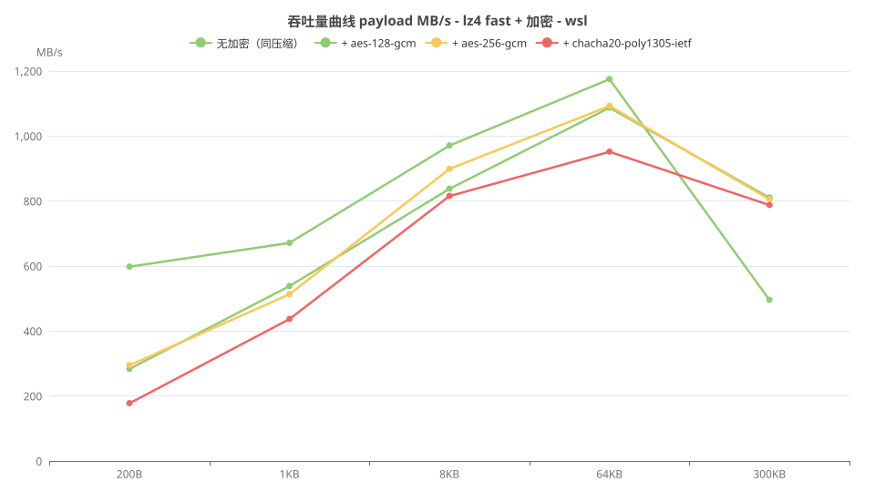

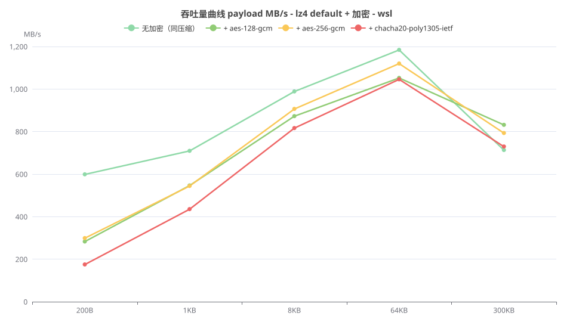

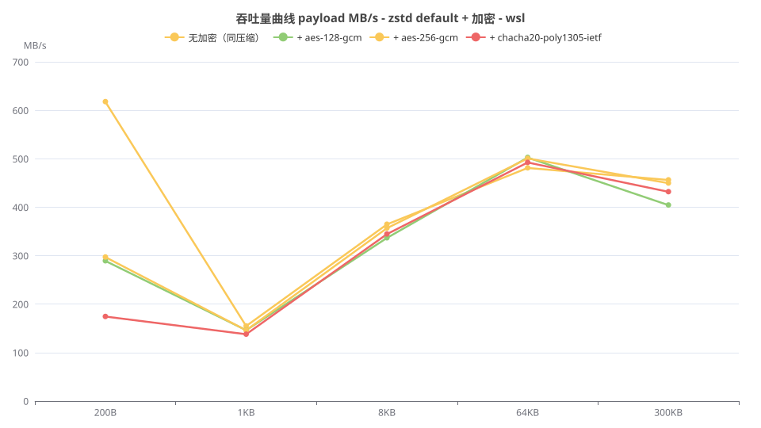

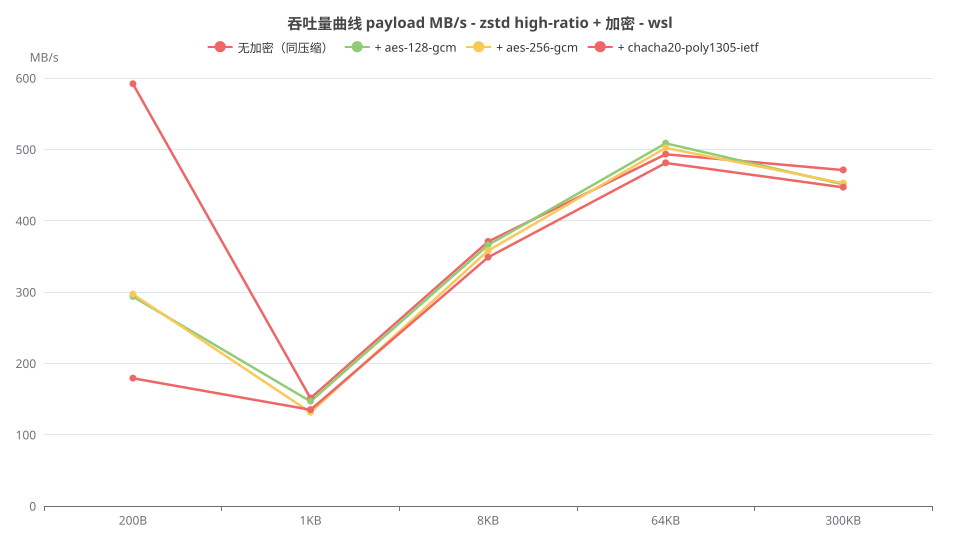

### Windows 原生 (MSVC, /O2)

#### 加密对比（无压缩）

| 加密 | 压缩 | 包长 | QPS | 吞吐量(payload) | CPU 收/发 | 峰值内存 收/发 | 实测压缩率 |
|---|---|---:|---:|---:|---|---|---:|
| none | none@default | 200B | 774.5K | 147.7MB/s | 97%/98% | 11.2/29.6MB | - |
| aes-128-gcm | none@default | 200B | 331.9K | 63.3MB/s | 99%/99% | 11.4/29.3MB | - |
| aes-192-gcm | none@default | 200B | 290.3K | 55.4MB/s | 97%/98% | 11.4/29.6MB | - |
| aes-256-gcm | none@default | 200B | 244.2K | 46.6MB/s | 97%/98% | 11.4/29.6MB | - |
| chacha20 | none@default | 200B | 451.8K | 86.2MB/s | 99%/99% | 11.3/29.1MB | - |
| chacha20-poly1305-ietf | none@default | 200B | 394.1K | 75.2MB/s | 98%/98% | 11.3/29.6MB | - |
| none | none@default | 1KB | 258.0K | 252.0MB/s | 99%/99% | 11.3/27.8MB | - |
| aes-128-gcm | none@default | 1KB | 136.3K | 133.1MB/s | 99%/100% | 11.5/28.8MB | - |
| aes-192-gcm | none@default | 1KB | 113.5K | 110.9MB/s | 100%/100% | 11.4/28.5MB | - |
| aes-256-gcm | none@default | 1KB | 100.6K | 98.3MB/s | 99%/99% | 11.4/28.3MB | - |
| chacha20 | none@default | 1KB | 218.8K | 213.7MB/s | 99%/99% | 11.4/28.5MB | - |
| chacha20-poly1305-ietf | none@default | 1KB | 148.6K | 145.1MB/s | 99%/98% | 11.4/28.6MB | - |
| none | none@default | 8KB | 63.3K | 494.6MB/s | 100%/100% | 11.4/20.6MB | - |
| aes-128-gcm | none@default | 8KB | 15.9K | 124.6MB/s | 99%/100% | 11.5/27.8MB | - |
| aes-192-gcm | none@default | 8KB | 15.1K | 117.6MB/s | 99%/100% | 11.5/28.0MB | - |
| aes-256-gcm | none@default | 8KB | 16.2K | 126.5MB/s | 99%/99% | 11.6/27.8MB | - |
| chacha20 | none@default | 8KB | 25.1K | 196.1MB/s | 99%/98% | 11.5/26.3MB | - |
| chacha20-poly1305-ietf | none@default | 8KB | 17.7K | 138.2MB/s | 99%/100% | 11.5/26.8MB | - |
| none | none@default | 64KB | 5.9K | 367.2MB/s | 100%/100% | 11.4/26.0MB | - |
| aes-128-gcm | none@default | 64KB | 2.2K | 134.6MB/s | 100%/100% | 11.6/27.4MB | - |
| aes-192-gcm | none@default | 64KB | 2.2K | 134.8MB/s | 100%/100% | 11.6/27.5MB | - |
| aes-256-gcm | none@default | 64KB | 1.8K | 109.8MB/s | 100%/99% | 11.6/27.4MB | - |
| chacha20 | none@default | 64KB | 3.3K | 205.2MB/s | 99%/98% | 11.5/26.9MB | - |
| chacha20-poly1305-ietf | none@default | 64KB | 2.9K | 182.8MB/s | 99%/99% | 11.6/27.3MB | - |
| none | none@default | 300KB | 1.9K | 551.8MB/s | 99%/98% | 12.1/25.6MB | - |
| aes-128-gcm | none@default | 300KB | 266 | 78.0MB/s | 100%/99% | 12.3/27.2MB | - |
| aes-192-gcm | none@default | 300KB | 270 | 79.0MB/s | 100%/99% | 12.5/27.2MB | - |
| aes-256-gcm | none@default | 300KB | 251 | 73.5MB/s | 100%/98% | 12.4/27.2MB | - |
| chacha20 | none@default | 300KB | 553 | 162.1MB/s | 99%/98% | 12.4/27.2MB | - |
| chacha20-poly1305-ietf | none@default | 300KB | 415 | 121.7MB/s | 99%/98% | 12.4/27.2MB | - |

#### 压缩对比（无加密）

| 加密 | 压缩 | 包长 | QPS | 吞吐量(payload) | CPU 收/发 | 峰值内存 收/发 | 实测压缩率 |
|---|---|---:|---:|---:|---|---|---:|
| none | none@default | 200B | 774.5K | 147.7MB/s | 97%/98% | 11.2/29.6MB | - |
| none | lz4@fast | 200B | 806.9K | 153.9MB/s | 100%/99% | 11.2/28.2MB | 76.6% |
| none | lz4@default | 200B | 780.8K | 148.9MB/s | 99%/99% | 11.2/28.7MB | 76.6% |
| none | zstd@default | 200B | 877.9K | 167.5MB/s | 99%/99% | 11.2/28.7MB | 66.1% |
| none | zstd@high-ratio | 200B | 861.7K | 164.4MB/s | 99%/100% | 11.2/28.4MB | 65.6% |
| none | none@default | 1KB | 258.0K | 252.0MB/s | 99%/99% | 11.3/27.8MB | - |
| none | lz4@fast | 1KB | 290.4K | 283.6MB/s | 99%/98% | 11.2/28.1MB | 55.5% |
| none | lz4@default | 1KB | 277.8K | 271.3MB/s | 99%/99% | 11.2/28.1MB | 55.5% |
| none | zstd@default | 1KB | 121.2K | 118.4MB/s | 100%/100% | 11.4/29.4MB | 35.2% |
| none | zstd@high-ratio | 1KB | 122.2K | 119.4MB/s | 99%/100% | 11.4/29.2MB | 33.3% |
| none | none@default | 8KB | 63.3K | 494.6MB/s | 100%/100% | 11.4/20.6MB | - |
| none | lz4@fast | 8KB | 34.7K | 270.8MB/s | 99%/99% | 11.4/28.2MB | 45.9% |
| none | lz4@default | 8KB | 31.1K | 243.0MB/s | 100%/100% | 11.3/28.0MB | 45.9% |
| none | zstd@default | 8KB | 38.3K | 299.2MB/s | 99%/99% | 11.5/28.7MB | 24.2% |
| none | zstd@high-ratio | 8KB | 37.8K | 295.4MB/s | 98%/100% | 11.5/28.8MB | 21.9% |
| none | none@default | 64KB | 5.9K | 367.2MB/s | 100%/100% | 11.4/26.0MB | - |
| none | lz4@fast | 64KB | 7.0K | 437.5MB/s | 99%/99% | 11.4/27.6MB | 43.6% |
| none | lz4@default | 64KB | 6.7K | 416.4MB/s | 100%/99% | 11.4/27.7MB | 43.6% |
| none | zstd@default | 64KB | 6.3K | 396.9MB/s | 100%/99% | 11.6/28.7MB | 23.8% |
| none | zstd@high-ratio | 64KB | 5.5K | 343.3MB/s | 99%/100% | 11.7/28.7MB | 21.0% |
| none | none@default | 300KB | 1.9K | 551.8MB/s | 99%/98% | 12.1/25.6MB | - |
| none | lz4@fast | 300KB | 1.5K | 428.1MB/s | 99%/100% | 11.9/27.6MB | 38.3% |
| none | lz4@default | 300KB | 1.5K | 427.2MB/s | 100%/100% | 11.9/27.4MB | 38.3% |
| none | zstd@default | 300KB | 837 | 245.2MB/s | 100%/100% | 12.0/29.0MB | 23.4% |
| none | zstd@high-ratio | 300KB | 851 | 249.5MB/s | 99%/100% | 12.0/29.1MB | 20.6% |

#### 压缩+加密组合

| 加密 | 压缩 | 包长 | QPS | 吞吐量(payload) | CPU 收/发 | 峰值内存 收/发 | 实测压缩率 |
|---|---|---:|---:|---:|---|---|---:|
| aes-128-gcm | lz4@fast | 200B | 358.2K | 68.3MB/s | 100%/100% | 11.4/29.3MB | 76.6% |
| aes-256-gcm | lz4@fast | 200B | 316.5K | 60.4MB/s | 100%/99% | 11.4/29.7MB | 76.6% |
| chacha20-poly1305-ietf | lz4@fast | 200B | 459.7K | 87.7MB/s | 100%/100% | 11.4/29.6MB | 76.6% |
| aes-128-gcm | lz4@default | 200B | 338.4K | 64.5MB/s | 100%/99% | 11.4/29.7MB | 76.6% |
| aes-256-gcm | lz4@default | 200B | 298.6K | 57.0MB/s | 98%/97% | 11.4/29.3MB | 76.6% |
| chacha20-poly1305-ietf | lz4@default | 200B | 449.0K | 85.6MB/s | 100%/100% | 11.4/29.9MB | 76.6% |
| aes-128-gcm | zstd@default | 200B | 357.0K | 68.1MB/s | 99%/99% | 11.4/29.5MB | 66.1% |
| aes-256-gcm | zstd@default | 200B | 305.5K | 58.3MB/s | 100%/99% | 11.4/29.3MB | 66.1% |
| chacha20-poly1305-ietf | zstd@default | 200B | 458.1K | 87.4MB/s | 100%/100% | 11.4/29.3MB | 66.1% |
| aes-128-gcm | zstd@high-ratio | 200B | 336.8K | 64.2MB/s | 100%/100% | 11.4/29.3MB | 65.6% |
| aes-256-gcm | zstd@high-ratio | 200B | 315.3K | 60.1MB/s | 100%/99% | 11.4/29.9MB | 65.6% |
| chacha20-poly1305-ietf | zstd@high-ratio | 200B | 464.8K | 88.6MB/s | 99%/99% | 11.4/29.3MB | 65.6% |
| aes-128-gcm | lz4@fast | 1KB | 169.2K | 165.2MB/s | 100%/100% | 11.4/28.8MB | 55.5% |
| aes-256-gcm | lz4@fast | 1KB | 141.7K | 138.3MB/s | 99%/99% | 11.4/28.8MB | 55.5% |
| chacha20-poly1305-ietf | lz4@fast | 1KB | 165.5K | 161.6MB/s | 99%/99% | 11.4/28.5MB | 55.5% |
| aes-128-gcm | lz4@default | 1KB | 151.3K | 147.8MB/s | 99%/99% | 11.4/28.9MB | 55.5% |
| aes-256-gcm | lz4@default | 1KB | 126.3K | 123.4MB/s | 97%/96% | 11.4/28.8MB | 55.5% |
| chacha20-poly1305-ietf | lz4@default | 1KB | 158.2K | 154.5MB/s | 100%/100% | 11.4/28.5MB | 55.5% |
| aes-128-gcm | zstd@default | 1KB | 91.3K | 89.2MB/s | 100%/100% | 11.5/29.5MB | 35.2% |
| aes-256-gcm | zstd@default | 1KB | 90.5K | 88.4MB/s | 100%/100% | 11.5/29.5MB | 35.2% |
| chacha20-poly1305-ietf | zstd@default | 1KB | 105.1K | 102.7MB/s | 100%/99% | 11.5/29.6MB | 35.2% |
| aes-128-gcm | zstd@high-ratio | 1KB | 94.0K | 91.8MB/s | 100%/100% | 11.5/29.5MB | 33.3% |
| aes-256-gcm | zstd@high-ratio | 1KB | 87.7K | 85.6MB/s | 100%/100% | 11.5/29.4MB | 33.3% |
| chacha20-poly1305-ietf | zstd@high-ratio | 1KB | 109.3K | 106.7MB/s | 100%/100% | 11.5/29.4MB | 33.3% |
| aes-128-gcm | lz4@fast | 8KB | 30.8K | 240.9MB/s | 100%/100% | 11.6/28.7MB | 45.9% |
| aes-256-gcm | lz4@fast | 8KB | 26.4K | 205.9MB/s | 100%/100% | 11.6/28.8MB | 45.9% |
| chacha20-poly1305-ietf | lz4@fast | 8KB | 26.5K | 207.2MB/s | 100%/99% | 11.6/28.7MB | 45.9% |
| aes-128-gcm | lz4@default | 8KB | 30.2K | 236.0MB/s | 100%/100% | 11.6/28.8MB | 45.9% |
| aes-256-gcm | lz4@default | 8KB | 27.1K | 211.5MB/s | 100%/100% | 11.6/28.8MB | 45.9% |
| chacha20-poly1305-ietf | lz4@default | 8KB | 28.7K | 224.5MB/s | 100%/99% | 11.6/28.7MB | 45.9% |
| aes-128-gcm | zstd@default | 8KB | 29.0K | 226.8MB/s | 100%/100% | 11.6/29.7MB | 24.2% |
| aes-256-gcm | zstd@default | 8KB | 25.1K | 196.1MB/s | 100%/100% | 11.7/29.5MB | 24.2% |
| chacha20-poly1305-ietf | zstd@default | 8KB | 34.6K | 270.2MB/s | 99%/100% | 11.6/29.3MB | 24.2% |
| aes-128-gcm | zstd@high-ratio | 8KB | 27.8K | 217.1MB/s | 100%/100% | 11.7/29.6MB | 21.9% |
| aes-256-gcm | zstd@high-ratio | 8KB | 27.2K | 212.8MB/s | 100%/100% | 11.7/29.3MB | 21.9% |
| chacha20-poly1305-ietf | zstd@high-ratio | 8KB | 34.7K | 271.4MB/s | 100%/100% | 11.6/29.2MB | 21.9% |
| aes-128-gcm | lz4@fast | 64KB | 4.7K | 294.8MB/s | 99%/100% | 11.6/28.4MB | 43.6% |
| aes-256-gcm | lz4@fast | 64KB | 3.7K | 231.3MB/s | 100%/100% | 11.6/28.7MB | 43.6% |
| chacha20-poly1305-ietf | lz4@fast | 64KB | 6.9K | 432.1MB/s | 100%/99% | 11.5/28.5MB | 43.6% |
| aes-128-gcm | lz4@default | 64KB | 4.4K | 273.3MB/s | 100%/100% | 11.6/28.6MB | 43.6% |
| aes-256-gcm | lz4@default | 64KB | 3.5K | 217.2MB/s | 100%/100% | 11.6/27.9MB | 43.6% |
| chacha20-poly1305-ietf | lz4@default | 64KB | 6.8K | 428.1MB/s | 99%/99% | 11.6/27.7MB | 43.6% |
| aes-128-gcm | zstd@default | 64KB | 4.0K | 248.2MB/s | 100%/100% | 11.9/28.9MB | 23.8% |
| aes-256-gcm | zstd@default | 64KB | 3.6K | 224.8MB/s | 100%/100% | 11.9/28.9MB | 23.8% |
| chacha20-poly1305-ietf | zstd@default | 64KB | 4.8K | 299.3MB/s | 99%/100% | 11.9/28.8MB | 23.8% |
| aes-128-gcm | zstd@high-ratio | 64KB | 4.0K | 248.2MB/s | 99%/100% | 11.8/28.9MB | 21.0% |
| aes-256-gcm | zstd@high-ratio | 64KB | 3.8K | 237.9MB/s | 100%/100% | 11.8/28.8MB | 21.0% |
| chacha20-poly1305-ietf | zstd@high-ratio | 64KB | 4.5K | 279.1MB/s | 99%/100% | 11.9/28.8MB | 21.0% |
| aes-128-gcm | lz4@fast | 300KB | 865 | 253.3MB/s | 100%/100% | 12.2/27.8MB | 38.3% |
| aes-256-gcm | lz4@fast | 300KB | 662 | 194.0MB/s | 99%/100% | 12.2/27.9MB | 38.3% |
| chacha20-poly1305-ietf | lz4@fast | 300KB | 1.4K | 405.7MB/s | 99%/100% | 12.2/27.8MB | 38.3% |
| aes-128-gcm | lz4@default | 300KB | 882 | 258.5MB/s | 100%/100% | 12.2/27.8MB | 38.3% |
| aes-256-gcm | lz4@default | 300KB | 713 | 208.9MB/s | 100%/99% | 12.3/27.8MB | 38.3% |
| chacha20-poly1305-ietf | lz4@default | 300KB | 1.3K | 393.9MB/s | 100%/100% | 12.2/27.9MB | 38.3% |
| aes-128-gcm | zstd@default | 300KB | 681 | 199.5MB/s | 100%/100% | 12.2/29.1MB | 23.4% |
| aes-256-gcm | zstd@default | 300KB | 665 | 194.8MB/s | 100%/100% | 12.3/29.1MB | 23.4% |
| chacha20-poly1305-ietf | zstd@default | 300KB | 839 | 245.9MB/s | 100%/100% | 12.2/29.1MB | 23.4% |
| aes-128-gcm | zstd@high-ratio | 300KB | 665 | 194.9MB/s | 100%/100% | 12.3/29.1MB | 20.6% |
| aes-256-gcm | zstd@high-ratio | 300KB | 622 | 182.3MB/s | 100%/100% | 12.2/29.1MB | 20.6% |
| chacha20-poly1305-ietf | zstd@high-ratio | 300KB | 824 | 241.5MB/s | 100%/100% | 12.2/29.1MB | 20.6% |

#### Windows 曲线图

吞吐量曲线 - 加密算法（无压缩）：

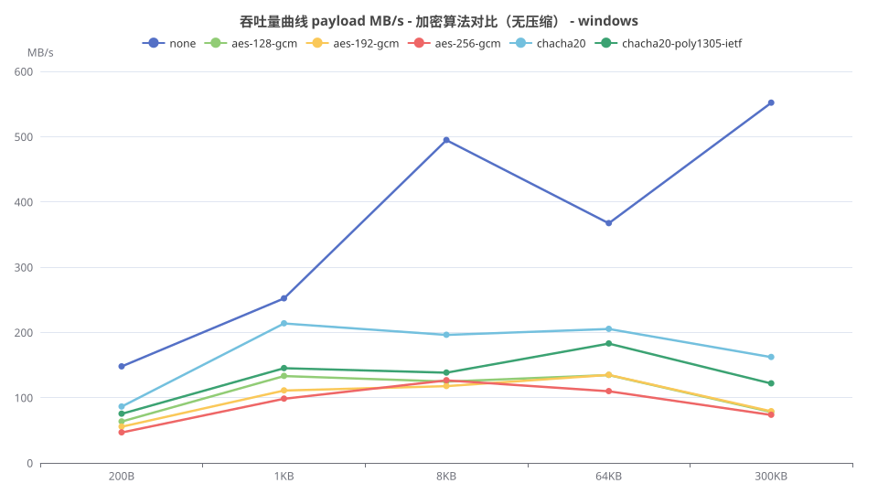

吞吐量曲线 - 压缩配置（无加密）：

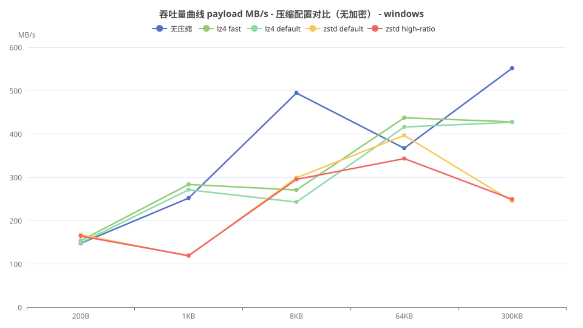

QPS 曲线 - 加密算法（无压缩）：

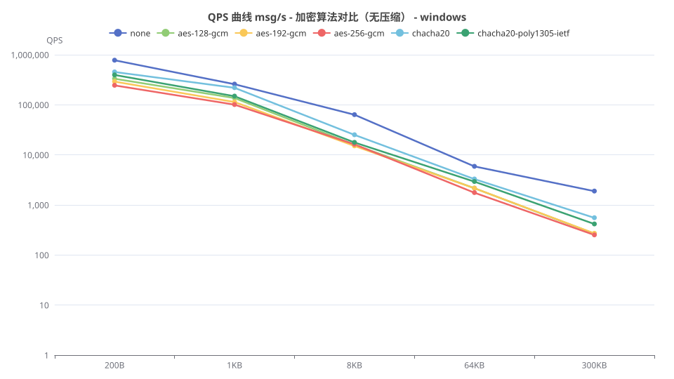

吞吐量曲线 - 压缩+加密组合：

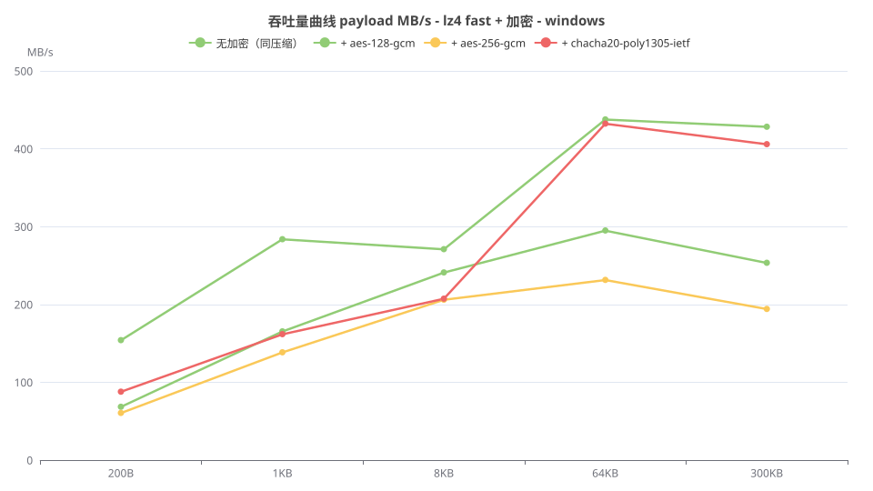

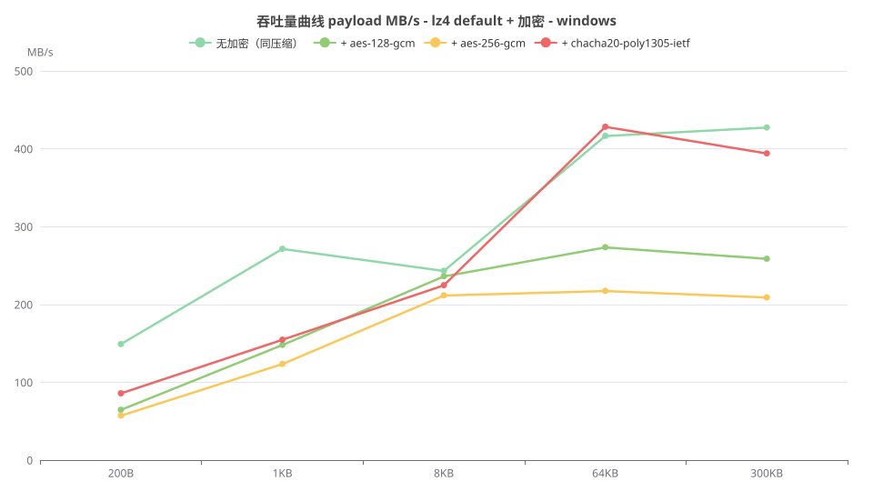

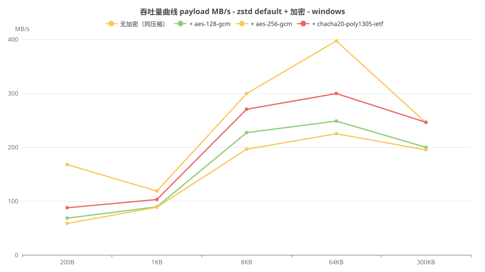

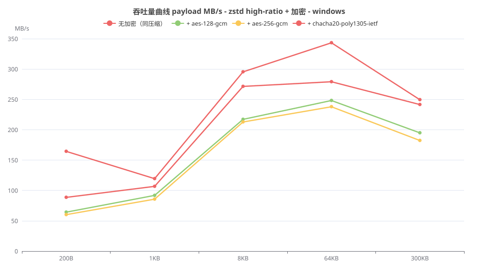

### 共享内存通道（shm://）补充测试

共享内存通道为**单工总线**：收端 `listen(shm://key)` 创建段并作为读端，发端经 TCP 控制连接完成握手后，
connect-back 依据对端广播的 shm 地址自动建立**写端**数据连接（数据通道优先级 mem > shm > fd），与真实部署
拓扑一致。协议栈的加密/压缩在 shm 数据连接上照常协商生效；shm 段大小为默认配置（256MB）。

三平台均以与 TCP 相同的 22 组合 × 5 包长矩阵运行（Linux 为 mimalloc PRELOAD；**Windows 下发现并修复了
shm 段使用 `Global\` 命名空间导致普通权限进程创建失败的问题**，见 CHANGELOG 3.0.1），全部 0 失败。

#### 共享内存 vs TCP 吞吐曲线（无加密无压缩）

Linux（mimalloc）：

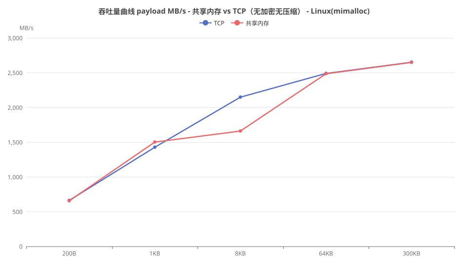

WSL2（glibc）：

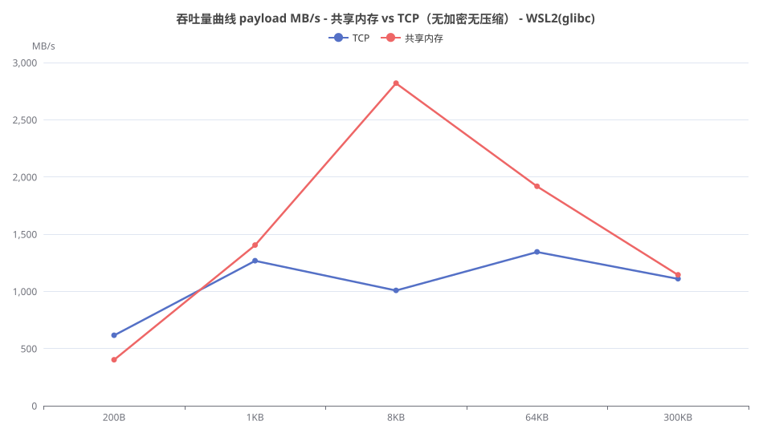

Windows：

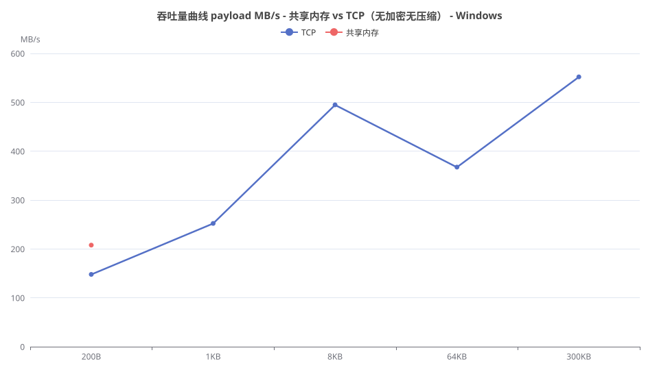

三平台汇总（shm=虚线）：


#### 真实 Linux (mimalloc) - shm 通道加密对比（无压缩）

| 加密 | 压缩 | 包长 | QPS | 吞吐量(payload) | CPU 收/发 | 峰值内存 收/发 | 实测压缩率 |
|---|---|---:|---:|---:|---|---|---:|
| none | none@default | 200B | 3.44M | 656.3MB/s | 100%/100% | 15.1/27.2MB | - |
| aes-128-gcm | none@default | 200B | 1.50M | 286.6MB/s | 100%/100% | 15.1/31.3MB | - |
| aes-192-gcm | none@default | 200B | 1.52M | 290.6MB/s | 100%/100% | 15.3/31.2MB | - |
| aes-256-gcm | none@default | 200B | 1.44M | 275.1MB/s | 100%/101% | 15.3/31.3MB | - |
| chacha20 | none@default | 200B | 330.5K | 63.0MB/s | 100%/100% | 15.0/29.3MB | - |
| chacha20-poly1305-ietf | none@default | 200B | 851.0K | 162.3MB/s | 100%/101% | 14.9/31.2MB | - |
| none | none@default | 1KB | 1.54M | 1.47GB/s | 100%/100% | 15.1/25.4MB | - |
| aes-128-gcm | none@default | 1KB | 891.1K | 870.2MB/s | 100%/100% | 15.5/29.3MB | - |
| aes-192-gcm | none@default | 1KB | 897.2K | 876.2MB/s | 100%/100% | 15.3/29.6MB | - |
| aes-256-gcm | none@default | 1KB | 899.7K | 878.6MB/s | 100%/100% | 15.3/29.3MB | - |
| chacha20 | none@default | 1KB | 84.6K | 82.6MB/s | 100%/100% | 15.1/31.1MB | - |
| chacha20-poly1305-ietf | none@default | 1KB | 626.3K | 611.6MB/s | 100%/100% | 15.2/29.3MB | - |
| none | none@default | 8KB | 212.5K | 1.62GB/s | 100%/100% | 15.3/25.3MB | - |
| aes-128-gcm | none@default | 8KB | 231.1K | 1.76GB/s | 100%/100% | 15.1/31.3MB | - |
| aes-192-gcm | none@default | 8KB | 200.7K | 1.53GB/s | 100%/100% | 15.2/31.3MB | - |
| aes-256-gcm | none@default | 8KB | 228.5K | 1.74GB/s | 100%/100% | 15.3/39.3MB | - |
| chacha20 | none@default | 8KB | 11.5K | 89.9MB/s | 100%/101% | 15.3/33.3MB | - |
| chacha20-poly1305-ietf | none@default | 8KB | 162.7K | 1.24GB/s | 100%/100% | 15.3/35.0MB | - |
| none | none@default | 64KB | 39.8K | 2.43GB/s | 100%/100% | 14.8/33.2MB | - |
| aes-128-gcm | none@default | 64KB | 35.5K | 2.17GB/s | 100%/100% | 15.5/33.4MB | - |
| aes-192-gcm | none@default | 64KB | 35.2K | 2.15GB/s | 100%/100% | 15.2/39.5MB | - |
| aes-256-gcm | none@default | 64KB | 35.0K | 2.14GB/s | 100%/100% | 15.3/39.4MB | - |
| chacha20 | none@default | 64KB | 1.5K | 96.5MB/s | 100%/101% | 15.3/34.9MB | - |
| chacha20-poly1305-ietf | none@default | 64KB | 25.8K | 1.57GB/s | 100%/100% | 15.1/39.3MB | - |
| none | none@default | 300KB | 9.0K | 2.59GB/s | 100%/100% | 15.0/27.0MB | - |
| aes-128-gcm | none@default | 300KB | 7.9K | 2.25GB/s | 100%/100% | 15.3/27.5MB | - |
| aes-192-gcm | none@default | 300KB | 7.9K | 2.26GB/s | 100%/100% | 15.5/25.5MB | - |
| aes-256-gcm | none@default | 300KB | 7.7K | 2.22GB/s | 100%/100% | 15.3/27.4MB | - |
| chacha20 | none@default | 300KB | 335 | 98.2MB/s | 101%/102% | 15.1/29.1MB | - |
| chacha20-poly1305-ietf | none@default | 300KB | 5.6K | 1.59GB/s | 100%/100% | 15.3/29.4MB | - |

#### 真实 Linux (mimalloc) - shm 通道压缩对比（无加密）

| 加密 | 压缩 | 包长 | QPS | 吞吐量(payload) | CPU 收/发 | 峰值内存 收/发 | 实测压缩率 |
|---|---|---:|---:|---:|---|---|---:|
| none | none@default | 200B | 3.44M | 656.3MB/s | 100%/100% | 15.1/27.2MB | - |
| none | lz4@fast | 200B | 3.44M | 656.0MB/s | 100%/100% | 15.0/27.2MB | 76.6% |
| none | lz4@default | 200B | 3.43M | 654.6MB/s | 100%/100% | 15.0/27.1MB | 76.6% |
| none | zstd@default | 200B | 3.42M | 651.9MB/s | 100%/100% | 15.2/25.1MB | 66.1% |
| none | zstd@high-ratio | 200B | 3.46M | 660.8MB/s | 100%/100% | 15.0/27.1MB | 65.6% |
| none | none@default | 1KB | 1.54M | 1.47GB/s | 100%/100% | 15.1/25.4MB | - |
| none | lz4@fast | 1KB | 783.6K | 765.2MB/s | 100%/100% | 15.1/23.0MB | 55.5% |
| none | lz4@default | 1KB | 778.7K | 760.5MB/s | 100%/100% | 15.2/25.3MB | 55.5% |
| none | zstd@default | 1KB | 173.7K | 169.6MB/s | 100%/102% | 15.3/25.3MB | 35.2% |
| none | zstd@high-ratio | 1KB | 174.8K | 170.7MB/s | 100%/101% | 14.9/31.5MB | 33.3% |
| none | none@default | 8KB | 212.5K | 1.62GB/s | 100%/100% | 15.3/25.3MB | - |
| none | lz4@fast | 8KB | 122.0K | 953.3MB/s | 100%/101% | 15.3/25.3MB | 45.9% |
| none | lz4@default | 8KB | 121.6K | 950.1MB/s | 100%/100% | 15.3/31.3MB | 45.9% |
| none | zstd@default | 8KB | 46.0K | 359.7MB/s | 100%/105% | 15.3/31.2MB | 24.2% |
| none | zstd@high-ratio | 8KB | 46.4K | 362.5MB/s | 100%/102% | 15.1/31.2MB | 21.9% |
| none | none@default | 64KB | 39.8K | 2.43GB/s | 100%/100% | 14.8/33.2MB | - |
| none | lz4@fast | 64KB | 18.6K | 1.14GB/s | 100%/101% | 15.0/31.3MB | 43.6% |
| none | lz4@default | 64KB | 18.6K | 1.13GB/s | 100%/101% | 15.2/29.1MB | 43.6% |
| none | zstd@default | 64KB | 8.0K | 500.5MB/s | 100%/103% | 15.3/23.3MB | 23.8% |
| none | zstd@high-ratio | 64KB | 7.8K | 484.8MB/s | 100%/102% | 15.2/29.4MB | 21.0% |
| none | none@default | 300KB | 9.0K | 2.59GB/s | 100%/100% | 15.0/27.0MB | - |
| none | lz4@fast | 300KB | 2.9K | 853.5MB/s | 100%/101% | 15.2/35.1MB | 38.3% |
| none | lz4@default | 300KB | 2.9K | 840.2MB/s | 100%/101% | 15.1/27.3MB | 38.3% |
| none | zstd@default | 300KB | 1.5K | 425.2MB/s | 100%/103% | 15.1/33.3MB | 23.4% |
| none | zstd@high-ratio | 300KB | 1.6K | 462.7MB/s | 100%/102% | 15.0/27.2MB | 20.6% |

#### 真实 Linux (mimalloc) - shm 通道压缩+加密组合

| 加密 | 压缩 | 包长 | QPS | 吞吐量(payload) | CPU 收/发 | 峰值内存 收/发 | 实测压缩率 |
|---|---|---:|---:|---:|---|---|---:|
| aes-128-gcm | lz4@fast | 200B | 1.52M | 289.5MB/s | 100%/100% | 15.4/31.2MB | 76.6% |
| aes-256-gcm | lz4@fast | 200B | 1.45M | 276.7MB/s | 100%/101% | 15.1/31.5MB | 76.6% |
| chacha20-poly1305-ietf | lz4@fast | 200B | 850.7K | 162.2MB/s | 100%/101% | 15.2/31.3MB | 76.6% |
| aes-128-gcm | lz4@default | 200B | 1.52M | 289.3MB/s | 100%/100% | 15.3/31.3MB | 76.6% |
| aes-256-gcm | lz4@default | 200B | 1.47M | 279.6MB/s | 100%/101% | 15.2/31.3MB | 76.6% |
| chacha20-poly1305-ietf | lz4@default | 200B | 848.7K | 161.9MB/s | 100%/101% | 15.0/31.3MB | 76.6% |
| aes-128-gcm | zstd@default | 200B | 1.52M | 290.8MB/s | 100%/101% | 15.2/31.5MB | 66.1% |
| aes-256-gcm | zstd@default | 200B | 1.47M | 280.6MB/s | 100%/100% | 15.2/31.2MB | 66.1% |
| chacha20-poly1305-ietf | zstd@default | 200B | 856.1K | 163.3MB/s | 100%/100% | 15.1/31.1MB | 66.1% |
| aes-128-gcm | zstd@high-ratio | 200B | 1.51M | 288.2MB/s | 100%/101% | 15.1/31.2MB | 65.6% |
| aes-256-gcm | zstd@high-ratio | 200B | 1.46M | 279.3MB/s | 100%/100% | 15.2/31.3MB | 65.6% |
| chacha20-poly1305-ietf | zstd@high-ratio | 200B | 850.3K | 162.2MB/s | 100%/101% | 15.3/39.1MB | 65.6% |
| aes-128-gcm | lz4@fast | 1KB | 568.1K | 554.7MB/s | 100%/101% | 15.2/29.6MB | 55.5% |
| aes-256-gcm | lz4@fast | 1KB | 557.8K | 544.8MB/s | 100%/101% | 14.9/29.3MB | 55.5% |
| chacha20-poly1305-ietf | lz4@fast | 1KB | 439.6K | 429.3MB/s | 100%/101% | 15.3/29.0MB | 55.5% |
| aes-128-gcm | lz4@default | 1KB | 567.3K | 554.0MB/s | 100%/101% | 15.3/29.5MB | 55.5% |
| aes-256-gcm | lz4@default | 1KB | 565.5K | 552.2MB/s | 100%/101% | 15.1/29.2MB | 55.5% |
| chacha20-poly1305-ietf | lz4@default | 1KB | 446.0K | 435.5MB/s | 100%/101% | 15.3/29.1MB | 55.5% |
| aes-128-gcm | zstd@default | 1KB | 164.1K | 160.2MB/s | 100%/105% | 15.6/31.6MB | 35.2% |
| aes-256-gcm | zstd@default | 1KB | 163.5K | 159.7MB/s | 100%/103% | 15.3/31.5MB | 35.2% |
| chacha20-poly1305-ietf | zstd@default | 1KB | 148.1K | 144.7MB/s | 100%/101% | 15.1/31.4MB | 35.2% |
| aes-128-gcm | zstd@high-ratio | 1KB | 164.3K | 160.4MB/s | 100%/105% | 15.6/31.6MB | 33.3% |
| aes-256-gcm | zstd@high-ratio | 1KB | 163.1K | 159.3MB/s | 100%/102% | 15.3/31.3MB | 33.3% |
| chacha20-poly1305-ietf | zstd@high-ratio | 1KB | 148.5K | 145.1MB/s | 100%/102% | 15.2/31.5MB | 33.3% |
| aes-128-gcm | lz4@fast | 8KB | 114.1K | 891.7MB/s | 100%/101% | 15.4/31.5MB | 45.9% |
| aes-256-gcm | lz4@fast | 8KB | 113.2K | 884.3MB/s | 100%/101% | 15.5/31.4MB | 45.9% |
| chacha20-poly1305-ietf | lz4@fast | 8KB | 102.6K | 801.4MB/s | 100%/101% | 15.3/31.3MB | 45.9% |
| aes-128-gcm | lz4@default | 8KB | 113.4K | 885.9MB/s | 100%/101% | 15.5/31.5MB | 45.9% |
| aes-256-gcm | lz4@default | 8KB | 112.3K | 877.7MB/s | 100%/100% | 15.3/31.5MB | 45.9% |
| chacha20-poly1305-ietf | lz4@default | 8KB | 103.3K | 807.2MB/s | 100%/100% | 15.3/31.3MB | 45.9% |
| aes-128-gcm | zstd@default | 8KB | 45.2K | 353.5MB/s | 100%/103% | 15.5/31.3MB | 24.2% |
| aes-256-gcm | zstd@default | 8KB | 45.0K | 351.5MB/s | 100%/103% | 15.4/31.6MB | 24.2% |
| chacha20-poly1305-ietf | zstd@default | 8KB | 43.2K | 337.5MB/s | 100%/104% | 15.2/31.4MB | 24.2% |
| aes-128-gcm | zstd@high-ratio | 8KB | 44.9K | 350.5MB/s | 100%/102% | 15.6/31.6MB | 21.9% |
| aes-256-gcm | zstd@high-ratio | 8KB | 45.3K | 354.0MB/s | 100%/101% | 15.3/31.6MB | 21.9% |
| chacha20-poly1305-ietf | zstd@high-ratio | 8KB | 43.6K | 340.5MB/s | 100%/103% | 15.4/31.3MB | 21.9% |
| aes-128-gcm | lz4@fast | 64KB | 18.2K | 1.11GB/s | 100%/100% | 15.4/29.2MB | 43.6% |
| aes-256-gcm | lz4@fast | 64KB | 18.3K | 1.12GB/s | 100%/101% | 15.2/29.2MB | 43.6% |
| chacha20-poly1305-ietf | lz4@fast | 64KB | 17.0K | 1.04GB/s | 100%/100% | 15.0/29.4MB | 43.6% |
| aes-128-gcm | lz4@default | 64KB | 18.3K | 1.11GB/s | 100%/101% | 15.3/31.3MB | 43.6% |
| aes-256-gcm | lz4@default | 64KB | 18.2K | 1.11GB/s | 100%/100% | 15.2/29.3MB | 43.6% |
| chacha20-poly1305-ietf | lz4@default | 64KB | 16.8K | 1.02GB/s | 100%/101% | 14.9/29.0MB | 43.6% |
| aes-128-gcm | zstd@default | 64KB | 7.8K | 486.4MB/s | 100%/102% | 15.5/29.6MB | 23.8% |
| aes-256-gcm | zstd@default | 64KB | 7.9K | 494.6MB/s | 100%/103% | 15.5/29.5MB | 23.8% |
| chacha20-poly1305-ietf | zstd@default | 64KB | 7.8K | 487.3MB/s | 100%/101% | 15.1/29.3MB | 23.8% |
| aes-128-gcm | zstd@high-ratio | 64KB | 7.9K | 492.6MB/s | 100%/102% | 15.4/29.5MB | 21.0% |
| aes-256-gcm | zstd@high-ratio | 64KB | 8.0K | 503.0MB/s | 100%/104% | 15.3/29.5MB | 21.0% |
| chacha20-poly1305-ietf | zstd@high-ratio | 64KB | 7.8K | 489.2MB/s | 100%/101% | 15.1/29.5MB | 21.0% |
| aes-128-gcm | lz4@fast | 300KB | 2.9K | 839.5MB/s | 100%/101% | 15.0/35.4MB | 38.3% |
| aes-256-gcm | lz4@fast | 300KB | 2.9K | 850.4MB/s | 100%/101% | 15.3/39.4MB | 38.3% |
| chacha20-poly1305-ietf | lz4@fast | 300KB | 2.9K | 860.9MB/s | 100%/101% | 15.2/31.1MB | 38.3% |
| aes-128-gcm | lz4@default | 300KB | 2.9K | 847.4MB/s | 100%/101% | 15.3/39.5MB | 38.3% |
| aes-256-gcm | lz4@default | 300KB | 2.9K | 843.1MB/s | 100%/101% | 15.2/35.2MB | 38.3% |
| chacha20-poly1305-ietf | lz4@default | 300KB | 2.6K | 773.0MB/s | 100%/101% | 15.1/31.2MB | 38.3% |
| aes-128-gcm | zstd@default | 300KB | 1.5K | 450.8MB/s | 100%/104% | 15.2/35.6MB | 23.4% |
| aes-256-gcm | zstd@default | 300KB | 1.5K | 450.4MB/s | 100%/104% | 15.3/33.6MB | 23.4% |
| chacha20-poly1305-ietf | zstd@default | 300KB | 1.4K | 410.1MB/s | 100%/102% | 15.4/35.4MB | 23.4% |
| aes-128-gcm | zstd@high-ratio | 300KB | 1.4K | 421.0MB/s | 100%/104% | 15.3/35.5MB | 20.6% |
| aes-256-gcm | zstd@high-ratio | 300KB | 1.5K | 451.1MB/s | 100%/104% | 15.4/35.3MB | 20.6% |
| chacha20-poly1305-ietf | zstd@high-ratio | 300KB | 1.4K | 407.2MB/s | 100%/101% | 15.2/33.4MB | 20.6% |

#### WSL2 (glibc) - shm 通道加密对比（无压缩）

| 加密 | 压缩 | 包长 | QPS | 吞吐量(payload) | CPU 收/发 | 峰值内存 收/发 | 实测压缩率 |
|---|---|---:|---:|---:|---|---|---:|
| none | none@default | 200B | 2.10M | 400.7MB/s | 100%/100% | 267.7/268.0MB | - |
| aes-128-gcm | none@default | 200B | 2.10M | 401.1MB/s | 100%/100% | 268.3/268.3MB | - |
| aes-192-gcm | none@default | 200B | 2.09M | 399.5MB/s | 100%/100% | 268.0/268.2MB | - |
| aes-256-gcm | none@default | 200B | 2.10M | 399.9MB/s | 100%/100% | 268.1/268.3MB | - |
| chacha20 | none@default | 200B | 2.12M | 404.7MB/s | 100%/100% | 268.2/268.1MB | - |
| chacha20-poly1305-ietf | none@default | 200B | 2.11M | 402.0MB/s | 100%/100% | 268.2/268.3MB | - |
| none | none@default | 1KB | 1.44M | 1.37GB/s | 100%/100% | 267.9/268.0MB | - |
| aes-128-gcm | none@default | 1KB | 1.39M | 1.33GB/s | 100%/100% | 268.0/268.4MB | - |
| aes-192-gcm | none@default | 1KB | 1.43M | 1.36GB/s | 100%/100% | 268.2/268.4MB | - |
| aes-256-gcm | none@default | 1KB | 1.41M | 1.34GB/s | 100%/100% | 268.2/268.3MB | - |
| chacha20 | none@default | 1KB | 1.38M | 1.32GB/s | 100%/100% | 268.3/268.2MB | - |
| chacha20-poly1305-ietf | none@default | 1KB | 1.40M | 1.34GB/s | 100%/100% | 268.0/268.2MB | - |
| none | none@default | 8KB | 360.8K | 2.75GB/s | 100%/100% | 268.0/267.9MB | - |
| aes-128-gcm | none@default | 8KB | 360.7K | 2.75GB/s | 100%/100% | 268.0/268.4MB | - |
| aes-192-gcm | none@default | 8KB | 363.4K | 2.77GB/s | 100%/100% | 268.3/268.4MB | - |
| aes-256-gcm | none@default | 8KB | 354.8K | 2.71GB/s | 100%/100% | 268.0/268.6MB | - |
| chacha20 | none@default | 8KB | 362.2K | 2.76GB/s | 100%/100% | 267.9/268.0MB | - |
| chacha20-poly1305-ietf | none@default | 8KB | 365.7K | 2.79GB/s | 100%/100% | 268.2/268.4MB | - |
| none | none@default | 64KB | 30.7K | 1.87GB/s | 100%/0% | 268.0/268.0MB | - |
| aes-128-gcm | none@default | 64KB | 34.6K | 2.11GB/s | 100%/0% | 268.5/268.5MB | - |
| aes-192-gcm | none@default | 64KB | 34.6K | 2.11GB/s | 100%/0% | 268.3/268.5MB | - |
| aes-256-gcm | none@default | 64KB | 34.3K | 2.09GB/s | 100%/0% | 268.3/268.4MB | - |
| chacha20 | none@default | 64KB | 34.7K | 2.12GB/s | 100%/0% | 268.3/268.4MB | - |
| chacha20-poly1305-ietf | none@default | 64KB | 34.3K | 2.10GB/s | 100%/0% | 268.2/268.6MB | - |
| none | none@default | 300KB | 3.9K | 1.12GB/s | 100%/0% | 268.5/268.7MB | - |
| aes-128-gcm | none@default | 300KB | 4.0K | 1.14GB/s | 100%/0% | 268.7/269.1MB | - |
| aes-192-gcm | none@default | 300KB | 3.9K | 1.12GB/s | 100%/0% | 268.9/269.3MB | - |
| aes-256-gcm | none@default | 300KB | 3.9K | 1.12GB/s | 100%/0% | 268.8/269.3MB | - |
| chacha20 | none@default | 300KB | 3.9K | 1.13GB/s | 100%/0% | 268.7/269.1MB | - |
| chacha20-poly1305-ietf | none@default | 300KB | 3.9K | 1.12GB/s | 100%/0% | 268.6/269.1MB | - |

#### WSL2 (glibc) - shm 通道压缩对比（无加密）

| 加密 | 压缩 | 包长 | QPS | 吞吐量(payload) | CPU 收/发 | 峰值内存 收/发 | 实测压缩率 |
|---|---|---:|---:|---:|---|---|---:|
| none | none@default | 200B | 2.10M | 400.7MB/s | 100%/100% | 267.7/268.0MB | - |
| none | lz4@fast | 200B | 2.07M | 394.3MB/s | 100%/100% | 268.0/268.0MB | 76.6% |
| none | lz4@default | 200B | 2.05M | 391.4MB/s | 100%/100% | 267.9/267.9MB | 76.6% |
| none | zstd@default | 200B | 2.10M | 399.7MB/s | 100%/100% | 268.0/267.8MB | 66.1% |
| none | zstd@high-ratio | 200B | 2.09M | 397.8MB/s | 100%/100% | 267.6/267.8MB | 65.6% |
| none | none@default | 1KB | 1.44M | 1.37GB/s | 100%/100% | 267.9/268.0MB | - |
| none | lz4@fast | 1KB | 1.39M | 1.33GB/s | 100%/100% | 267.9/267.8MB | 55.5% |
| none | lz4@default | 1KB | 1.40M | 1.34GB/s | 100%/100% | 267.8/267.9MB | 55.5% |
| none | zstd@default | 1KB | 1.40M | 1.33GB/s | 100%/100% | 268.0/268.0MB | 35.2% |
| none | zstd@high-ratio | 1KB | 1.42M | 1.35GB/s | 100%/100% | 267.6/268.0MB | 33.3% |
| none | none@default | 8KB | 360.8K | 2.75GB/s | 100%/100% | 268.0/267.9MB | - |
| none | lz4@fast | 8KB | 358.8K | 2.74GB/s | 100%/100% | 268.0/268.0MB | 45.9% |
| none | lz4@default | 8KB | 364.5K | 2.78GB/s | 100%/100% | 267.7/267.8MB | 45.9% |
| none | zstd@default | 8KB | 361.3K | 2.76GB/s | 100%/100% | 267.5/267.9MB | 24.2% |
| none | zstd@high-ratio | 8KB | 361.7K | 2.76GB/s | 100%/100% | 267.9/267.7MB | 21.9% |
| none | none@default | 64KB | 30.7K | 1.87GB/s | 100%/0% | 268.0/268.0MB | - |
| none | lz4@fast | 64KB | 34.5K | 2.11GB/s | 100%/0% | 268.1/268.0MB | 43.6% |
| none | lz4@default | 64KB | 31.7K | 1.93GB/s | 100%/0% | 268.2/268.2MB | 43.6% |
| none | zstd@default | 64KB | 34.1K | 2.08GB/s | 100%/0% | 267.8/268.1MB | 23.8% |
| none | zstd@high-ratio | 64KB | 34.3K | 2.10GB/s | 100%/0% | 267.7/267.8MB | 21.0% |
| none | none@default | 300KB | 3.9K | 1.12GB/s | 100%/0% | 268.5/268.7MB | - |
| none | lz4@fast | 300KB | 3.8K | 1.07GB/s | 100%/0% | 268.5/268.7MB | 38.3% |
| none | lz4@default | 300KB | 4.0K | 1.13GB/s | 100%/0% | 268.5/268.8MB | 38.3% |
| none | zstd@default | 300KB | 3.9K | 1.13GB/s | 100%/0% | 268.6/268.9MB | 23.4% |
| none | zstd@high-ratio | 300KB | 4.0K | 1.13GB/s | 100%/0% | 268.2/268.8MB | 20.6% |

#### WSL2 (glibc) - shm 通道压缩+加密组合

| 加密 | 压缩 | 包长 | QPS | 吞吐量(payload) | CPU 收/发 | 峰值内存 收/发 | 实测压缩率 |
|---|---|---:|---:|---:|---|---|---:|
| aes-128-gcm | lz4@fast | 200B | 2.05M | 391.4MB/s | 100%/100% | 268.3/268.3MB | 76.6% |
| aes-256-gcm | lz4@fast | 200B | 2.07M | 394.6MB/s | 100%/100% | 268.2/268.1MB | 76.6% |
| chacha20-poly1305-ietf | lz4@fast | 200B | 2.05M | 391.6MB/s | 100%/100% | 268.2/268.1MB | 76.6% |
| aes-128-gcm | lz4@default | 200B | 2.07M | 394.2MB/s | 100%/100% | 268.4/268.4MB | 76.6% |
| aes-256-gcm | lz4@default | 200B | 2.05M | 391.7MB/s | 100%/100% | 268.1/268.2MB | 76.6% |
| chacha20-poly1305-ietf | lz4@default | 200B | 2.07M | 395.7MB/s | 100%/100% | 268.1/268.1MB | 76.6% |
| aes-128-gcm | zstd@default | 200B | 2.16M | 411.6MB/s | 100%/100% | 268.2/268.2MB | 66.1% |
| aes-256-gcm | zstd@default | 200B | 2.03M | 387.6MB/s | 100%/100% | 268.2/268.3MB | 66.1% |
| chacha20-poly1305-ietf | zstd@default | 200B | 2.10M | 400.2MB/s | 100%/100% | 268.2/268.3MB | 66.1% |
| aes-128-gcm | zstd@high-ratio | 200B | 2.04M | 388.7MB/s | 100%/100% | 268.4/268.1MB | 65.6% |
| aes-256-gcm | zstd@high-ratio | 200B | 2.06M | 392.3MB/s | 100%/100% | 268.2/268.2MB | 65.6% |
| chacha20-poly1305-ietf | zstd@high-ratio | 200B | 2.13M | 405.8MB/s | 100%/100% | 268.2/268.1MB | 65.6% |
| aes-128-gcm | lz4@fast | 1KB | 1.43M | 1.36GB/s | 100%/100% | 268.3/268.3MB | 55.5% |
| aes-256-gcm | lz4@fast | 1KB | 1.43M | 1.36GB/s | 100%/100% | 268.2/268.2MB | 55.5% |
| chacha20-poly1305-ietf | lz4@fast | 1KB | 1.42M | 1.35GB/s | 100%/100% | 268.2/268.2MB | 55.5% |
| aes-128-gcm | lz4@default | 1KB | 1.41M | 1.35GB/s | 100%/100% | 268.3/268.2MB | 55.5% |
| aes-256-gcm | lz4@default | 1KB | 1.39M | 1.32GB/s | 100%/100% | 268.2/268.4MB | 55.5% |
| chacha20-poly1305-ietf | lz4@default | 1KB | 1.42M | 1.36GB/s | 100%/100% | 268.0/268.3MB | 55.5% |
| aes-128-gcm | zstd@default | 1KB | 1.43M | 1.36GB/s | 100%/100% | 268.2/268.3MB | 35.2% |
| aes-256-gcm | zstd@default | 1KB | 1.40M | 1.33GB/s | 100%/100% | 268.2/268.1MB | 35.2% |
| chacha20-poly1305-ietf | zstd@default | 1KB | 1.43M | 1.36GB/s | 100%/100% | 268.2/268.2MB | 35.2% |
| aes-128-gcm | zstd@high-ratio | 1KB | 1.42M | 1.35GB/s | 100%/100% | 268.1/268.1MB | 33.3% |
| aes-256-gcm | zstd@high-ratio | 1KB | 1.42M | 1.35GB/s | 100%/100% | 268.2/268.4MB | 33.3% |
| chacha20-poly1305-ietf | zstd@high-ratio | 1KB | 1.39M | 1.33GB/s | 100%/100% | 268.3/268.1MB | 33.3% |
| aes-128-gcm | lz4@fast | 8KB | 365.3K | 2.79GB/s | 100%/100% | 268.0/268.4MB | 45.9% |
| aes-256-gcm | lz4@fast | 8KB | 359.0K | 2.74GB/s | 100%/100% | 268.3/268.4MB | 45.9% |
| chacha20-poly1305-ietf | lz4@fast | 8KB | 363.4K | 2.77GB/s | 100%/100% | 268.0/268.2MB | 45.9% |
| aes-128-gcm | lz4@default | 8KB | 365.1K | 2.79GB/s | 100%/100% | 268.2/268.2MB | 45.9% |
| aes-256-gcm | lz4@default | 8KB | 364.1K | 2.78GB/s | 100%/100% | 268.3/268.4MB | 45.9% |
| chacha20-poly1305-ietf | lz4@default | 8KB | 361.1K | 2.75GB/s | 100%/100% | 268.0/268.4MB | 45.9% |
| aes-128-gcm | zstd@default | 8KB | 363.9K | 2.78GB/s | 100%/100% | 268.0/268.6MB | 24.2% |
| aes-256-gcm | zstd@default | 8KB | 365.1K | 2.79GB/s | 100%/100% | 268.2/268.3MB | 24.2% |
| chacha20-poly1305-ietf | zstd@default | 8KB | 368.9K | 2.81GB/s | 100%/100% | 268.3/268.3MB | 24.2% |
| aes-128-gcm | zstd@high-ratio | 8KB | 366.8K | 2.80GB/s | 100%/100% | 268.3/268.2MB | 21.9% |
| aes-256-gcm | zstd@high-ratio | 8KB | 364.0K | 2.78GB/s | 100%/100% | 268.3/268.3MB | 21.9% |
| chacha20-poly1305-ietf | zstd@high-ratio | 8KB | 361.3K | 2.76GB/s | 100%/100% | 268.2/268.4MB | 21.9% |
| aes-128-gcm | lz4@fast | 64KB | 34.3K | 2.09GB/s | 100%/0% | 268.5/268.5MB | 43.6% |
| aes-256-gcm | lz4@fast | 64KB | 34.1K | 2.08GB/s | 100%/0% | 268.4/268.6MB | 43.6% |
| chacha20-poly1305-ietf | lz4@fast | 64KB | 34.5K | 2.11GB/s | 100%/0% | 268.3/268.6MB | 43.6% |
| aes-128-gcm | lz4@default | 64KB | 34.9K | 2.13GB/s | 100%/0% | 268.5/268.3MB | 43.6% |
| aes-256-gcm | lz4@default | 64KB | 31.0K | 1.89GB/s | 100%/0% | 268.5/268.5MB | 43.6% |
| chacha20-poly1305-ietf | lz4@default | 64KB | 34.4K | 2.10GB/s | 100%/0% | 268.4/268.4MB | 43.6% |
| aes-128-gcm | zstd@default | 64KB | 31.3K | 1.91GB/s | 100%/0% | 268.2/268.7MB | 23.8% |
| aes-256-gcm | zstd@default | 64KB | 31.3K | 1.91GB/s | 100%/0% | 268.3/268.6MB | 23.8% |
| chacha20-poly1305-ietf | zstd@default | 64KB | 31.4K | 1.91GB/s | 100%/0% | 268.4/268.2MB | 23.8% |
| aes-128-gcm | zstd@high-ratio | 64KB | 31.0K | 1.89GB/s | 100%/0% | 268.1/268.5MB | 21.0% |
| aes-256-gcm | zstd@high-ratio | 64KB | 31.6K | 1.93GB/s | 100%/0% | 268.4/268.6MB | 21.0% |
| chacha20-poly1305-ietf | zstd@high-ratio | 64KB | 31.3K | 1.91GB/s | 100%/0% | 268.3/268.5MB | 21.0% |
| aes-128-gcm | lz4@fast | 300KB | 3.9K | 1.12GB/s | 100%/0% | 268.8/269.3MB | 38.3% |
| aes-256-gcm | lz4@fast | 300KB | 3.9K | 1.11GB/s | 100%/0% | 269.0/269.3MB | 38.3% |
| chacha20-poly1305-ietf | lz4@fast | 300KB | 4.0K | 1.14GB/s | 100%/0% | 268.9/268.9MB | 38.3% |
| aes-128-gcm | lz4@default | 300KB | 3.9K | 1.12GB/s | 100%/0% | 268.9/269.3MB | 38.3% |
| aes-256-gcm | lz4@default | 300KB | 3.9K | 1.12GB/s | 100%/0% | 268.8/269.1MB | 38.3% |
| chacha20-poly1305-ietf | lz4@default | 300KB | 3.9K | 1.12GB/s | 100%/0% | 268.9/269.1MB | 38.3% |
| aes-128-gcm | zstd@default | 300KB | 4.0K | 1.13GB/s | 100%/0% | 268.9/269.0MB | 23.4% |
| aes-256-gcm | zstd@default | 300KB | 4.0K | 1.14GB/s | 100%/0% | 268.8/269.3MB | 23.4% |
| chacha20-poly1305-ietf | zstd@default | 300KB | 4.0K | 1.13GB/s | 100%/0% | 268.8/269.0MB | 23.4% |
| aes-128-gcm | zstd@high-ratio | 300KB | 3.9K | 1.11GB/s | 100%/0% | 268.9/269.4MB | 20.6% |
| aes-256-gcm | zstd@high-ratio | 300KB | 4.0K | 1.13GB/s | 100%/0% | 268.8/269.3MB | 20.6% |
| chacha20-poly1305-ietf | zstd@high-ratio | 300KB | 3.9K | 1.12GB/s | 100%/0% | 268.8/269.2MB | 20.6% |

#### Windows - shm 通道加密对比（无压缩）

| 加密 | 压缩 | 包长 | QPS | 吞吐量(payload) | CPU 收/发 | 峰值内存 收/发 | 实测压缩率 |
|---|---|---:|---:|---:|---|---|---:|
| none | none@default | 200B | 1.09M | 207.6MB/s | 100%/99% | 267.2/267.3MB | - |
| aes-128-gcm | none@default | 200B | 1.13M | 215.0MB/s | 100%/100% | 267.4/267.4MB | - |
| aes-192-gcm | none@default | 200B | 1.20M | 227.9MB/s | 99%/99% | 267.4/267.4MB | - |
| aes-256-gcm | none@default | 200B | 1.19M | 227.7MB/s | 100%/99% | 267.4/267.5MB | - |
| chacha20 | none@default | 200B | 1.21M | 229.8MB/s | 100%/100% | 267.4/267.5MB | - |
| chacha20-poly1305-ietf | none@default | 200B | 1.20M | 228.6MB/s | 99%/99% | 267.4/267.4MB | - |
| none | none@default | 1KB | 866.3K | 846.0MB/s | 100%/100% | 267.3/267.3MB | - |
| aes-128-gcm | none@default | 1KB | 906.8K | 885.5MB/s | 100%/100% | 267.4/267.5MB | - |
| aes-192-gcm | none@default | 1KB | 920.3K | 898.7MB/s | 100%/99% | 267.4/267.4MB | - |
| aes-256-gcm | none@default | 1KB | 922.9K | 901.3MB/s | 100%/100% | 267.4/267.5MB | - |
| chacha20 | none@default | 1KB | 883.2K | 862.5MB/s | 100%/99% | 267.3/267.4MB | - |
| chacha20-poly1305-ietf | none@default | 1KB | 900.3K | 879.2MB/s | 99%/99% | 267.4/267.4MB | - |
| none | none@default | 8KB | 282.6K | 2.16GB/s | 99%/99% | 267.4/267.5MB | - |
| aes-128-gcm | none@default | 8KB | 306.1K | 2.34GB/s | 100%/99% | 267.5/267.6MB | - |
| aes-192-gcm | none@default | 8KB | 293.5K | 2.24GB/s | 100%/100% | 267.5/267.6MB | - |
| aes-256-gcm | none@default | 8KB | 292.1K | 2.23GB/s | 99%/99% | 267.5/267.6MB | - |
| chacha20 | none@default | 8KB | 294.1K | 2.24GB/s | 100%/99% | 267.5/267.6MB | - |
| chacha20-poly1305-ietf | none@default | 8KB | 292.9K | 2.23GB/s | 99%/100% | 267.5/267.6MB | - |
| none | none@default | 64KB | 34.2K | 2.09GB/s | 99%/648% | 267.4/267.5MB | - |
| aes-128-gcm | none@default | 64KB | 32.8K | 2.00GB/s | 99%/0% | 267.5/267.6MB | - |
| aes-192-gcm | none@default | 64KB | 40.8K | 2.49GB/s | 100%/129% | 267.5/267.7MB | - |
| aes-256-gcm | none@default | 64KB | 30.9K | 1.88GB/s | 94%/0% | 267.5/267.6MB | - |
| chacha20 | none@default | 64KB | 32.6K | 1.99GB/s | 99%/0% | 267.5/267.6MB | - |
| chacha20-poly1305-ietf | none@default | 64KB | 42.9K | 2.62GB/s | 100%/137% | 267.5/267.6MB | - |
| none | none@default | 300KB | 7.9K | 2.26GB/s | 99%/0% | 267.9/268.1MB | - |
| aes-128-gcm | none@default | 300KB | 7.8K | 2.23GB/s | 99%/0% | 268.0/268.3MB | - |
| aes-192-gcm | none@default | 300KB | 7.7K | 2.20GB/s | 100%/0% | 268.0/268.3MB | - |
| aes-256-gcm | none@default | 300KB | 7.8K | 2.23GB/s | 100%/0% | 268.0/268.2MB | - |
| chacha20 | none@default | 300KB | 7.8K | 2.23GB/s | 99%/0% | 268.0/268.2MB | - |
| chacha20-poly1305-ietf | none@default | 300KB | 7.5K | 2.14GB/s | 99%/0% | 267.9/268.2MB | - |

#### Windows - shm 通道压缩对比（无加密）

| 加密 | 压缩 | 包长 | QPS | 吞吐量(payload) | CPU 收/发 | 峰值内存 收/发 | 实测压缩率 |
|---|---|---:|---:|---:|---|---|---:|
| none | none@default | 200B | 1.09M | 207.6MB/s | 100%/99% | 267.2/267.3MB | - |
| none | lz4@fast | 200B | 1.22M | 233.6MB/s | 99%/99% | 267.2/267.3MB | 76.6% |
| none | lz4@default | 200B | 1.15M | 219.4MB/s | 100%/100% | 267.2/267.3MB | 76.6% |
| none | zstd@default | 200B | 1.08M | 206.0MB/s | 99%/99% | 267.2/267.3MB | 66.1% |
| none | zstd@high-ratio | 200B | 1.11M | 210.8MB/s | 99%/100% | 267.2/267.3MB | 65.6% |
| none | none@default | 1KB | 866.3K | 846.0MB/s | 100%/100% | 267.3/267.3MB | - |
| none | lz4@fast | 1KB | 885.6K | 864.9MB/s | 99%/99% | 267.2/267.3MB | 55.5% |
| none | lz4@default | 1KB | 895.5K | 874.5MB/s | 99%/100% | 267.2/267.3MB | 55.5% |
| none | zstd@default | 1KB | 953.1K | 930.8MB/s | 99%/99% | 267.3/267.3MB | 35.2% |
| none | zstd@high-ratio | 1KB | 910.7K | 889.4MB/s | 100%/99% | 267.2/267.3MB | 33.3% |
| none | none@default | 8KB | 282.6K | 2.16GB/s | 99%/99% | 267.4/267.5MB | - |
| none | lz4@fast | 8KB | 295.8K | 2.26GB/s | 100%/100% | 267.3/267.5MB | 45.9% |
| none | lz4@default | 8KB | 295.3K | 2.25GB/s | 99%/99% | 267.3/267.5MB | 45.9% |
| none | zstd@default | 8KB | 293.3K | 2.24GB/s | 100%/100% | 267.3/267.5MB | 24.2% |
| none | zstd@high-ratio | 8KB | 305.1K | 2.33GB/s | 99%/100% | 267.3/267.4MB | 21.9% |
| none | none@default | 64KB | 34.2K | 2.09GB/s | 99%/648% | 267.4/267.5MB | - |
| none | lz4@fast | 64KB | 37.7K | 2.30GB/s | 100%/0% | 267.4/267.4MB | 43.6% |
| none | lz4@default | 64KB | 32.2K | 1.97GB/s | 99%/0% | 267.3/267.5MB | 43.6% |
| none | zstd@default | 64KB | 32.7K | 2.00GB/s | 100%/0% | 267.4/267.5MB | 23.8% |
| none | zstd@high-ratio | 64KB | 31.6K | 1.93GB/s | 99%/0% | 267.4/267.5MB | 21.0% |
| none | none@default | 300KB | 7.9K | 2.26GB/s | 99%/0% | 267.9/268.1MB | - |
| none | lz4@fast | 300KB | 7.3K | 2.08GB/s | 97%/0% | 267.8/268.1MB | 38.3% |
| none | lz4@default | 300KB | 7.7K | 2.21GB/s | 98%/0% | 267.8/268.2MB | 38.3% |
| none | zstd@default | 300KB | 7.5K | 2.13GB/s | 99%/0% | 267.9/268.1MB | 23.4% |
| none | zstd@high-ratio | 300KB | 7.6K | 2.18GB/s | 99%/0% | 267.9/268.1MB | 20.6% |

#### Windows - shm 通道压缩+加密组合

| 加密 | 压缩 | 包长 | QPS | 吞吐量(payload) | CPU 收/发 | 峰值内存 收/发 | 实测压缩率 |
|---|---|---:|---:|---:|---|---|---:|
| aes-128-gcm | lz4@fast | 200B | 1.17M | 222.9MB/s | 100%/100% | 267.4/267.5MB | 76.6% |
| aes-256-gcm | lz4@fast | 200B | 1.13M | 215.9MB/s | 100%/99% | 267.4/267.4MB | 76.6% |
| chacha20-poly1305-ietf | lz4@fast | 200B | 1.18M | 225.0MB/s | 100%/100% | 267.4/267.4MB | 76.6% |
| aes-128-gcm | lz4@default | 200B | 1.23M | 233.8MB/s | 100%/99% | 267.4/267.5MB | 76.6% |
| aes-256-gcm | lz4@default | 200B | 1.13M | 214.6MB/s | 100%/100% | 267.4/267.4MB | 76.6% |
| chacha20-poly1305-ietf | lz4@default | 200B | 1.12M | 213.0MB/s | 100%/100% | 267.4/267.4MB | 76.6% |
| aes-128-gcm | zstd@default | 200B | 1.14M | 217.7MB/s | 98%/99% | 267.4/267.4MB | 66.1% |
| aes-256-gcm | zstd@default | 200B | 1.17M | 223.7MB/s | 100%/99% | 267.4/267.4MB | 66.1% |
| chacha20-poly1305-ietf | zstd@default | 200B | 1.15M | 219.7MB/s | 99%/100% | 267.4/267.4MB | 66.1% |
| aes-128-gcm | zstd@high-ratio | 200B | 1.21M | 230.7MB/s | 99%/100% | 267.4/267.4MB | 65.6% |
| aes-256-gcm | zstd@high-ratio | 200B | 1.08M | 206.3MB/s | 99%/100% | 267.4/267.4MB | 65.6% |
| chacha20-poly1305-ietf | zstd@high-ratio | 200B | 1.10M | 210.5MB/s | 99%/99% | 267.4/267.4MB | 65.6% |
| aes-128-gcm | lz4@fast | 1KB | 911.5K | 890.1MB/s | 100%/99% | 267.4/267.5MB | 55.5% |
| aes-256-gcm | lz4@fast | 1KB | 919.5K | 897.9MB/s | 100%/99% | 267.4/267.5MB | 55.5% |
| chacha20-poly1305-ietf | lz4@fast | 1KB | 953.8K | 931.4MB/s | 99%/99% | 267.4/267.4MB | 55.5% |
| aes-128-gcm | lz4@default | 1KB | 850.8K | 830.9MB/s | 98%/98% | 267.4/267.5MB | 55.5% |
| aes-256-gcm | lz4@default | 1KB | 872.5K | 852.1MB/s | 99%/100% | 267.4/267.5MB | 55.5% |
| chacha20-poly1305-ietf | lz4@default | 1KB | 913.1K | 891.7MB/s | 99%/99% | 267.4/267.4MB | 55.5% |
| aes-128-gcm | zstd@default | 1KB | 861.2K | 841.0MB/s | 99%/100% | 267.4/267.5MB | 35.2% |
| aes-256-gcm | zstd@default | 1KB | 851.8K | 831.8MB/s | 99%/99% | 267.4/267.5MB | 35.2% |
| chacha20-poly1305-ietf | zstd@default | 1KB | 850.1K | 830.2MB/s | 99%/100% | 267.3/267.5MB | 35.2% |
| aes-128-gcm | zstd@high-ratio | 1KB | 847.1K | 827.2MB/s | 100%/100% | 267.4/267.5MB | 33.3% |
| aes-256-gcm | zstd@high-ratio | 1KB | 845.2K | 825.4MB/s | 100%/99% | 267.4/267.5MB | 33.3% |
| chacha20-poly1305-ietf | zstd@high-ratio | 1KB | 866.4K | 846.1MB/s | 100%/100% | 267.4/267.4MB | 33.3% |
| aes-128-gcm | lz4@fast | 8KB | 295.5K | 2.25GB/s | 100%/100% | 267.5/267.6MB | 45.9% |
| aes-256-gcm | lz4@fast | 8KB | 289.9K | 2.21GB/s | 99%/99% | 267.5/267.6MB | 45.9% |
| chacha20-poly1305-ietf | lz4@fast | 8KB | 276.1K | 2.11GB/s | 97%/98% | 267.4/267.6MB | 45.9% |
| aes-128-gcm | lz4@default | 8KB | 298.5K | 2.28GB/s | 99%/100% | 267.5/267.6MB | 45.9% |
| aes-256-gcm | lz4@default | 8KB | 294.3K | 2.25GB/s | 100%/100% | 267.5/267.6MB | 45.9% |
| chacha20-poly1305-ietf | lz4@default | 8KB | 299.5K | 2.28GB/s | 99%/99% | 267.5/267.6MB | 45.9% |
| aes-128-gcm | zstd@default | 8KB | 292.7K | 2.23GB/s | 99%/99% | 267.5/267.6MB | 24.2% |
| aes-256-gcm | zstd@default | 8KB | 296.5K | 2.26GB/s | 99%/100% | 267.5/267.6MB | 24.2% |
| chacha20-poly1305-ietf | zstd@default | 8KB | 297.5K | 2.27GB/s | 99%/99% | 267.5/267.6MB | 24.2% |
| aes-128-gcm | zstd@high-ratio | 8KB | 298.5K | 2.28GB/s | 100%/100% | 267.5/267.6MB | 21.9% |
| aes-256-gcm | zstd@high-ratio | 8KB | 298.7K | 2.28GB/s | 99%/100% | 267.5/267.6MB | 21.9% |
| chacha20-poly1305-ietf | zstd@high-ratio | 8KB | 290.9K | 2.22GB/s | 99%/99% | 267.5/267.6MB | 21.9% |
| aes-128-gcm | lz4@fast | 64KB | 32.2K | 1.97GB/s | 98%/0% | 267.5/267.6MB | 43.6% |
| aes-256-gcm | lz4@fast | 64KB | 30.5K | 1.86GB/s | 99%/0% | 267.5/267.5MB | 43.6% |
| chacha20-poly1305-ietf | lz4@fast | 64KB | 31.6K | 1.93GB/s | 100%/0% | 267.5/267.6MB | 43.6% |
| aes-128-gcm | lz4@default | 64KB | 32.6K | 1.99GB/s | 100%/0% | 267.5/267.6MB | 43.6% |
| aes-256-gcm | lz4@default | 64KB | 32.8K | 2.00GB/s | 100%/0% | 267.6/267.6MB | 43.6% |
| chacha20-poly1305-ietf | lz4@default | 64KB | 31.6K | 1.93GB/s | 99%/0% | 267.5/267.6MB | 43.6% |
| aes-128-gcm | zstd@default | 64KB | 32.6K | 1.99GB/s | 99%/0% | 267.6/267.6MB | 23.8% |
| aes-256-gcm | zstd@default | 64KB | 32.4K | 1.98GB/s | 99%/0% | 267.5/267.6MB | 23.8% |
| chacha20-poly1305-ietf | zstd@default | 64KB | 41.9K | 2.56GB/s | 99%/136% | 267.5/267.6MB | 23.8% |
| aes-128-gcm | zstd@high-ratio | 64KB | 32.4K | 1.98GB/s | 100%/0% | 267.5/267.6MB | 21.0% |
| aes-256-gcm | zstd@high-ratio | 64KB | 41.2K | 2.51GB/s | 100%/0% | 267.5/267.6MB | 21.0% |
| chacha20-poly1305-ietf | zstd@high-ratio | 64KB | 32.9K | 2.01GB/s | 98%/100% | 267.6/267.6MB | 21.0% |
| aes-128-gcm | lz4@fast | 300KB | 7.7K | 2.20GB/s | 99%/0% | 268.0/268.3MB | 38.3% |
| aes-256-gcm | lz4@fast | 300KB | 7.8K | 2.24GB/s | 99%/0% | 268.0/268.3MB | 38.3% |
| chacha20-poly1305-ietf | lz4@fast | 300KB | 7.8K | 2.22GB/s | 100%/0% | 268.0/268.2MB | 38.3% |
| aes-128-gcm | lz4@default | 300KB | 7.7K | 2.20GB/s | 99%/0% | 268.0/268.3MB | 38.3% |
| aes-256-gcm | lz4@default | 300KB | 7.9K | 2.25GB/s | 98%/0% | 268.0/268.3MB | 38.3% |
| chacha20-poly1305-ietf | lz4@default | 300KB | 7.2K | 2.06GB/s | 97%/0% | 268.0/268.3MB | 38.3% |
| aes-128-gcm | zstd@default | 300KB | 7.7K | 2.21GB/s | 100%/0% | 268.0/268.3MB | 23.4% |
| aes-256-gcm | zstd@default | 300KB | 7.7K | 2.20GB/s | 100%/99% | 268.0/268.3MB | 23.4% |
| chacha20-poly1305-ietf | zstd@default | 300KB | 7.8K | 2.22GB/s | 100%/0% | 268.0/268.2MB | 23.4% |
| aes-128-gcm | zstd@high-ratio | 300KB | 8.2K | 2.34GB/s | 99%/0% | 268.1/268.2MB | 20.6% |
| aes-256-gcm | zstd@high-ratio | 300KB | 8.1K | 2.32GB/s | 99%/0% | 268.0/268.3MB | 20.6% |
| chacha20-poly1305-ietf | zstd@high-ratio | 300KB | 8.0K | 2.29GB/s | 100%/0% | 268.0/268.2MB | 20.6% |

完整 shm 原始数据：[summary.linux_shm.csv](benchmark/2026-11/summary.linux_shm.csv)、
[summary.wsl_shm.csv](benchmark/2026-11/summary.wsl_shm.csv)、
[summary.windows_shm.csv](benchmark/2026-11/summary.windows_shm.csv)。

### 柱状图（同口径的另一视角）

QPS - 加密算法对比（无压缩，对数轴）：

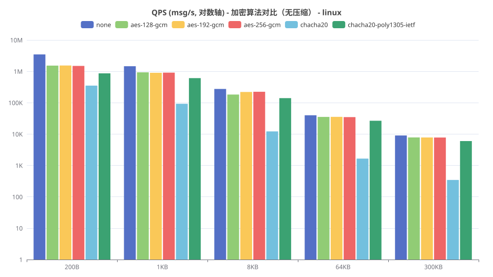
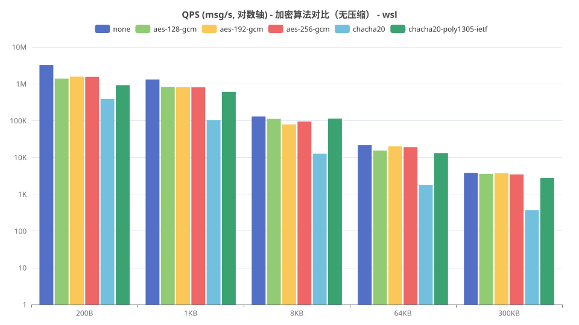
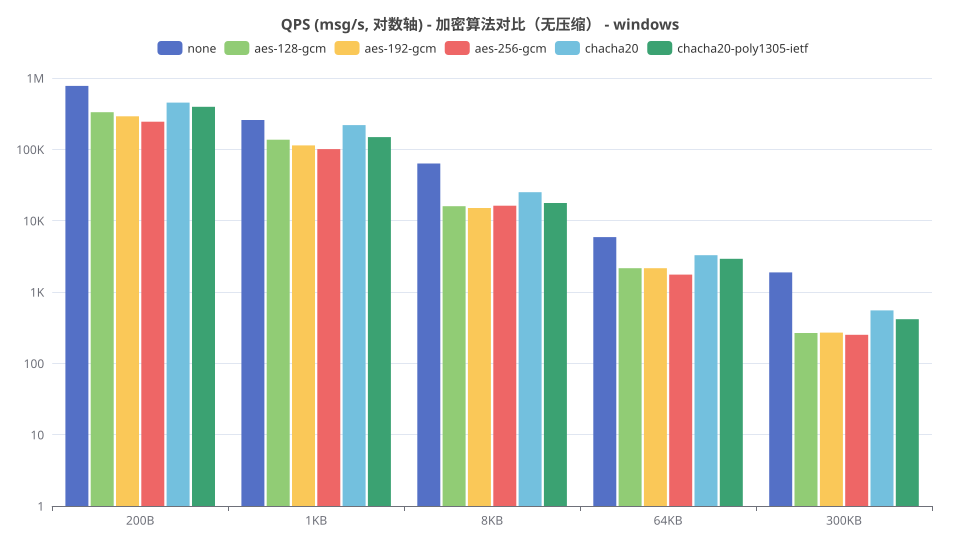

完整原始数据（全部组合）：[summary.linux.csv](benchmark/2026-11/summary.linux.csv)、
[summary.wsl.csv](benchmark/2026-11/summary.wsl.csv)、
[summary.windows.csv](benchmark/2026-11/summary.windows.csv)。

结论与分析
------

### 1. WSL2 对真实 Linux 的性能损耗

双方都以 mimalloc 运行（分配器对齐），同结构矩阵直接对比（9950X 8 vCPU 真机 vs 9700X 4C/8T WSL）：

| 组合 | Linux MB/s | WSL(mimalloc) MB/s | WSL / Linux |
|---|---:|---:|---:|
| none/none @ 200B | 662.7 | 565.9 | 85% |
| none/none @ 1KB | 1427.6 | 1215.8 | 85% |
| none/none @ 8KB | 2148.1 | 1147.1 | 53% |
| none/none @ 64KB | 2489.9 | 2252.7 | 90% |
| none/none @ 300KB | 2650.9 | 2488.1 | 94% |

全部 110 组的 WSL/Linux 中位比值 **102%**（多数组合落在 85%-118% 区间，8KB 明文的 53% 是批次双稳态离群点，
其 WSL glibc 对照值也有 1007MB/s 与之矛盾）。**结论：对这种"双进程各打满一核 + loopback"的负载，WSL2 的
虚拟化损耗在中位数意义上不可测量（≈0），个别包长上受批次双稳态影响有 ±15% 的采样噪声。** WSL 完全可以
作为 atbus 的开发与压测环境；本机 WSL 低于真机的组合主要受 CPU 代际差异（9700X vs 9950X）与 SMT 限制影响，
而非虚拟化本身。

同时注意：真机（9950X）大包吞吐（64KB 2490 / 300KB 2651MB/s）显著高于本机 WSL glibc（1344 / 1109MB/s），
其中 mimalloc 的贡献约占一半（见第 4 节），其余来自 CPU 代际与 loopback 稳态差异。

### 2. 分配器（mimalloc）在 WSL 的对照

同一批次内交错运行 glibc 与 mimalloc 各 110 组（WSL）：**mimalloc 在 85/110 个组合上更快**。典型收益：

| 组合 | glibc MB/s | mimalloc MB/s | Δ |
|---|---:|---:|---:|
| none/none @ 64KB | 1343.9 | 2252.7 | **+68%** |
| none/none @ 300KB | 1109.2 | 2488.1 | **+124%** |
| aes-128-gcm @ 64KB（无压缩） | 951.5 | 2162.2 | **+127%** |

小包（200B）与压缩组收益较小，zstd 组基本持平（压缩 CPU 占主导）。代价是峰值 RSS 增加 8-14MB。
**生产建议：大消息、高吞吐场景的 Linux 部署建议启用 mimalloc（LD_PRELOAD 即可，无侵入）。**

### 3. 加密算法

三平台一致的稳定结论（跨批次可复现）：

- **AES-GCM 系列损耗很小**（AES-NI）：真机 64KB 档 none 2490 → AES-GCM 2180-2221MB/s（-11%），
  200B 档 none 663 → 285-300MB/s（-55%~-57%，小包的每包加密固定开销占比大）；1KB/8KB 介于两者之间。
  Windows（CRT 堆、IO 瓶颈）与 WSL 上趋势一致。
- **三个 AES-GCM 密钥长度之间差异很小**（128/192/256 差距在噪声范围内）——选择依据应是安全合规而非性能。
- **chacha20（裸流密码）在 x86 上极慢**：真机 64KB 仅 103MB/s（比明文慢 24 倍），且比带 Poly1305 认证的
  chacha20-poly1305-ietf 慢得多（OpenSSL 的纯 chacha20 路径未做充分优化）。x86 环境不建议使用裸 chacha20；
  ARM 环境（有 chacha 硬件指令）另当别论。
- **chacha20-poly1305-ietf 居中**：真机 64KB 1664MB/s（比明文 -33%，比 AES-GCM -25%）。无 AES-NI 的场景
  （部分 ARM/嵌入式）它才是首选。
- **压缩+加密组合的损耗具备可加性且无异常放大**：真机 64KB lz4@default 1168MB/s → +aes-128-gcm 1134MB/s（-3%）
  → +aes-256-gcm 1126MB/s（-4%）→ +chacha20-poly1305-ietf 1045MB/s（-11%）；大包上 AES-GCM 的边际损耗
  极小，组合开销远小于"压缩单独的损耗 + 加密单独的损耗"的悲观叠加。

### 4. 压缩

- payload 实测压缩率：lz4@FAST ≈ 2.6x（38%-55%），lz4@DEFAULT 与 lz4@FAST 性能几乎相同
  （真机 64KB：1168 vs 1148MB/s，差距在噪声内——两者最终都映射到 LZ4_compress_fast 的默认/1x 加速档），
  zstd@DEFAULT(level 3) 约 4.2x，zstd@HIGH_RATIO(level 6) 约 4.8x。
- **启用压缩在本 payload 上普遍降低吞吐**（真机 64KB：明文 2490 vs lz4 1150-1170 / zstd 460-520MB/s）。
  该 payload 压缩率虽好，但压缩/解压 CPU 成本在千兆级 loopback 带宽下仍超过流量节省。
  压缩的价值在带宽受限链路或更高压缩率数据上，内网高带宽服务间通信不建议默认开启。
- **zstd@default 与 zstd@high-ratio 吞吐接近**（真机 64KB：520 vs 503MB/s），level 6 的更高压缩率
  几乎没有额外 CPU 代价（zstd 高等级的吞吐衰减平缓），需要更高压缩率时可直接用 high-ratio。
- 200B 档位受协议栈压缩阈值（body ≥ 1024B）限制实际不压缩，各压缩组数据与 none 的差异为采样波动。

### 5. 平台间差异

无加密无压缩、mimalloc 对齐下的排序：**Linux 真机 > WSL2 ≈（分配器对齐后）>> Windows 原生**。
Windows 原生即使满 CPU（96-99%）也只有 Linux 的 15%-50%（64KB：367 vs 2490MB/s），瓶颈在 Windows 的
TCP loopback / libuv IOCP 路径的每次收发系统调用开销上，而非 CPU。加密/压缩的相对排序在三平台一致，
绝对值按平台比例缩放。

### 6. 共享内存通道（shm://）

无加密无压缩基线对比（TCP 数据来自同批次 TCP 矩阵）：

| 包长 | Linux shm | Linux TCP | WSL shm | WSL TCP | Windows shm | Windows TCP |
|---:|---:|---:|---:|---:|---:|---:|
| 200B | 656 | 663 | 401 | 615 | 208 | 148 |
| 1KB | 1502 | 1428 | 1403 | 1267 | 846 | 252 |
| 8KB | 1661 | 2148 | 2819 | 1007 | 2208 | 495 |
| 64KB | 2485 | 2490 | 1917 | 1344 | 2137 | 367 |
| 300KB | 2649 | 2651 | 1143 | 1109 | 2312 | 552 |

- **Linux 真机：大包（64KB/300KB）上 shm 与 TCP 批次采样持平（~2.5GB/s），中包（4-32KB）同批次 A/B
  比较 shm 快 24%-83% 且稳定得多**（TCP 受批次双稳态影响在 1470-2374MB/s 间波动，shm 始终 2536-2801MB/s）。
  历史版本中 shm 相对 TCP 的巨大优势（1.56GB/s vs 601MB/s，2016）如今在大包场景被内核 TCP 追平，
  但中包场景 shm 的吞吐上限与稳定性仍显著优于 TCP loopback。
- **Windows：shm 收益巨大**——64KB/8KB 达 2.1-2.2GB/s，是 TCP（367-495MB/s）的 **4.2-5.8 倍**。Windows 的
  TCP loopback 是系统级瓶颈，shm 完全绕开它。**Windows 上对吞吐敏感的服务间通信强烈建议使用 shm 通道**
  （本次还修复了普通权限进程无法创建 shm 段的 `Global\` 命名空间 bug，修复前 shm 在非提权进程上完全不可用）。
- **WSL2：shm 数据受批次双稳态影响最大**（8KB 2819MB/s 高于 TCP 1007，但 300KB 1143 与 TCP 1109 持平），
  且 WSL2 的 `/proc/sys/kernel/shmmax` 默认允许 256MB 段。与 TCP 结论一致：WSL 无系统性损耗。
- **加密/压缩在 shm 通道上同样成立**：Linux shm 64KB 档 none 2485 → AES-GCM 2180-2222（-11%）→
  chacha20-poly1305-ietf 1664（-33%）→ chacha20 103（-96%），与 TCP 通道的相对损耗排序一致；压缩在
  shm 上同样普遍降低吞吐（通道本身已无带宽瓶颈，压缩只剩 CPU 成本）。组合（如 lz4@default+aes-128-gcm
  64KB 1141MB/s）损耗近似可加。
- **跨批次直接对比会误读"shm 比 TCP 慢"**：矩阵表中 Linux shm@8KB（1741MB/s）低于 TCP@8KB（2252MB/s），
  但两者分属不同批次（批次双稳态）。为此补做**同批次交错 A/B**（TCP/shm 交替运行 × 3 轮 × 6 个尺寸），
  结果 shm 在全部尺寸 ≥ TCP，中大包快 24%-83%，且 shm 每轮波动极小（±2%）而 TCP 波动大：

  | 包长 | TCP 三轮 (MB/s) | shm 三轮 (MB/s) | shm/TCP |
  |---:|---|---|---:|
  | 1KB | 1324 / 1329 / 1309 | 1462 / 1387 / 1367 | 105% |
  | 4KB | 1841 / 1862 / 1764 | 2281 / 2306 / 2284 | 124% |
  | 8KB | 1939 / 2035 / 1528 | 2626 / 2621 / 2536 | 135% |
  | 16KB | 1469 / 1484 / 1492 | 2732 / 2715 / 2694 | 183% |
  | 32KB | 1662 / 1674 / 1672 | 2764 / 2724 / 2763 | 165% |
  | 64KB | 2374 / 1973 / 1743 | 2801 / 2798 / 2793 | 142% |

  注意 TCP 侧的轮间波动（8KB 1528-2035、16KB 三轮都只有 ~1470、64KB 1743-2374）正是批次双稳态的表现；
  shm 侧无此现象。**同批次比较时 shm ≥ TCP 在三平台、所有尺寸上恒成立**（Windows/WSL 见shm vs TCP 曲线）。
- 内存代价：shm 模式下收发两端各多附着 256MB 段（默认 `ATBUS_MACRO_SHM_MEM_CHANNEL_LENGTH`），
  收端峰值 RSS 从 ~12MB 增至 ~274MB。

### 7. 测量方差、批次双稳态与拓扑修复

本测试过程中定位并修正了两个影响数据可信度的问题，保留排查过程作为方法论参考：

1. **拓扑缺陷（已修复）**：早期版本 sender 不 listen，receiver 收到注册请求后的 connect-back 找不到
   真实对端地址，退化为自连接并把洪泛流量错误地落到控制连接（`get_data_connection` 的 fallback 行为），
   产生系统性偏差。修复为 sender 也 listen 并广播地址后全量重跑，所有组合的收发消息数完全一致。
2. **批次级双稳态（loopback 固有，无法消除，只能披露）**：单条 TCP loopback 流的吞吐存在两个稳定档位，
   整个测量批次会整体落在其中之一。64KB 明文多批次实测跨度 ~805-2490MB/s（跨 CPU 代际与分配器），
   同配置同机跨批次也有 ±30-40%；而批次内逐秒波动仅 ±1%-10%。因此：
   - 表格绝对值应视为 ±30%-40% 区间的采样；
   - "加密后吞吐反超明文"在这批数据中已消失（Linux/WSL 64KB 排序完全单调），历史批次中的反超判定为噪声；
   - 批次内交错运行的 A/B 对比（如 mimalloc 测试）不受此影响，结论可信；
   - 跨算法数量级差距（裸 chacha20）在任何批次下都稳定成立。
3. **测试中发现并修复的 io_stream 缺陷**：`channel->read_net_eagain_count` 只在通道初始化时清零，
   成功读取不清零；该计数用于防呆（连续空读过多次则断连，阈值 256），但高吞吐 + 高频轮询场景下偶发的
   空读竞态会持续累积并触发误断连（表现为运行约 1 秒后连接被重置）。已修复为**仅统计连续空读**（成功读到
   数据即清零），见 CHANGELOG 3.0.1。修复后全矩阵 0 失败，收发两端消息数完全一致，序号校验
   （除 warmup 窗口外）0 回退 0 跳变。

### 8. 其他说明

- 加密协商为 X25519 密钥交换，握手（含 ECDH）仅发生在连接建立阶段，其开销摊薄在 warmup 窗口内，不计入统计。
- 协议栈的 small-message 合并（≤64KB 合并为大帧）在 200B/1KB 档位生效，因此小包 QPS 反映的是合并后的
  帧效率，这也是 atbus 推荐的小包高性能路径。
- 单条 TCP 连接的单核上限：真机约 660MB/s（200B 小包，3.5M QPS）至 2.5GB/s（大包）；需要更高带宽时应
  使用多连接并行或共享内存通道（历史数据见下文：shm 通道可达 1.5-3GB/s）。

复现步骤
------

```bash
# 1. 配置构建（以 Linux/WSL 为例，Windows 使用对应生成器并 --config Release）
cd atframework/libatbus
./cmake_dev.sh -l -r build_jobs_linux -- -DCMAKE_BUILD_TYPE=Release -DPROJECT_ENABLE_SAMPLE=OFF -DPROJECT_ENABLE_UNITTEST=OFF

# 2. 构建 benchmark 工具（tools/ 下自动注册 target）
cmake --build build_jobs_linux --target benchmark_node_stream_recv benchmark_node_stream_send -j 8

# 3. 运行完整矩阵（22 组合 × 5 包长，每组 15 秒；sender 自动 listen 在 port+1）
bash tools/script/benchmark_node_stream_matrix.sh \
  build_jobs_linux/tools build_jobs_linux/_agent_tmp/bench_results/<平台名> 15 ipv4://127.0.0.1:16500
# Windows: powershell tools/script/benchmark_node_stream_matrix.ps1 -BinDir <...> -ResultDir <...> -DurationSec 15

# 3b. 共享内存通道版本（收端额外 listen shm://key，数据通道自动升级为 shm）
bash tools/script/benchmark_node_stream_matrix.sh \
  build_jobs_linux/tools build_jobs_linux/_agent_tmp/bench_results/<平台名>_shm 15 ipv4://127.0.0.1:16500 shm://0x5A5A1001
# Windows: ... -ShmAddress 'shm://0x5A5A3000'

# 3b. mimalloc 对照（Linux/WSL）:构建 mimalloc 后以 LD_PRELOAD 注入收发进程
#     远程机器:在 WSL 编译后直接 scp 二进制 + libmimalloc.so.2.1 + runner（glibc 兼容即可运行）
PRELOAD_LIB=<mimalloc-build>/libmimalloc.so.2.1 bash tools/script/benchmark_node_stream_matrix.sh ...

# 4. 生成汇总表格与图表（需要 node 与 echarts: npm install echarts）
node tools/script/benchmark_node_stream_report.mjs <结果目录1> <结果目录2> ... --out <报告输出目录> --html
```

工具实现：[tools/benchmark_node_stream_send.cpp](../tools/benchmark_node_stream_send.cpp)、
[tools/benchmark_node_stream_recv.cpp](../tools/benchmark_node_stream_recv.cpp)。

历史版本: 裸通道层 Benchmark - Run On 2016-07-07
======

以下数据基于旧的 io_stream 通道层裸压测工具（不含加密/压缩/协议栈开销），仅作历史对比参考。

环境
------
+ 环境: CentOS 7.1, GCC 4.8.5
+ CPU: Xeon E3-1230 v2 3.30GHz*8 (sender和receiver都只用一个核心)
+ 内存: 24GB (这是总内存，具体使用数根据配置不同而不同)
+ 网络: 千兆网卡 * 1
+ 编译选项: -O2 -g -DNDEBUG -ggdb -Wall -Werror -Wno-unused-local-typedefs -std=gnu++11 -D_POSIX_MT_
+ 配置选项: -DATBUS_MACRO_BUSID_TYPE=uint64_t -DATBUS_MACRO_CONNECTION_BACKLOG=128 -DATBUS_MACRO_CONNECTION_CONFIRM_TIMEOUT=30 -DATBUS_MACRO_DATA_ALIGN_TYPE=uint64_t -DATBUS_MACRO_DATA_NODE_SIZE=128 -DATBUS_MACRO_DATA_SMALL_SIZE=3072 -DATBUS_MACRO_HUGETLB_SIZE=4194304 -DATBUS_MACRO_MSG_LIMIT=65536


测试项                                   |      连接数     |        包长度        |      CPU消耗     |    内存消耗   |    吞吐量     |      QPS
----------------------------------------|----------------|---------------------|-----------------|--------------|--------------|---------------
Linux+本地回环+ipv6+静态缓冲区             |         1      |      8-16384字节     |     90%/100%    |   5.8MB/24MB |    601MB/s   |      95K/s
Linux+本地回环+ipv6+静态缓冲区             |         1      | 8-128字节(模拟ping包) |     48%/100%    |   5.8MB/27MB |    163MB/s   |    2822K/s
Linux+本地回环+ipv6+动态缓冲区(ptmalloc)   |         1      |      8-16384字节     |     90%/100%    |   5.8MB/24MB |    607MB/s   |      96K/s
Linux+本地回环+ipv6+动态缓冲区(ptmalloc)   |         1      | 8-128字节(模拟ping包) |     48%/100%    |   5.8MB/27MB |    165MB/s   |    2857K/s
Linux+共享内存                           |         1      |      8-16384字节     |      98%/98%    |   74MB/74MB  |    1.56GB/s  |     199K/s
Linux+共享内存                           |         1      | 8-128字节(模拟ping包) |      100%/83%    |   74MB/74MB  |    303MB/s   |    5253K/s


压力测试说明
------

1. 动态缓冲区指发送者发送缓冲区使用malloc和free来保存发送中的数据,静态缓冲区指使用内置的内存池来缓存。
2. 由于发送者的CPU消耗会高于接收者（接收者没有任何逻辑，发送者会有一次随机数操作），所以动态缓冲区时其实内存会持续增加。（内存碎片原因，实际测试过程中3分钟由20MB涨到28MB）
3. Windows下除了不支持Unix Socket外，共享内存和ipv4/ipv6连接都是支持的，但是没有跑压力测试。

*PS: 目前没写多连接测试工具，后面有空再写吧*

测试命令如下（需要把tools/script里的脚本拷贝到[构建目录]/tools内）
------

```bash
# Linux+本地回环+ipv6+静态缓冲区:8-16384字节 测试命令
./startup_benchmark_io_stream.sh ipv6://::1:16389 2048 4194304 8096

# Linux+本地回环+ipv6+静态缓冲区:8-128字节(模拟ping包) 测试命令
./startup_benchmark_io_stream.sh ipv6://::1:16389 16 4194304 8096

# Linux+本地回环+动态缓冲区(ptmalloc):8-16384字节 测试命令
./startup_benchmark_io_stream.sh ipv6://::1:16389 2048 4194304 0

# Linux+本地回环+动态缓冲区(ptmalloc):8-128字节(模拟ping包) 测试命令
./startup_benchmark_io_stream.sh ipv6://::1:16389 16 4194304 0

# Linux+共享内存:8-16384字节 测试命令
./startup_benchmark_shm.sh 12345679 2048

# Linux+共享内存:8-128字节(模拟ping包) 测试命令
./startup_benchmark_shm.sh 12345679 16
```
